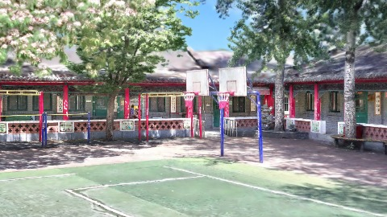
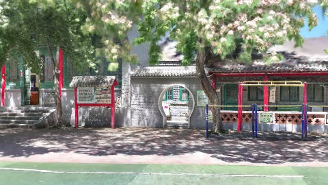
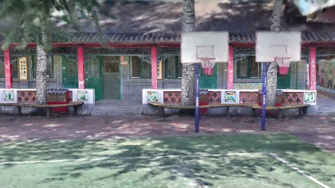
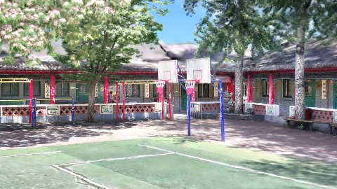
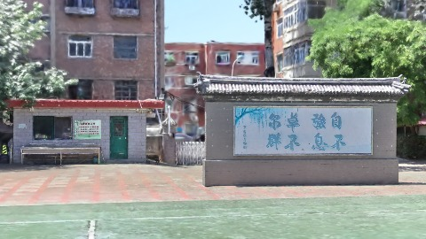
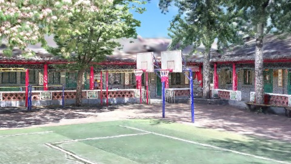
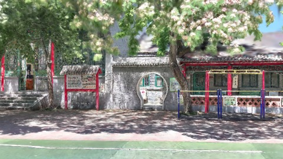
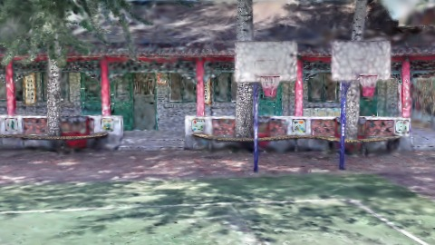
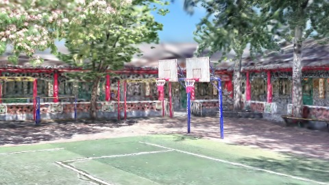
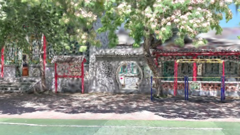

# Scene Profile Benchmark — 2026-08-07

## 本轮维度: profile

Suite: `public/benchmark-suites/scene-chengjian-v7-budget6-rs-sweep.json`

Renderer: `webgpu`

## 运行条件

- Cold start: yes
- Browser session: fresh-chromium-per-case
- Chromium HTTP cache: disabled-cdp-clearBrowserCache-zero-disk-cache
- Cold start (default): fresh Chromium per case, HTTP cache disabled
- OS 页缓存 / GPU 编译缓存：脚本不控制，跨次运行可能仍有差异

| label | presetId | budget | lodMode | lodRuntime | firstFrameMs | jsHeap@1st | vram@1st | jsHeapPeak | vramPeak | fpsP50 | fpsP95 | gsplatsAvgM |
|-------|----------|--------|---------|------------|--------------|------------|----------|------------|----------|--------|--------|-------------|
| chengjian-v7-b6-rs1 | undefined | 6 | - | refinement | 22084.60000014305 | 171 | 272 | 385 | 429 | 97.0 | 120.0 | 4.01 |
| chengjian-v7-b6-rs2 | undefined | 6 | - | refinement | 29580.89999985695 | 212 | 311 | 386 | 424 | 106.0 | 120.0 | 3.26 |
| chengjian-v7-b6-rs4 | undefined | 6 | - | refinement | 25960.5 | 159 | 279 | 318 | 375 | 120.0 | 120.0 | 1.86 |
| chengjian-v7-b6-rs8 | undefined | 6 | - | refinement | 14999.5 | 126 | 250 | 245 | 324 | 120.0 | 120.0 | 0.84 |

## 交互巡检（糊→清晰）

### chengjian-v7-b6-rs1

播放段 FPS: P50=97.0, P95=120.0, min=66.0, 总播放=2853ms

| waypoint | animTimeSec | moveMs | pendingPeak | blurToClearMs | fpsP50(refine) | fpsP95(refine) | fpsMin | gsplatsAtClearM | jsHeap@clear | vram@clear | jsHeapPeak | vramPeak | timeout |
|----------|-------------|--------|-------------|---------------|----------------|----------------|--------|-----------------|--------------|------------|------------|----------|---------|
| kf-0 | 0.00 | 0 | 0 | 0 | 120.0 | 120.0 | 120.0 | 2.83 | 172 | 272 | 172 | 272 | N |
| kf-1 | 1.00 | 958 | 27 | 12197 | 111.0 | 120.0 | 97.0 | 3.47 | 244 | 333 | 252 | 333 | N |
| kf-2 | 2.00 | 946 | 35 | 17801 | 78.0 | 105.0 | 65.0 | 5.06 | 346 | 413 | 360 | 414 | N |
| kf-3 | 3.00 | 949 | 30 | 12200 | 120.0 | 120.0 | 72.0 | 4.70 | 379 | 427 | 385 | 429 | N |

变清晰截图（480×270 JPEG）：

**kf-0**

**kf-1**

**kf-2**

**kf-3**

### chengjian-v7-b6-rs2

播放段 FPS: P50=106.0, P95=120.0, min=77.0, 总播放=2861ms

| waypoint | animTimeSec | moveMs | pendingPeak | blurToClearMs | fpsP50(refine) | fpsP95(refine) | fpsMin | gsplatsAtClearM | jsHeap@clear | vram@clear | jsHeapPeak | vramPeak | timeout |
|----------|-------------|--------|-------------|---------------|----------------|----------------|--------|-----------------|--------------|------------|------------|----------|---------|
| kf-0 | 0.00 | 0 | 0 | 0 | 119.0 | 120.0 | 119.0 | 2.44 | 214 | 311 | 222 | 311 | N |
| kf-1 | 1.00 | 950 | 21 | 10401 | 118.0 | 120.0 | 106.0 | 2.99 | 271 | 349 | 279 | 349 | N |
| kf-2 | 2.00 | 953 | 36 | 18202 | 94.0 | 120.0 | 77.0 | 4.24 | 361 | 423 | 367 | 424 | N |
| kf-3 | 3.00 | 958 | 28 | 12201 | 120.0 | 120.0 | 78.0 | 3.40 | 340 | 417 | 386 | 422 | N |

变清晰截图（480×270 JPEG）：

**kf-0**

**kf-1**

**kf-2**

**kf-3**

### chengjian-v7-b6-rs4

播放段 FPS: P50=120.0, P95=120.0, min=119.0, 总播放=2841ms

| waypoint | animTimeSec | moveMs | pendingPeak | blurToClearMs | fpsP50(refine) | fpsP95(refine) | fpsMin | gsplatsAtClearM | jsHeap@clear | vram@clear | jsHeapPeak | vramPeak | timeout |
|----------|-------------|--------|-------------|---------------|----------------|----------------|--------|-----------------|--------------|------------|------------|----------|---------|
| kf-0 | 0.00 | 0 | 0 | 0 | 120.0 | 120.0 | 120.0 | 1.30 | 158 | 279 | 177 | 279 | N |
| kf-1 | 1.00 | 950 | 17 | 9001 | 120.0 | 120.0 | 119.0 | 1.81 | 213 | 318 | 231 | 318 | N |
| kf-2 | 2.00 | 946 | 29 | 12800 | 120.0 | 120.0 | 119.0 | 2.42 | 300 | 370 | 305 | 370 | N |
| kf-3 | 3.00 | 945 | 24 | 9400 | 120.0 | 120.0 | 119.0 | 1.93 | 288 | 375 | 318 | 375 | N |

变清晰截图（480×270 JPEG）：

**kf-0**

**kf-1**

**kf-2**

**kf-3**

### chengjian-v7-b6-rs8

播放段 FPS: P50=120.0, P95=120.0, min=119.0, 总播放=2851ms

| waypoint | animTimeSec | moveMs | pendingPeak | blurToClearMs | fpsP50(refine) | fpsP95(refine) | fpsMin | gsplatsAtClearM | jsHeap@clear | vram@clear | jsHeapPeak | vramPeak | timeout |
|----------|-------------|--------|-------------|---------------|----------------|----------------|--------|-----------------|--------------|------------|------------|----------|---------|
| kf-0 | 0.00 | 0 | 0 | 0 | 120.0 | 120.0 | 119.0 | 0.58 | 129 | 252 | 143 | 252 | N |
| kf-1 | 1.00 | 958 | 19 | 9400 | 120.0 | 120.0 | 119.0 | 0.87 | 190 | 289 | 201 | 291 | N |
| kf-2 | 2.00 | 946 | 10 | 4600 | 120.0 | 120.0 | 119.0 | 1.02 | 219 | 306 | 222 | 306 | N |
| kf-3 | 3.00 | 947 | 14 | 5601 | 120.0 | 120.0 | 110.0 | 0.86 | 231 | 324 | 245 | 324 | N |

变清晰截图（480×270 JPEG）：

**kf-0**

**kf-1**

**kf-2**

**kf-3**

## 优化前 vs 优化后

### default（基线 `chengjian-v7-b6-rs1`）

| case | lodMode | lodRuntime | firstFrameMs | kf-1 blur | kf-2 blur | blur P90 | vramPeak | poolEvictions |
|------|---------|------------|--------------|-----------|-----------|----------|----------|---------------|
| chengjian-v7-b6-rs1 | - | refinement | 22085 (—) | 12197 (—) | 17801 | 17801 | 429 | - |
| chengjian-v7-b6-rs2 | - | refinement | 29581 (33.9%) | 10401 (-14.7%) | 18202 | 18202 | 424 | - |
| chengjian-v7-b6-rs4 | - | refinement | 25961 (17.6%) | 9001 (-26.2%) | 12800 | 12800 | 375 | - |
| chengjian-v7-b6-rs8 | - | refinement | 15000 (-32.1%) | 9400 (-22.9%) | 4600 | 9400 | 324 | - |

## 结论

- 见上方对比表；`bottleneckHint` 见 `results.json`（scheduler / asset-http / mixed）