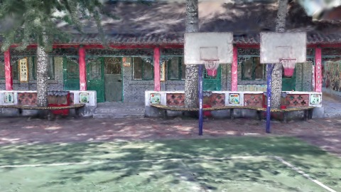
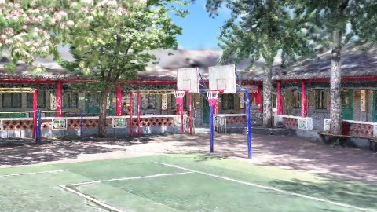
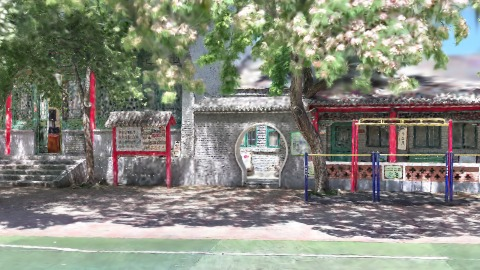
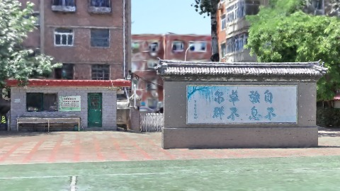
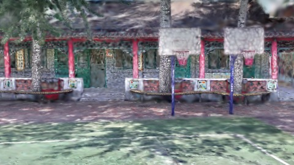
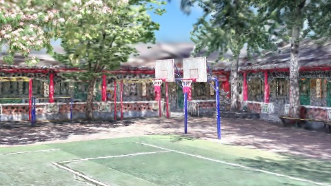
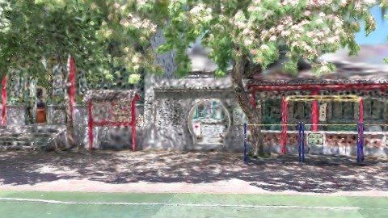
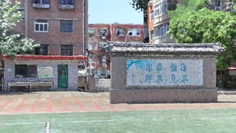

# Scene Profile Benchmark — 2026-08-07

## 本轮维度: profile

Suite: `public/benchmark-suites/scene-chengjian-v7-renderscale-4-8.json`

Renderer: `webgpu`

## 运行条件

- Cold start: yes
- Browser session: fresh-chromium-per-case
- Chromium HTTP cache: disabled-cdp-clearBrowserCache-zero-disk-cache
- Cold start (default): fresh Chromium per case, HTTP cache disabled
- OS 页缓存 / GPU 编译缓存：脚本不控制，跨次运行可能仍有差异

| label | presetId | budget | lodMode | lodRuntime | firstFrameMs | jsHeap@1st | vram@1st | jsHeapPeak | vramPeak | fpsP50 | fpsP95 | gsplatsAvgM |
|-------|----------|--------|---------|------------|--------------|------------|----------|------------|----------|--------|--------|-------------|
| chengjian-v7-rs4 | undefined | 4 | - | refinement | 21327.099999904633 | 177 | 227 | 313 | 318 | 120.0 | 120.0 | 1.65 |
| chengjian-v7-rs8 | undefined | 4 | - | refinement | 17504.5 | 147 | 213 | 242 | 269 | 120.0 | 120.0 | 0.80 |

## 交互巡检（糊→清晰）

### chengjian-v7-rs4

播放段 FPS: P50=120.0, P95=120.0, min=119.0, 总播放=2861ms

| waypoint | animTimeSec | moveMs | pendingPeak | blurToClearMs | fpsP50(refine) | fpsP95(refine) | fpsMin | gsplatsAtClearM | jsHeap@clear | vram@clear | jsHeapPeak | vramPeak | timeout |
|----------|-------------|--------|-------------|---------------|----------------|----------------|--------|-----------------|--------------|------------|------------|----------|---------|
| kf-0 | 0.00 | 0 | 0 | 0 | 120.0 | 120.0 | 120.0 | 1.13 | 186 | 227 | 187 | 227 | N |
| kf-1 | 1.00 | 950 | 11 | 9400 | 120.0 | 120.0 | 119.0 | 1.63 | 222 | 262 | 234 | 262 | N |
| kf-2 | 2.00 | 954 | 26 | 10400 | 120.0 | 120.0 | 119.0 | 2.12 | 275 | 309 | 294 | 309 | N |
| kf-3 | 3.00 | 957 | 20 | 7001 | 120.0 | 120.0 | 119.0 | 1.71 | 289 | 318 | 313 | 318 | N |

变清晰截图（480×270 JPEG）：

**kf-0**

**kf-1**

**kf-2**

**kf-3**

### chengjian-v7-rs8

播放段 FPS: P50=120.0, P95=120.0, min=119.0, 总播放=2842ms

| waypoint | animTimeSec | moveMs | pendingPeak | blurToClearMs | fpsP50(refine) | fpsP95(refine) | fpsMin | gsplatsAtClearM | jsHeap@clear | vram@clear | jsHeapPeak | vramPeak | timeout |
|----------|-------------|--------|-------------|---------------|----------------|----------------|--------|-----------------|--------------|------------|------------|----------|---------|
| kf-0 | 0.00 | 0 | 0 | 0 | 120.0 | 120.0 | 120.0 | 0.62 | 160 | 213 | 169 | 213 | N |
| kf-1 | 1.00 | 949 | 13 | 5400 | 119.0 | 120.0 | 119.0 | 0.79 | 176 | 231 | 190 | 231 | N |
| kf-2 | 2.00 | 947 | 9 | 5201 | 120.0 | 120.0 | 120.0 | 0.97 | 210 | 252 | 220 | 252 | N |
| kf-3 | 3.00 | 946 | 8 | 5600 | 120.0 | 120.0 | 119.0 | 0.82 | 220 | 269 | 242 | 269 | N |

变清晰截图（480×270 JPEG）：

**kf-0**

**kf-1**

**kf-2**

**kf-3**

## 优化前 vs 优化后

### default（基线 `chengjian-v7-rs4`）

| case | lodMode | lodRuntime | firstFrameMs | kf-1 blur | kf-2 blur | blur P90 | vramPeak | poolEvictions |
|------|---------|------------|--------------|-----------|-----------|----------|----------|---------------|
| chengjian-v7-rs4 | - | refinement | 21327 (—) | 9400 (—) | 10400 | 10400 | 318 | - |
| chengjian-v7-rs8 | - | refinement | 17505 (-17.9%) | 5400 (-42.6%) | 5201 | 5600 | 269 | - |

## 结论

- 见上方对比表；`bottleneckHint` 见 `results.json`（scheduler / asset-http / mixed）