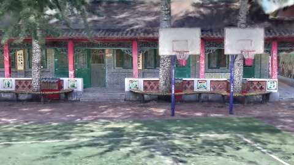
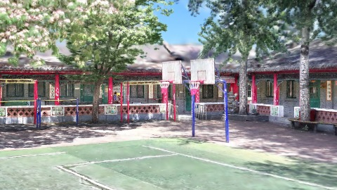
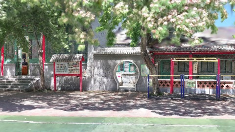
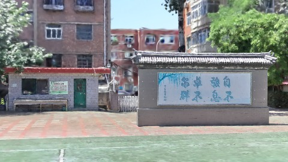
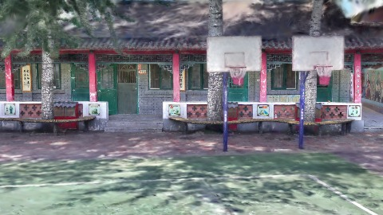
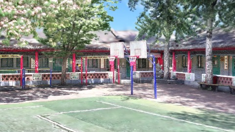
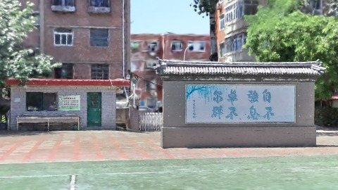

# Scene Profile Benchmark — 2026-08-07

## 本轮维度: profile

Suite: `public/benchmark-suites/scene-chengjian-v7-selectmode-ab.json`

Renderer: `webgpu`

## 运行条件

- Cold start: yes
- Browser session: fresh-chromium-per-case
- Chromium HTTP cache: disabled-cdp-clearBrowserCache-zero-disk-cache
- Cold start (default): fresh Chromium per case, HTTP cache disabled
- OS 页缓存 / GPU 编译缓存：脚本不控制，跨次运行可能仍有差异

| label | presetId | budget | lodMode | lodRuntime | firstFrameMs | jsHeap@1st | vram@1st | jsHeapPeak | vramPeak | fpsP50 | fpsP95 | gsplatsAvgM |
|-------|----------|--------|---------|------------|--------------|------------|----------|------------|----------|--------|--------|-------------|
| chengjian-v7-renderScale-rs1 | undefined | 4 | - | refinement | 34325 | 187 | 241 | 335 | 339 | 120.0 | 120.0 | 3.02 |
| chengjian-v7-distance | undefined | 4 | - | refinement | 26692 | 202 | 243 | 333 | 330 | 120.0 | 120.0 | 3.12 |

## 交互巡检（糊→清晰）

### chengjian-v7-renderScale-rs1

播放段 FPS: P50=120.0, P95=120.0, min=99.0, 总播放=2858ms

| waypoint | animTimeSec | moveMs | pendingPeak | blurToClearMs | fpsP50(refine) | fpsP95(refine) | fpsMin | gsplatsAtClearM | jsHeap@clear | vram@clear | jsHeapPeak | vramPeak | timeout |
|----------|-------------|--------|-------------|---------------|----------------|----------------|--------|-----------------|--------------|------------|------------|----------|---------|
| kf-0 | 0.00 | 0 | 0 | 0 | 119.0 | 119.0 | 119.0 | 2.27 | 188 | 239 | 206 | 241 | N |
| kf-1 | 1.00 | 958 | 9 | 8000 | 120.0 | 120.0 | 119.0 | 2.74 | 222 | 263 | 230 | 263 | N |
| kf-2 | 2.00 | 947 | 30 | 15800 | 120.0 | 120.0 | 101.0 | 3.62 | 303 | 329 | 316 | 329 | N |
| kf-3 | 3.00 | 953 | 21 | 9401 | 120.0 | 120.0 | 99.0 | 3.47 | 320 | 339 | 335 | 339 | N |

变清晰截图（480×270 JPEG）：

**kf-0**

**kf-1**

**kf-2**

**kf-3**

### chengjian-v7-distance

播放段 FPS: P50=120.0, P95=120.0, min=97.0, 总播放=2851ms

| waypoint | animTimeSec | moveMs | pendingPeak | blurToClearMs | fpsP50(refine) | fpsP95(refine) | fpsMin | gsplatsAtClearM | jsHeap@clear | vram@clear | jsHeapPeak | vramPeak | timeout |
|----------|-------------|--------|-------------|---------------|----------------|----------------|--------|-----------------|--------------|------------|------------|----------|---------|
| kf-0 | 0.00 | 0 | 0 | 0 | 119.0 | 120.0 | 119.0 | 2.40 | 217 | 238 | 217 | 245 | N |
| kf-1 | 1.00 | 950 | 11 | 8200 | 120.0 | 120.0 | 119.0 | 2.87 | 223 | 262 | 237 | 262 | N |
| kf-2 | 2.00 | 948 | 29 | 16001 | 110.0 | 120.0 | 94.0 | 3.62 | 295 | 327 | 322 | 328 | N |
| kf-3 | 3.00 | 954 | 21 | 8201 | 119.0 | 120.0 | 98.0 | 3.59 | 302 | 323 | 333 | 327 | N |

变清晰截图（480×270 JPEG）：

**kf-0**

**kf-1**

**kf-2**

**kf-3**

## 优化前 vs 优化后

### default（基线 `chengjian-v7-renderScale-rs1`）

| case | lodMode | lodRuntime | firstFrameMs | kf-1 blur | kf-2 blur | blur P90 | vramPeak | poolEvictions |
|------|---------|------------|--------------|-----------|-----------|----------|----------|---------------|
| chengjian-v7-renderScale-rs1 | - | refinement | 34325 (—) | 8000 (—) | 15800 | 15800 | 339 | - |
| chengjian-v7-distance | - | refinement | 26692 (-22.2%) | 8200 (2.5%) | 16001 | 16001 | 330 | - |

## 结论

- 见上方对比表；`bottleneckHint` 见 `results.json`（scheduler / asset-http / mixed）