# Scene Profile Benchmark — 2026-08-10

## 本轮维度: profile

Suite: `public/benchmark-suites/scene-chengjian-v7-budget6-rs-sweep.json`

Renderer: `webgpu`

## 运行条件

- Cold start: yes
- Browser session: fresh-chromium-per-case
- Chromium HTTP cache: disabled-cdp-clearBrowserCache-zero-disk-cache
- Cold start (default): fresh Chromium per case, HTTP cache disabled
- OS 页缓存 / GPU 编译缓存：脚本不控制，跨次运行可能仍有差异

| label | presetId | budget | lodMode | lodRuntime | firstFrameMs | jsHeap@1st | vram@1st | jsHeapPeak | vramPeak | fpsP50 | fpsP95 | gsplatsAvgM |
|-------|----------|--------|---------|------------|--------------|------------|----------|------------|----------|--------|--------|-------------|
| chengjian-v7-b6-rs1 | undefined | 6 | - | refinement | 20846.200000047684 | 180 | 272 | 382 | 421 | 91.0 | 119.0 | 4.02 |
| chengjian-v7-b6-rs2 | undefined | 6 | - | refinement | 27868.700000047684 | 209 | 308 | 390 | 422 | 102.0 | 120.0 | 3.33 |
| chengjian-v7-b6-rs4 | undefined | 6 | - | refinement | 22384 | 167 | 275 | 317 | 379 | 120.0 | 120.0 | 1.88 |
| chengjian-v7-b6-rs8 | undefined | 6 | - | refinement | 14280.399999856949 | 131 | 248 | 236 | 321 | 120.0 | 120.0 | 0.84 |

## 交互巡检（糊→清晰）

### chengjian-v7-b6-rs1

播放段 FPS: P50=91.0, P95=119.0, min=61.0, 总播放=2869ms

| waypoint | animTimeSec | moveMs | pendingPeak | blurToClearMs | fpsP50(refine) | fpsP95(refine) | fpsMin | gsplatsAtClearM | jsHeap@clear | vram@clear | jsHeapPeak | vramPeak | timeout |
|----------|-------------|--------|-------------|---------------|----------------|----------------|--------|-----------------|--------------|------------|------------|----------|---------|
| kf-0 | 0.00 | 0 | 0 | 0 | 120.0 | 120.0 | 119.0 | 2.80 | 193 | 274 | 196 | 274 | N |
| kf-1 | 1.00 | 957 | 30 | 11000 | 118.0 | 120.0 | 99.0 | 3.53 | 239 | 333 | 264 | 334 | N |
| kf-2 | 2.00 | 955 | 39 | 20001 | 82.0 | 105.0 | 62.0 | 5.06 | 344 | 410 | 359 | 411 | N |
| kf-3 | 3.00 | 957 | 29 | 11000 | 120.0 | 120.0 | 61.0 | 4.70 | 357 | 421 | 382 | 421 | N |

变清晰截图（480×270 JPEG）：

**kf-0**

**kf-1**

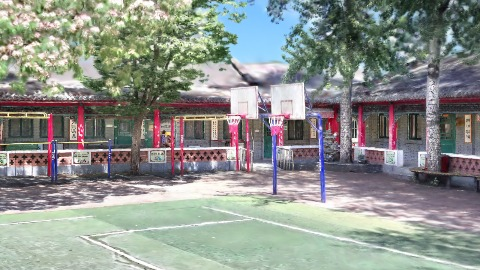

**kf-2**

**kf-3**

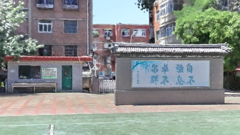

### chengjian-v7-b6-rs2

播放段 FPS: P50=102.0, P95=120.0, min=73.0, 总播放=2855ms

| waypoint | animTimeSec | moveMs | pendingPeak | blurToClearMs | fpsP50(refine) | fpsP95(refine) | fpsMin | gsplatsAtClearM | jsHeap@clear | vram@clear | jsHeapPeak | vramPeak | timeout |
|----------|-------------|--------|-------------|---------------|----------------|----------------|--------|-----------------|--------------|------------|------------|----------|---------|
| kf-0 | 0.00 | 0 | 0 | 0 | 120.0 | 120.0 | 119.0 | 2.51 | 213 | 312 | 230 | 312 | N |
| kf-1 | 1.00 | 949 | 27 | 12604 | 119.0 | 120.0 | 101.0 | 3.15 | 285 | 358 | 293 | 358 | N |
| kf-2 | 2.00 | 953 | 37 | 16002 | 94.0 | 116.0 | 77.0 | 4.22 | 348 | 420 | 371 | 420 | N |
| kf-3 | 3.00 | 953 | 27 | 12201 | 120.0 | 120.0 | 73.0 | 3.43 | 354 | 416 | 390 | 422 | N |

变清晰截图（480×270 JPEG）：

**kf-0**

**kf-1**

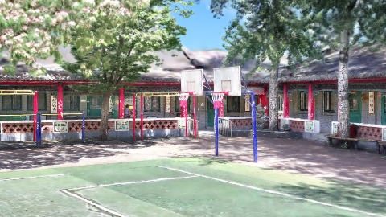

**kf-2**

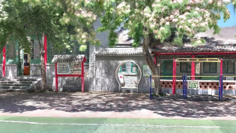

**kf-3**

### chengjian-v7-b6-rs4

播放段 FPS: P50=120.0, P95=120.0, min=119.0, 总播放=2841ms

| waypoint | animTimeSec | moveMs | pendingPeak | blurToClearMs | fpsP50(refine) | fpsP95(refine) | fpsMin | gsplatsAtClearM | jsHeap@clear | vram@clear | jsHeapPeak | vramPeak | timeout |
|----------|-------------|--------|-------------|---------------|----------------|----------------|--------|-----------------|--------------|------------|------------|----------|---------|
| kf-0 | 0.00 | 0 | 0 | 0 | 120.0 | 120.0 | 120.0 | 1.32 | 179 | 279 | 179 | 279 | N |
| kf-1 | 1.00 | 950 | 18 | 11201 | 120.0 | 120.0 | 119.0 | 1.85 | 234 | 328 | 242 | 328 | N |
| kf-2 | 2.00 | 946 | 29 | 13600 | 120.0 | 120.0 | 119.0 | 2.39 | 299 | 372 | 307 | 372 | N |
| kf-3 | 3.00 | 945 | 23 | 8801 | 120.0 | 120.0 | 119.0 | 1.95 | 316 | 379 | 317 | 379 | N |

变清晰截图（480×270 JPEG）：

**kf-0**

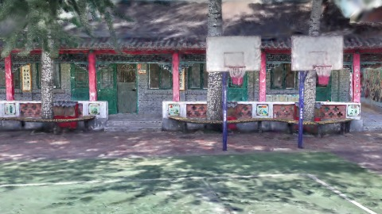

**kf-1**

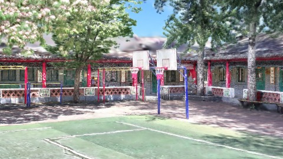

**kf-2**

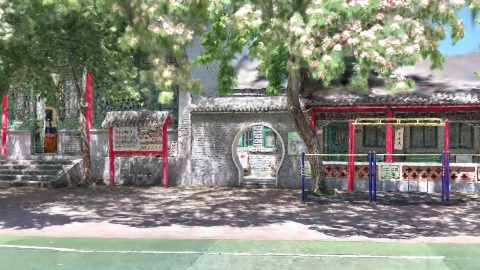

**kf-3**

### chengjian-v7-b6-rs8

播放段 FPS: P50=120.0, P95=120.0, min=119.0, 总播放=2851ms

| waypoint | animTimeSec | moveMs | pendingPeak | blurToClearMs | fpsP50(refine) | fpsP95(refine) | fpsMin | gsplatsAtClearM | jsHeap@clear | vram@clear | jsHeapPeak | vramPeak | timeout |
|----------|-------------|--------|-------------|---------------|----------------|----------------|--------|-----------------|--------------|------------|------------|----------|---------|
| kf-0 | 0.00 | 0 | 0 | 0 | 120.0 | 120.0 | 120.0 | 0.58 | 141 | 248 | 141 | 248 | N |
| kf-1 | 1.00 | 950 | 20 | 9001 | 120.0 | 120.0 | 119.0 | 0.86 | 194 | 293 | 207 | 293 | N |
| kf-2 | 2.00 | 955 | 14 | 6601 | 120.0 | 120.0 | 119.0 | 1.04 | 208 | 305 | 213 | 305 | N |
| kf-3 | 3.00 | 947 | 13 | 5600 | 120.0 | 120.0 | 119.0 | 0.87 | 234 | 321 | 236 | 321 | N |

变清晰截图（480×270 JPEG）：

**kf-0**

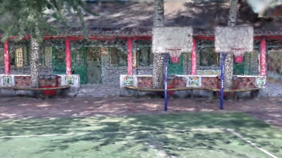

**kf-1**

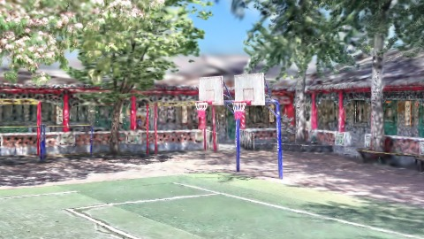

**kf-2**

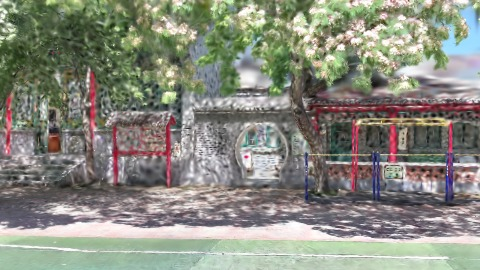

**kf-3**

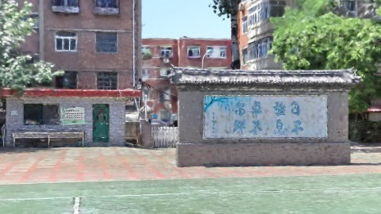

## 优化前 vs 优化后

### default（基线 `chengjian-v7-b6-rs1`）

| case | lodMode | lodRuntime | firstFrameMs | kf-1 blur | kf-2 blur | blur P90 | vramPeak | poolEvictions |
|------|---------|------------|--------------|-----------|-----------|----------|----------|---------------|
| chengjian-v7-b6-rs1 | - | refinement | 20846 (—) | 11000 (—) | 20001 | 20001 | 421 | - |
| chengjian-v7-b6-rs2 | - | refinement | 27869 (33.7%) | 12604 (14.6%) | 16002 | 16002 | 422 | - |
| chengjian-v7-b6-rs4 | - | refinement | 22384 (7.4%) | 11201 (1.8%) | 13600 | 13600 | 379 | - |
| chengjian-v7-b6-rs8 | - | refinement | 14280 (-31.5%) | 9001 (-18.2%) | 6601 | 9001 | 321 | - |

## 结论

- 见上方对比表；`bottleneckHint` 见 `results.json`（scheduler / asset-http / mixed）