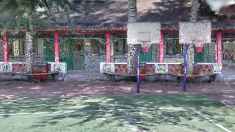
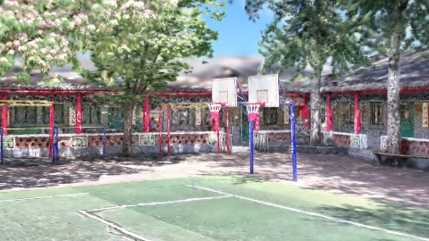
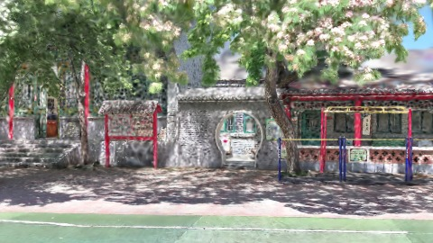
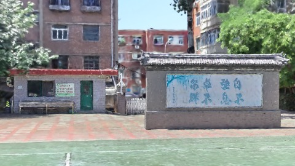

# Scene Profile Benchmark — 2026-08-10

## 本轮维度: profile

Suite: `public/benchmark-suites/scene-chengjian-v7-budget6-rs6.json`

Renderer: `webgpu`

## 运行条件

- Cold start: yes
- Browser session: fresh-chromium-per-case
- Chromium HTTP cache: disabled-cdp-clearBrowserCache-zero-disk-cache
- Cold start (default): fresh Chromium per case, HTTP cache disabled
- OS 页缓存 / GPU 编译缓存：脚本不控制，跨次运行可能仍有差异

| label | presetId | budget | lodMode | lodRuntime | firstFrameMs | jsHeap@1st | vram@1st | jsHeapPeak | vramPeak | fpsP50 | fpsP95 | gsplatsAvgM |
|-------|----------|--------|---------|------------|--------------|------------|----------|------------|----------|--------|--------|-------------|
| chengjian-v7-b6-rs6 | undefined | 6 | - | refinement | 22031.900000095367 | 180 | 277 | 274 | 344 | 60.0 | 60.0 | 1.24 |

## 交互巡检（糊→清晰）

### chengjian-v7-b6-rs6

播放段 FPS: P50=60.0, P95=60.0, min=60.0, 总播放=2893ms

| waypoint | animTimeSec | moveMs | pendingPeak | blurToClearMs | fpsP50(refine) | fpsP95(refine) | fpsMin | gsplatsAtClearM | jsHeap@clear | vram@clear | jsHeapPeak | vramPeak | timeout |
|----------|-------------|--------|-------------|---------------|----------------|----------------|--------|-----------------|--------------|------------|------------|----------|---------|
| kf-0 | 0.00 | 0 | 0 | 0 | 60.0 | 60.0 | 60.0 | 1.00 | 178 | 277 | 185 | 277 | N |
| kf-1 | 1.00 | 966 | 15 | 6600 | 60.0 | 60.0 | 59.0 | 1.24 | 212 | 310 | 225 | 310 | N |
| kf-2 | 2.00 | 961 | 18 | 7601 | 60.0 | 60.0 | 59.0 | 1.51 | 241 | 338 | 263 | 339 | N |
| kf-3 | 3.00 | 966 | 16 | 6601 | 60.0 | 60.0 | 59.0 | 1.22 | 256 | 343 | 274 | 344 | N |

变清晰截图（480×270 JPEG）：

**kf-0**

**kf-1**

**kf-2**

**kf-3**

## 优化前 vs 优化后

### default（基线 `chengjian-v7-b6-rs6`）

| case | lodMode | lodRuntime | firstFrameMs | kf-1 blur | kf-2 blur | blur P90 | vramPeak | poolEvictions |
|------|---------|------------|--------------|-----------|-----------|----------|----------|---------------|
| chengjian-v7-b6-rs6 | - | refinement | 22032 (—) | 6600 (—) | 7601 | 7601 | 344 | - |

## 结论

- 见上方对比表；`bottleneckHint` 见 `results.json`（scheduler / asset-http / mixed）