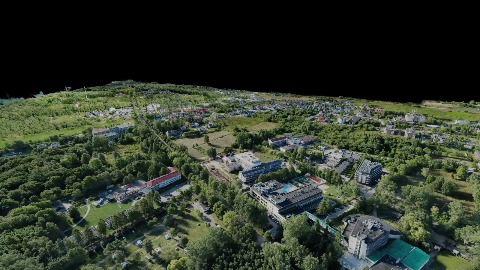
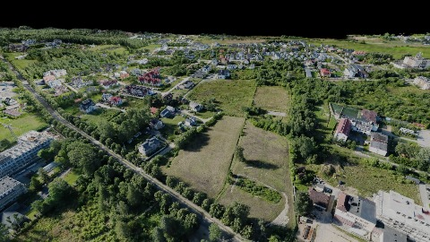
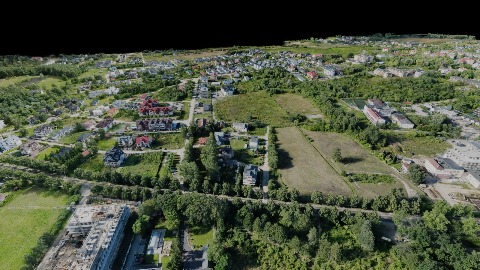
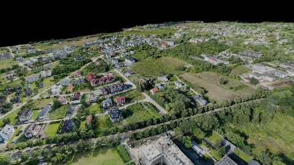
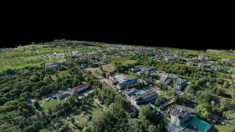
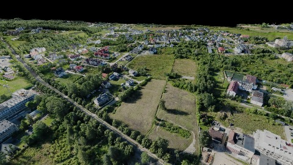
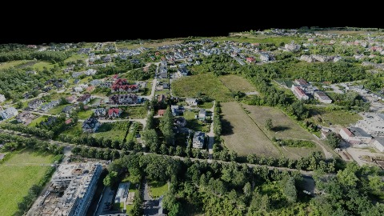
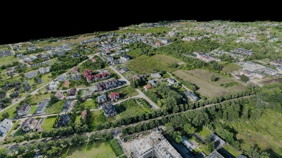

# Scene Profile Benchmark — 2026-08-10

## 本轮维度: profile

Suite: `public/benchmark-suites/scene-poland-leaf-coarseness.json`

Renderer: `webgpu`

## 运行条件

- Cold start: yes
- Browser session: fresh-chromium-per-case
- Chromium HTTP cache: disabled-cdp-clearBrowserCache-zero-disk-cache
- Cold start (default): fresh Chromium per case, HTTP cache disabled
- OS 页缓存 / GPU 编译缓存：脚本不控制，跨次运行可能仍有差异

| label | presetId | budget | lodMode | lodRuntime | firstFrameMs | jsHeap@1st | vram@1st | jsHeapPeak | vramPeak | fpsP50 | fpsP95 | gsplatsAvgM |
|-------|----------|--------|---------|------------|--------------|------------|----------|------------|----------|--------|--------|-------------|
| poland-leaf-fine-extent10 | undefined | - | - | refinement | 79870.90000009537 | 363 | 311 | 535 | 376 | 19.0 | 29.0 | 3.49 |
| poland-leaf-coarse-extent0 | undefined | - | - | refinement | 45159.700000047684 | 334 | 316 | 428 | 393 | 60.0 | 60.0 | 3.42 |

## 交互巡检（糊→清晰）

### poland-leaf-fine-extent10

播放段 FPS: P50=19.0, P95=29.0, min=11.0, 总播放=6378ms

| waypoint | animTimeSec | moveMs | pendingPeak | blurToClearMs | fpsP50(refine) | fpsP95(refine) | fpsMin | gsplatsAtClearM | jsHeap@clear | vram@clear | jsHeapPeak | vramPeak | timeout |
|----------|-------------|--------|-------------|---------------|----------------|----------------|--------|-----------------|--------------|------------|------------|----------|---------|
| kf-0 | 0.00 | 0 | 0 | 0 | 12.0 | 12.0 | 12.0 | 3.35 | 381 | 313 | 391 | 313 | N |
| kf-1 | 2.10 | 2164 | 29 | 12639 | 28.0 | 31.0 | 12.0 | 3.60 | 422 | 355 | 496 | 355 | N |
| kf-2 | 4.20 | 2090 | 8 | 4777 | 26.0 | 29.0 | 15.0 | 3.53 | 472 | 349 | 508 | 376 | N |
| kf-3 | 6.30 | 2124 | 7 | 2655 | 15.0 | 19.0 | 13.0 | 3.47 | 428 | 374 | 535 | 376 | N |

变清晰截图（480×270 JPEG）：

**kf-0**

**kf-1**

**kf-2**

**kf-3**

### poland-leaf-coarse-extent0

播放段 FPS: P50=60.0, P95=60.0, min=59.0, 总播放=6177ms

| waypoint | animTimeSec | moveMs | pendingPeak | blurToClearMs | fpsP50(refine) | fpsP95(refine) | fpsMin | gsplatsAtClearM | jsHeap@clear | vram@clear | jsHeapPeak | vramPeak | timeout |
|----------|-------------|--------|-------------|---------------|----------------|----------------|--------|-----------------|--------------|------------|------------|----------|---------|
| kf-0 | 0.00 | 0 | 0 | 0 | 59.0 | 59.0 | 59.0 | 3.16 | 293 | 316 | 354 | 316 | N |
| kf-1 | 2.10 | 2069 | 30 | 13601 | 60.0 | 60.0 | 59.0 | 3.60 | 375 | 358 | 385 | 358 | N |
| kf-2 | 4.20 | 2061 | 7 | 3601 | 60.0 | 60.0 | 60.0 | 3.48 | 412 | 356 | 415 | 356 | N |
| kf-3 | 6.30 | 2048 | 17 | 7200 | 60.0 | 60.0 | 59.0 | 3.43 | 417 | 393 | 428 | 393 | N |

变清晰截图（480×270 JPEG）：

**kf-0**

**kf-1**

**kf-2**

**kf-3**

## 优化前 vs 优化后

### poland-leaf-coarseness（基线 `poland-leaf-fine-extent10`）

| case | lodMode | lodRuntime | firstFrameMs | kf-1 blur | kf-2 blur | blur P90 | vramPeak | poolEvictions |
|------|---------|------------|--------------|-----------|-----------|----------|----------|---------------|
| poland-leaf-fine-extent10 | - | refinement | 79871 (—) | 12639 (—) | 4777 | 12639 | 376 | - |
| poland-leaf-coarse-extent0 | - | refinement | 45160 (-43.5%) | 13601 (7.6%) | 3601 | 13601 | 393 | - |

## 结论

- 见上方对比表；`bottleneckHint` 见 `results.json`（scheduler / asset-http / mixed）