# Scene Profile Benchmark — 2026-08-10

## 本轮维度: profile

Suite: `public/benchmark-suites/scene-poland-pack-hard-compare.json`

Renderer: `webgpu`

## 运行条件

- Cold start: yes
- Browser session: fresh-chromium-per-case
- Chromium HTTP cache: disabled-cdp-clearBrowserCache-zero-disk-cache
- Cold start (default): fresh Chromium per case, HTTP cache disabled
- OS 页缓存 / GPU 编译缓存：脚本不控制，跨次运行可能仍有差异

| label | presetId | budget | lodMode | lodRuntime | firstFrameMs | jsHeap@1st | vram@1st | jsHeapPeak | vramPeak | fpsP50 | fpsP95 | gsplatsAvgM |
|-------|----------|--------|---------|------------|--------------|------------|----------|------------|----------|--------|--------|-------------|
| poland-96k-normal | undefined | - | - | refinement | 103025.70000004768 | 442 | 328 | 718 | 493 | 10.0 | 23.0 | 3.00 |
| poland-96k-hard | undefined | - | - | refinement | 17736.900000095367 | 136 | 164 | 238 | 221 | 60.0 | 60.0 | 0.23 |
| poland-192k-hard | undefined | - | - | refinement | 27661.599999904633 | 135 | 171 | 226 | 237 | 60.0 | 60.0 | 0.21 |
| poland-256k-hard | undefined | - | - | refinement | 22763.60000014305 | 129 | 167 | 187 | 207 | 60.0 | 60.0 | 0.20 |

## 交互巡检（糊→清晰）

### poland-96k-normal

播放段 FPS: P50=10.0, P95=23.0, min=5.0, 总播放=24544ms

| waypoint | animTimeSec | moveMs | pendingPeak | blurToClearMs | fpsP50(refine) | fpsP95(refine) | fpsMin | gsplatsAtClearM | jsHeap@clear | vram@clear | jsHeapPeak | vramPeak | timeout |
|----------|-------------|--------|-------------|---------------|----------------|----------------|--------|-----------------|--------------|------------|------------|----------|---------|
| kf-0 | 0.00 | 0 | 0 | 0 | 12.0 | 12.0 | 11.0 | 2.83 | 473 | 329 | 473 | 331 | N |
| kf-1 | 2.10 | 2438 | 52 | 23438 | 23.0 | 25.0 | 9.0 | 3.21 | 492 | 385 | 574 | 385 | N |
| kf-2 | 4.20 | 2115 | 10 | 5608 | 20.0 | 23.0 | 11.0 | 2.95 | 615 | 367 | 626 | 409 | N |
| kf-3 | 6.30 | 2239 | 20 | 7774 | 15.0 | 16.0 | 9.0 | 2.89 | 612 | 371 | 619 | 401 | N |
| kf-4 | 8.40 | 3063 | 15 | 5826 | 11.0 | 11.0 | 6.0 | 2.65 | 557 | 407 | 579 | 407 | N |
| kf-5 | 10.50 | 3687 | 20 | 6234 | 10.0 | 11.0 | 5.0 | 2.82 | 589 | 411 | 615 | 413 | N |
| kf-6 | 12.60 | 3554 | 25 | 11151 | 11.0 | 12.0 | 6.0 | 3.07 | 623 | 424 | 635 | 435 | N |
| kf-7 | 14.70 | 3218 | 22 | 10964 | 15.0 | 16.0 | 6.0 | 3.19 | 571 | 448 | 676 | 448 | N |
| kf-8 | 16.80 | 2170 | 15 | 18010 | 23.0 | 24.0 | 10.0 | 3.10 | 580 | 465 | 671 | 465 | N |
| kf-9 | 18.90 | 2061 | 21 | 21956 | 23.0 | 25.0 | 12.0 | 3.23 | 671 | 491 | 718 | 493 | N |

变清晰截图（480×270 JPEG）：

**kf-0**

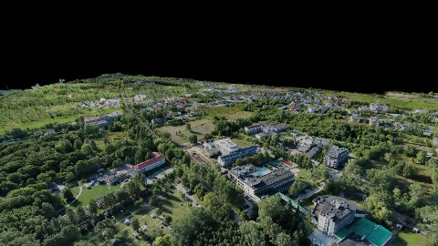

**kf-1**

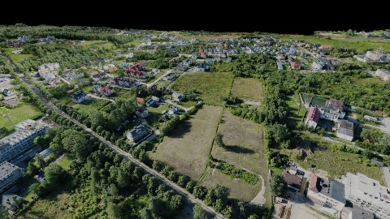

**kf-2**

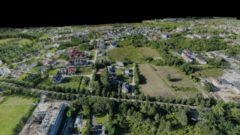

**kf-3**

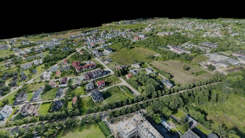

**kf-4**

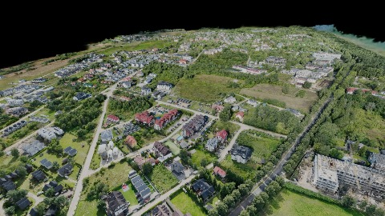

**kf-5**

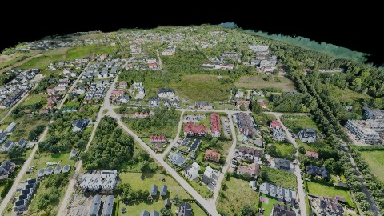

**kf-6**

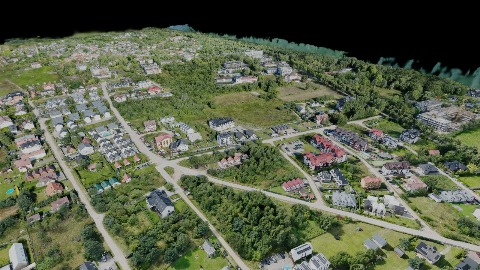

**kf-7**

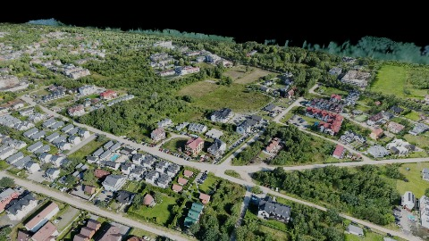

**kf-8**

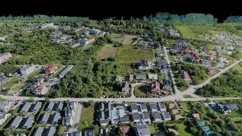

**kf-9**

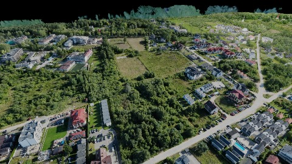

### poland-96k-hard

播放段 FPS: P50=60.0, P95=60.0, min=44.0, 总播放=18563ms

| waypoint | animTimeSec | moveMs | pendingPeak | blurToClearMs | fpsP50(refine) | fpsP95(refine) | fpsMin | gsplatsAtClearM | jsHeap@clear | vram@clear | jsHeapPeak | vramPeak | timeout |
|----------|-------------|--------|-------------|---------------|----------------|----------------|--------|-----------------|--------------|------------|------------|----------|---------|
| kf-0 | 0.00 | 0 | 0 | 0 | 59.0 | 59.0 | 59.0 | 0.19 | 131 | 164 | 148 | 164 | N |
| kf-1 | 2.10 | 2051 | 12 | 12201 | 60.0 | 60.0 | 59.0 | 0.22 | 145 | 183 | 173 | 183 | N |
| kf-2 | 4.20 | 2047 | 0 | 0 | 59.0 | 60.0 | 59.0 | 0.21 | 138 | 182 | 155 | 182 | N |
| kf-3 | 6.30 | 2052 | 3 | 4201 | 60.0 | 60.0 | 59.0 | 0.22 | 163 | 188 | 180 | 188 | N |
| kf-4 | 8.40 | 2064 | 5 | 2801 | 51.0 | 60.0 | 51.0 | 0.23 | 173 | 199 | 202 | 199 | N |
| kf-5 | 10.50 | 2082 | 3 | 3606 | 59.0 | 60.0 | 44.0 | 0.24 | 188 | 206 | 210 | 206 | N |
| kf-6 | 12.60 | 2086 | 0 | 0 | 45.0 | 45.0 | 45.0 | 0.24 | 182 | 206 | 229 | 206 | N |
| kf-7 | 14.70 | 2059 | 3 | 4400 | 59.0 | 60.0 | 52.0 | 0.24 | 171 | 212 | 238 | 212 | N |
| kf-8 | 16.80 | 2059 | 1 | 2601 | 60.0 | 60.0 | 59.0 | 0.24 | 198 | 215 | 220 | 215 | N |
| kf-9 | 18.90 | 2063 | 2 | 3201 | 60.0 | 60.0 | 59.0 | 0.23 | 204 | 221 | 232 | 221 | N |

变清晰截图（480×270 JPEG）：

**kf-0**

**kf-1**

**kf-2**

**kf-3**

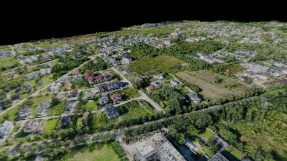

**kf-4**

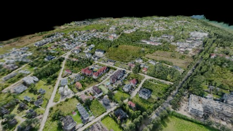

**kf-5**

**kf-6**

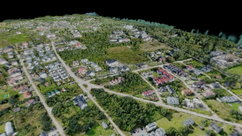

**kf-7**

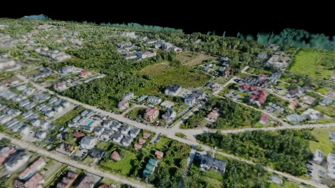

**kf-8**

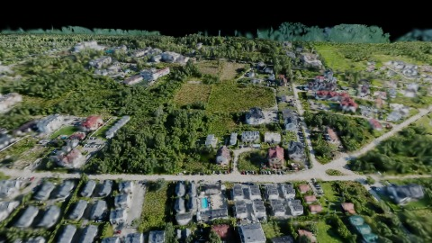

**kf-9**

### poland-192k-hard

播放段 FPS: P50=60.0, P95=60.0, min=59.0, 总播放=18547ms

| waypoint | animTimeSec | moveMs | pendingPeak | blurToClearMs | fpsP50(refine) | fpsP95(refine) | fpsMin | gsplatsAtClearM | jsHeap@clear | vram@clear | jsHeapPeak | vramPeak | timeout |
|----------|-------------|--------|-------------|---------------|----------------|----------------|--------|-----------------|--------------|------------|------------|----------|---------|
| kf-0 | 0.00 | 0 | 0 | 0 | 60.0 | 60.0 | 60.0 | 0.19 | 129 | 171 | 136 | 171 | N |
| kf-1 | 2.10 | 2068 | 3 | 9800 | 60.0 | 60.0 | 59.0 | 0.22 | 143 | 193 | 158 | 193 | N |
| kf-2 | 4.20 | 2065 | 1 | 4801 | 60.0 | 60.0 | 59.0 | 0.21 | 137 | 194 | 164 | 194 | N |
| kf-3 | 6.30 | 2066 | 2 | 7001 | 60.0 | 60.0 | 59.0 | 0.21 | 156 | 201 | 175 | 201 | N |
| kf-4 | 8.40 | 2050 | 3 | 6001 | 60.0 | 60.0 | 59.0 | 0.21 | 175 | 219 | 199 | 219 | N |
| kf-5 | 10.50 | 2065 | 1 | 4402 | 60.0 | 60.0 | 60.0 | 0.22 | 196 | 223 | 200 | 223 | N |
| kf-6 | 12.60 | 2064 | 1 | 6001 | 60.0 | 60.0 | 59.0 | 0.22 | 194 | 226 | 216 | 226 | N |
| kf-7 | 14.70 | 2061 | 0 | 0 | 60.0 | 60.0 | 60.0 | 0.21 | 198 | 226 | 202 | 226 | N |
| kf-8 | 16.80 | 2045 | 1 | 5200 | 60.0 | 60.0 | 60.0 | 0.22 | 205 | 237 | 214 | 237 | N |
| kf-9 | 18.90 | 2064 | 0 | 0 | 60.0 | 60.0 | 60.0 | 0.21 | 191 | 234 | 216 | 234 | N |

变清晰截图（480×270 JPEG）：

**kf-0**

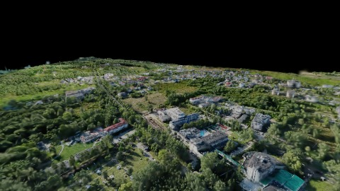

**kf-1**

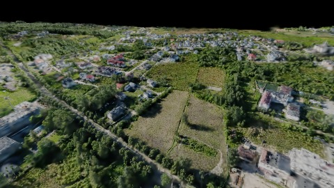

**kf-2**

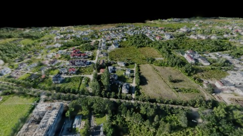

**kf-3**

**kf-4**

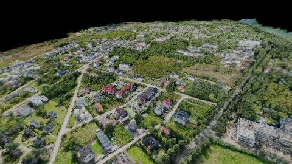

**kf-5**

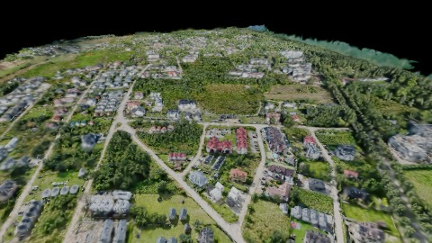

**kf-6**

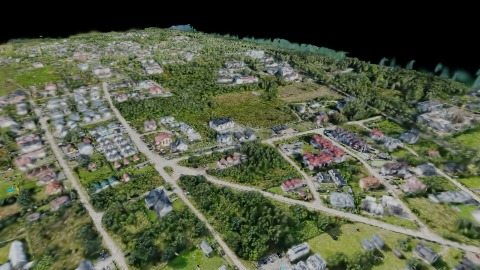

**kf-7**

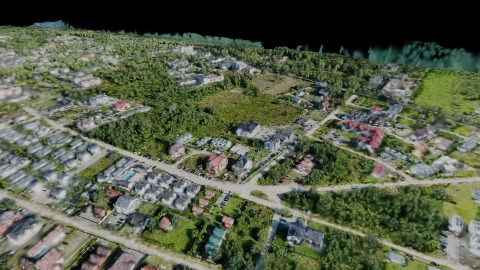

**kf-8**

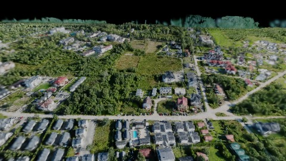

**kf-9**

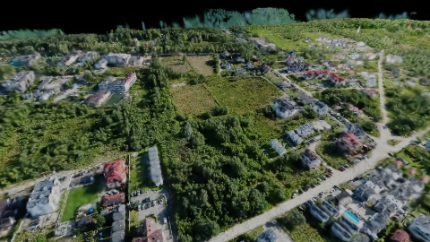

### poland-256k-hard

播放段 FPS: P50=60.0, P95=60.0, min=59.0, 总播放=18532ms

| waypoint | animTimeSec | moveMs | pendingPeak | blurToClearMs | fpsP50(refine) | fpsP95(refine) | fpsMin | gsplatsAtClearM | jsHeap@clear | vram@clear | jsHeapPeak | vramPeak | timeout |
|----------|-------------|--------|-------------|---------------|----------------|----------------|--------|-----------------|--------------|------------|------------|----------|---------|
| kf-0 | 0.00 | 0 | 0 | 0 | 59.0 | 60.0 | 59.0 | 0.19 | 114 | 167 | 129 | 167 | N |
| kf-1 | 2.10 | 2050 | 1 | 13401 | 60.0 | 60.0 | 59.0 | 0.19 | 127 | 177 | 134 | 177 | N |
| kf-2 | 4.20 | 2065 | 1 | 12400 | 60.0 | 60.0 | 59.0 | 0.19 | 147 | 182 | 149 | 182 | N |
| kf-3 | 6.30 | 2066 | 1 | 3605 | 60.0 | 60.0 | 60.0 | 0.19 | 149 | 187 | 150 | 187 | N |
| kf-4 | 8.40 | 2050 | 3 | 14001 | 60.0 | 60.0 | 59.0 | 0.20 | 152 | 202 | 170 | 202 | N |
| kf-5 | 10.50 | 2048 | 1 | 5402 | 60.0 | 60.0 | 60.0 | 0.20 | 176 | 207 | 176 | 207 | N |
| kf-6 | 12.60 | 2064 | 0 | 0 | 59.0 | 60.0 | 59.0 | 0.20 | 170 | 207 | 179 | 207 | N |
| kf-7 | 14.70 | 2064 | 0 | 0 | 60.0 | 60.0 | 60.0 | 0.20 | 159 | 207 | 177 | 207 | N |
| kf-8 | 16.80 | 2062 | 0 | 0 | 60.0 | 60.0 | 60.0 | 0.20 | 166 | 207 | 179 | 207 | N |
| kf-9 | 18.90 | 2063 | 0 | 0 | 60.0 | 60.0 | 60.0 | 0.21 | 167 | 207 | 183 | 207 | N |

变清晰截图（480×270 JPEG）：

**kf-0**

**kf-1**

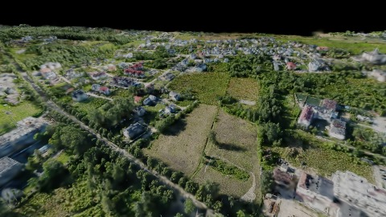

**kf-2**

**kf-3**

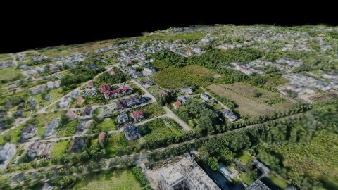

**kf-4**

**kf-5**

**kf-6**

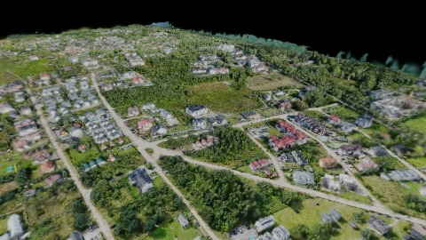

**kf-7**

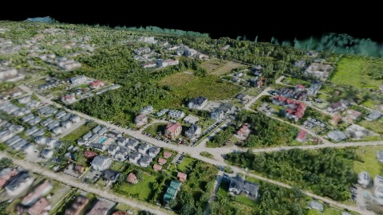

**kf-8**

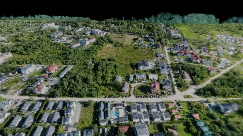

**kf-9**

## 优化前 vs 优化后

### poland-pack-hard（基线 `poland-96k-normal`）

| case | lodMode | lodRuntime | firstFrameMs | kf-1 blur | kf-2 blur | blur P90 | vramPeak | poolEvictions |
|------|---------|------------|--------------|-----------|-----------|----------|----------|---------------|
| poland-96k-normal | - | refinement | 103026 (—) | 23438 (—) | 5608 | 23438 | 493 | - |
| poland-96k-hard | - | refinement | 17737 (-82.8%) | 12201 (-47.9%) | 0 | 12201 | 221 | - |
| poland-192k-hard | - | refinement | 27662 (-73.2%) | 9800 (-58.2%) | 4801 | 9800 | 237 | - |
| poland-256k-hard | - | refinement | 22764 (-77.9%) | 13401 (-42.8%) | 12400 | 14001 | 207 | - |

## 结论

- 见上方对比表；`bottleneckHint` 见 `results.json`（scheduler / asset-http / mixed）