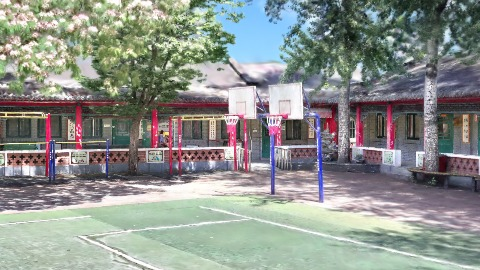
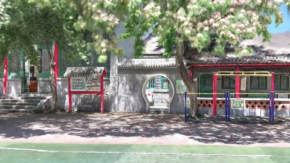
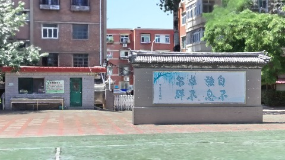
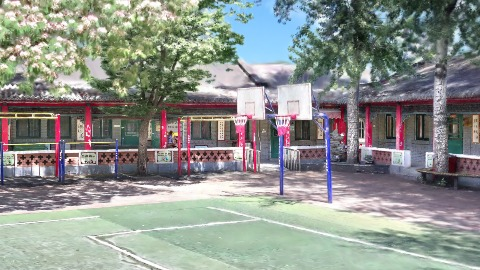
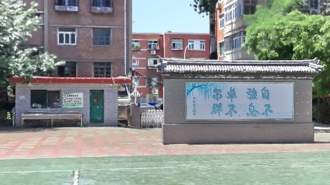
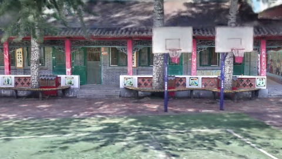
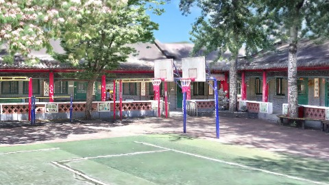
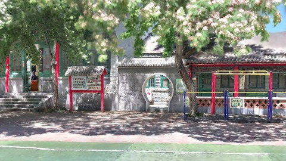

# Scene Profile Benchmark — 2026-08-11

## 本轮维度: profile

Suite: `public/benchmark-suites/scene-chengjian-v7-budget-ab.json`

Renderer: `webgpu`

## 运行条件

- Cold start: yes
- Browser session: fresh-chromium-per-case
- Chromium HTTP cache: disabled-cdp-clearBrowserCache-zero-disk-cache
- Cold start (default): fresh Chromium per case, HTTP cache disabled
- OS 页缓存 / GPU 编译缓存：脚本不控制，跨次运行可能仍有差异

| label | presetId | budget | lodMode | lodRuntime | firstFrameMs | jsHeap@1st | vram@1st | jsHeapPeak | vramPeak | fpsP50 | fpsP95 | gsplatsAvgM |
|-------|----------|--------|---------|------------|--------------|------------|----------|------------|----------|--------|--------|-------------|
| chengjian-v7-distance-budget-2.5 | undefined | 2.5 | - | refinement | 7826.200000047684 | 244 | 245 | 427 | 356 | 32.0 | 39.0 | 2.38 |
| chengjian-v7-distance-budget-4 | undefined | 4 | - | refinement | 7316.299999952316 | 250 | 262 | 465 | 422 | 50.0 | 60.0 | 3.11 |
| chengjian-v7-distance-budget-6 | undefined | 6 | - | refinement | 6167.099999904633 | 228 | 327 | 511 | 512 | 41.0 | 60.0 | 3.79 |

## 交互巡检（糊→清晰）

### chengjian-v7-distance-budget-2.5

播放段 FPS: P50=32.0, P95=39.0, min=28.0, 总播放=2871ms

| waypoint | animTimeSec | moveMs | pendingPeak | blurToClearMs | fpsP50(refine) | fpsP95(refine) | fpsMin | gsplatsAtClearM | jsHeap@clear | vram@clear | jsHeapPeak | vramPeak | timeout |
|----------|-------------|--------|-------------|---------------|----------------|----------------|--------|-----------------|--------------|------------|------------|----------|---------|
| kf-0 | 0.00 | 0 | 0 | 0 | 37.0 | 37.0 | 37.0 | 2.43 | 254 | 211 | 254 | 238 | N |
| kf-1 | 1.00 | 959 | 26 | 6000 | 31.0 | 39.0 | 28.0 | 2.45 | 304 | 263 | 345 | 295 | N |
| kf-2 | 2.00 | 960 | 30 | 3400 | 32.0 | 34.0 | 27.0 | 2.47 | 409 | 292 | 409 | 356 | N |
| kf-3 | 3.00 | 953 | 43 | 4400 | 51.0 | 58.0 | 32.0 | 2.17 | 416 | 346 | 416 | 349 | N |

变清晰截图（480×270 JPEG）：

**kf-0**

**kf-1**

**kf-2**

**kf-3**

### chengjian-v7-distance-budget-4

播放段 FPS: P50=50.0, P95=60.0, min=42.0, 总播放=2899ms

| waypoint | animTimeSec | moveMs | pendingPeak | blurToClearMs | fpsP50(refine) | fpsP95(refine) | fpsMin | gsplatsAtClearM | jsHeap@clear | vram@clear | jsHeapPeak | vramPeak | timeout |
|----------|-------------|--------|-------------|---------------|----------------|----------------|--------|-----------------|--------------|------------|------------|----------|---------|
| kf-0 | 0.00 | 0 | 0 | 0 | 60.0 | 60.0 | 60.0 | 2.55 | 251 | 248 | 260 | 262 | N |
| kf-1 | 1.00 | 967 | 43 | 4995 | 60.0 | 60.0 | 48.0 | 3.88 | 313 | 319 | 332 | 328 | N |
| kf-2 | 2.00 | 966 | 42 | 5401 | 59.0 | 60.0 | 44.0 | 3.91 | 381 | 391 | 420 | 392 | N |
| kf-3 | 3.00 | 966 | 41 | 4401 | 60.0 | 60.0 | 42.0 | 2.09 | 365 | 355 | 465 | 422 | N |

变清晰截图（480×270 JPEG）：

**kf-0**

**kf-1**

**kf-2**

**kf-3**

### chengjian-v7-distance-budget-6

播放段 FPS: P50=41.0, P95=60.0, min=29.0, 总播放=2888ms

| waypoint | animTimeSec | moveMs | pendingPeak | blurToClearMs | fpsP50(refine) | fpsP95(refine) | fpsMin | gsplatsAtClearM | jsHeap@clear | vram@clear | jsHeapPeak | vramPeak | timeout |
|----------|-------------|--------|-------------|---------------|----------------|----------------|--------|-----------------|--------------|------------|------------|----------|---------|
| kf-0 | 0.00 | 0 | 0 | 0 | 59.0 | 59.0 | 59.0 | 2.55 | 232 | 295 | 235 | 327 | N |
| kf-1 | 1.00 | 951 | 41 | 3000 | 59.0 | 60.0 | 36.0 | 4.63 | 302 | 386 | 318 | 386 | N |
| kf-2 | 2.00 | 972 | 47 | 5401 | 35.0 | 57.0 | 29.0 | 5.88 | 478 | 490 | 478 | 499 | N |
| kf-3 | 3.00 | 965 | 34 | 3601 | 60.0 | 60.0 | 39.0 | 2.09 | 357 | 408 | 511 | 512 | N |

变清晰截图（480×270 JPEG）：

**kf-0**

**kf-1**

**kf-2**

**kf-3**

## 优化前 vs 优化后

### chengjian-v7-budget（基线 `chengjian-v7-distance-budget-2.5`）

| case | lodMode | lodRuntime | firstFrameMs | kf-1 blur | kf-2 blur | blur P90 | vramPeak | poolEvictions |
|------|---------|------------|--------------|-----------|-----------|----------|----------|---------------|
| chengjian-v7-distance-budget-2.5 | - | refinement | 7826 (—) | 6000 (—) | 3400 | 6000 | 356 | - |
| chengjian-v7-distance-budget-4 | - | refinement | 7316 (-6.5%) | 4995 (-16.8%) | 5401 | 5401 | 422 | - |
| chengjian-v7-distance-budget-6 | - | refinement | 6167 (-21.2%) | 3000 (-50.0%) | 5401 | 5401 | 512 | - |

## 结论

- 见上方对比表；`bottleneckHint` 见 `results.json`（scheduler / asset-http / mixed）