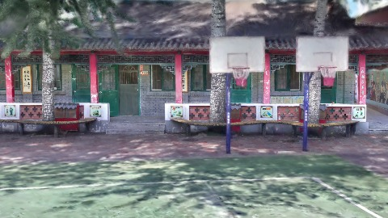
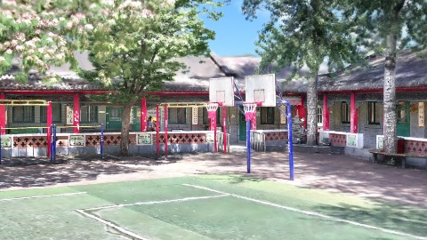
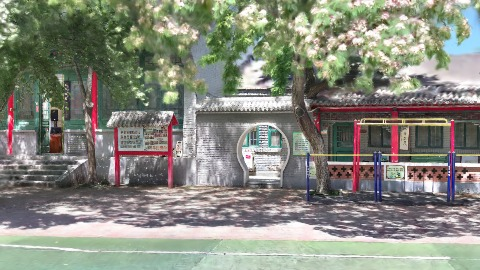
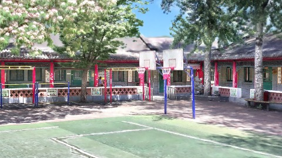
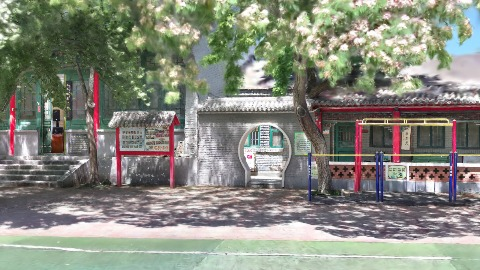
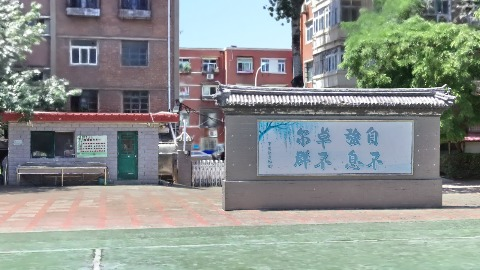

# Scene Profile Benchmark — 2026-08-11

## 本轮维度: profile

Suite: `public/benchmark-suites/scene-chengjian-v7-center-fast-clear-ab.json`

Renderer: `webgpu`

## 运行条件

- Cold start: yes
- Browser session: fresh-chromium-per-case
- Chromium HTTP cache: disabled-cdp-clearBrowserCache-zero-disk-cache
- Cold start (default): fresh Chromium per case, HTTP cache disabled
- OS 页缓存 / GPU 编译缓存：脚本不控制，跨次运行可能仍有差异

| label | presetId | budget | lodMode | lodRuntime | firstFrameMs | jsHeap@1st | vram@1st | jsHeapPeak | vramPeak | fpsP50 | fpsP95 | gsplatsAvgM |
|-------|----------|--------|---------|------------|--------------|------------|----------|------------|----------|--------|--------|-------------|
| chengjian-v7-budget4-centerFastClear-on | undefined | 4 | - | refinement | 20615.200000047684 | 97 | 171 | 449 | 409 | 24.0 | 44.0 | 3.07 |
| chengjian-v7-budget4-centerFastClear-off | undefined | 4 | - | refinement | 6436.5 | 240 | 264 | 498 | 441 | 50.0 | 60.0 | 3.12 |

## 交互巡检（糊→清晰）

### chengjian-v7-budget4-centerFastClear-on

播放段 FPS: P50=24.0, P95=44.0, min=23.0, 总播放=2896ms

| waypoint | animTimeSec | moveMs | pendingPeak | blurToClearMs | fpsP50(refine) | fpsP95(refine) | fpsMin | gsplatsAtClearM | jsHeap@clear | vram@clear | jsHeapPeak | vramPeak | timeout |
|----------|-------------|--------|-------------|---------------|----------------|----------------|--------|-----------------|--------------|------------|------------|----------|---------|
| kf-0 | 0.00 | 0 | 63 | 18200 | 83.0 | 92.0 | 37.0 | 2.55 | 257 | 268 | 257 | 268 | N |
| kf-1 | 1.00 | 970 | 26 | - | 26.0 | 33.0 | 22.0 | - | - | - | 342 | 318 | Y |
| kf-2 | 2.00 | 967 | 32 | 3400 | 23.0 | 35.0 | 19.0 | 3.58 | 426 | 354 | 426 | 406 | N |
| kf-3 | 3.00 | 959 | 11 | - | 41.0 | 49.0 | 31.0 | - | - | - | 427 | 409 | Y |

变清晰截图（480×270 JPEG）：

**kf-0**

**kf-1**

**kf-2**

**kf-3**

### chengjian-v7-budget4-centerFastClear-off

播放段 FPS: P50=50.0, P95=60.0, min=45.0, 总播放=2882ms

| waypoint | animTimeSec | moveMs | pendingPeak | blurToClearMs | fpsP50(refine) | fpsP95(refine) | fpsMin | gsplatsAtClearM | jsHeap@clear | vram@clear | jsHeapPeak | vramPeak | timeout |
|----------|-------------|--------|-------------|---------------|----------------|----------------|--------|-----------------|--------------|------------|------------|----------|---------|
| kf-0 | 0.00 | 0 | 0 | 0 | 60.0 | 60.0 | 60.0 | 2.55 | 230 | 250 | 242 | 264 | N |
| kf-1 | 1.00 | 967 | 44 | 3800 | 59.0 | 60.0 | 50.0 | 3.87 | 306 | 327 | 330 | 330 | N |
| kf-2 | 2.00 | 965 | 39 | 5201 | 58.0 | 60.0 | 45.0 | 3.90 | 386 | 378 | 418 | 395 | N |
| kf-3 | 3.00 | 950 | 31 | 2798 | 59.0 | 60.0 | 45.0 | 2.17 | 411 | 381 | 498 | 441 | N |

变清晰截图（480×270 JPEG）：

**kf-0**

**kf-1**

**kf-2**

**kf-3**

## 优化前 vs 优化后

### chengjian-v7-center-fast-clear（基线 `chengjian-v7-budget4-centerFastClear-on`）

| case | lodMode | lodRuntime | firstFrameMs | kf-1 blur | kf-2 blur | blur P90 | vramPeak | poolEvictions |
|------|---------|------------|--------------|-----------|-----------|----------|----------|---------------|
| chengjian-v7-budget4-centerFastClear-on | - | refinement | 20615 (—) | - (—) | 3400 | 18200 | 409 | - |
| chengjian-v7-budget4-centerFastClear-off | - | refinement | 6437 (-68.8%) | 3800 (-%) | 5201 | 5201 | 441 | - |

## 结论

- 见上方对比表；`bottleneckHint` 见 `results.json`（scheduler / asset-http / mixed）