# Scene Profile Benchmark — 2026-08-11

## 本轮维度: profile

Suite: `public/benchmark-suites/scene-chengjian-v7-maxconcurrent-ab.json`

Renderer: `webgpu`

## 运行条件

- Cold start: yes
- Browser session: fresh-chromium-per-case
- Chromium HTTP cache: disabled-cdp-clearBrowserCache-zero-disk-cache
- Cold start (default): fresh Chromium per case, HTTP cache disabled
- OS 页缓存 / GPU 编译缓存：脚本不控制，跨次运行可能仍有差异

| label | presetId | budget | lodMode | lodRuntime | firstFrameMs | jsHeap@1st | vram@1st | jsHeapPeak | vramPeak | fpsP50 | fpsP95 | gsplatsAvgM |
|-------|----------|--------|---------|------------|--------------|------------|----------|------------|----------|--------|--------|-------------|
| chengjian-v7-maxConcurrent-1 | undefined | 4 | - | refinement | 30505.200000047684 | 191 | 231 | 282 | 300 | 60.0 | 60.0 | 2.84 |
| chengjian-v7-maxConcurrent-2 | undefined | 4 | - | refinement | 32883 | 189 | 233 | 330 | 311 | 60.0 | 60.0 | 2.86 |
| chengjian-v7-maxConcurrent-4 | undefined | 4 | - | refinement | 30547 | 179 | 231 | 355 | 346 | 51.0 | 60.0 | 3.12 |
| chengjian-v7-maxConcurrent-8 | undefined | 4 | - | refinement | 35560.200000047684 | 187 | 240 | 393 | 381 | 55.0 | 60.0 | 3.11 |

## 交互巡检（糊→清晰）

### chengjian-v7-maxConcurrent-1

播放段 FPS: P50=60.0, P95=60.0, min=51.0, 总播放=2880ms

| waypoint | animTimeSec | moveMs | pendingPeak | blurToClearMs | fpsP50(refine) | fpsP95(refine) | fpsMin | gsplatsAtClearM | jsHeap@clear | vram@clear | jsHeapPeak | vramPeak | timeout |
|----------|-------------|--------|-------------|---------------|----------------|----------------|--------|-----------------|--------------|------------|------------|----------|---------|
| kf-0 | 0.00 | 0 | 0 | 0 | 60.0 | 60.0 | 60.0 | 2.55 | 181 | 231 | 191 | 231 | N |
| kf-1 | 1.00 | 967 | 36 | 27001 | 60.0 | 60.0 | 50.0 | 3.86 | 254 | 298 | 275 | 300 | N |
| kf-2 | 2.00 | 950 | 34 | - | 60.0 | 60.0 | 53.0 | - | - | - | 277 | 296 | Y |
| kf-3 | 3.00 | 963 | 45 | 23400 | 60.0 | 60.0 | 59.0 | 2.09 | 246 | 269 | 282 | 273 | N |

变清晰截图（480×270 JPEG）：

**kf-0**

**kf-1**

**kf-2**

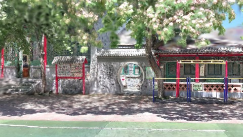

**kf-3**

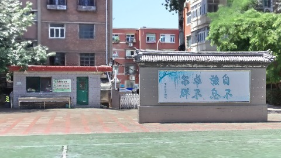

### chengjian-v7-maxConcurrent-2

播放段 FPS: P50=60.0, P95=60.0, min=52.0, 总播放=2865ms

| waypoint | animTimeSec | moveMs | pendingPeak | blurToClearMs | fpsP50(refine) | fpsP95(refine) | fpsMin | gsplatsAtClearM | jsHeap@clear | vram@clear | jsHeapPeak | vramPeak | timeout |
|----------|-------------|--------|-------------|---------------|----------------|----------------|--------|-----------------|--------------|------------|------------|----------|---------|
| kf-0 | 0.00 | 0 | 0 | 0 | 60.0 | 60.0 | 60.0 | 2.55 | 184 | 231 | 189 | 233 | N |
| kf-1 | 1.00 | 967 | 41 | 26801 | 59.0 | 60.0 | 53.0 | 3.85 | 272 | 308 | 292 | 311 | N |
| kf-2 | 2.00 | 950 | 38 | - | 60.0 | 60.0 | 52.0 | - | - | - | 288 | 306 | Y |
| kf-3 | 3.00 | 948 | 36 | 22802 | 60.0 | 60.0 | 59.0 | 2.17 | 249 | 274 | 330 | 276 | N |

变清晰截图（480×270 JPEG）：

**kf-0**

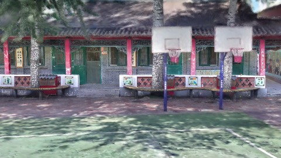

**kf-1**

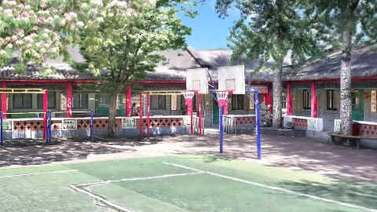

**kf-2**

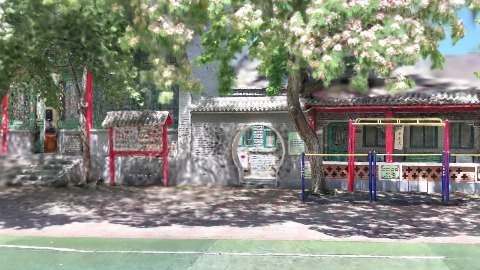

**kf-3**

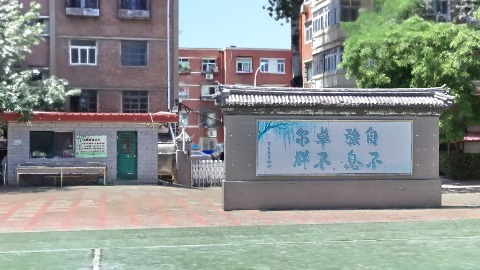

### chengjian-v7-maxConcurrent-4

播放段 FPS: P50=51.0, P95=60.0, min=49.0, 总播放=2879ms

| waypoint | animTimeSec | moveMs | pendingPeak | blurToClearMs | fpsP50(refine) | fpsP95(refine) | fpsMin | gsplatsAtClearM | jsHeap@clear | vram@clear | jsHeapPeak | vramPeak | timeout |
|----------|-------------|--------|-------------|---------------|----------------|----------------|--------|-----------------|--------------|------------|------------|----------|---------|
| kf-0 | 0.00 | 0 | 0 | 0 | 60.0 | 60.0 | 60.0 | 2.55 | 165 | 231 | 198 | 231 | N |
| kf-1 | 1.00 | 966 | 41 | 29200 | 60.0 | 60.0 | 47.0 | 3.90 | 281 | 314 | 337 | 320 | N |
| kf-2 | 2.00 | 951 | 36 | 36201 | 60.0 | 60.0 | 43.0 | 3.93 | 321 | 343 | 355 | 346 | N |
| kf-3 | 3.00 | 962 | 31 | 25000 | 60.0 | 60.0 | 50.0 | 2.09 | 250 | 294 | 345 | 342 | N |

变清晰截图（480×270 JPEG）：

**kf-0**

**kf-1**

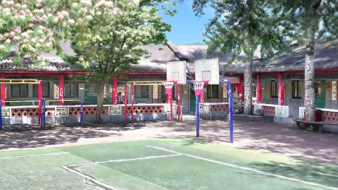

**kf-2**

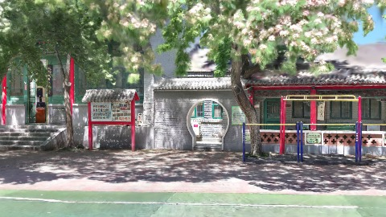

**kf-3**

### chengjian-v7-maxConcurrent-8

播放段 FPS: P50=55.0, P95=60.0, min=50.0, 总播放=2881ms

| waypoint | animTimeSec | moveMs | pendingPeak | blurToClearMs | fpsP50(refine) | fpsP95(refine) | fpsMin | gsplatsAtClearM | jsHeap@clear | vram@clear | jsHeapPeak | vramPeak | timeout |
|----------|-------------|--------|-------------|---------------|----------------|----------------|--------|-----------------|--------------|------------|------------|----------|---------|
| kf-0 | 0.00 | 0 | 0 | 0 | 60.0 | 60.0 | 60.0 | 2.55 | 215 | 238 | 215 | 240 | N |
| kf-1 | 1.00 | 952 | 39 | 32600 | 59.0 | 60.0 | 54.0 | 3.86 | 303 | 322 | 317 | 325 | N |
| kf-2 | 2.00 | 965 | 38 | 23600 | 60.0 | 60.0 | 50.0 | 3.92 | 360 | 376 | 393 | 376 | N |
| kf-3 | 3.00 | 965 | 42 | 24409 | 60.0 | 60.0 | 51.0 | 2.09 | 296 | 327 | 392 | 381 | N |

变清晰截图（480×270 JPEG）：

**kf-0**

**kf-1**

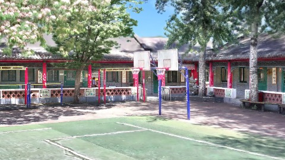

**kf-2**

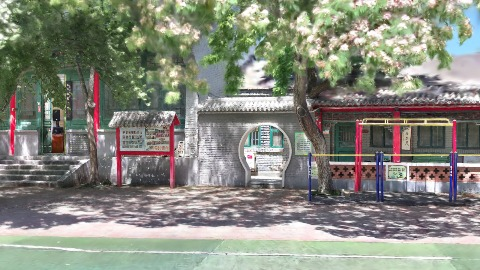

**kf-3**

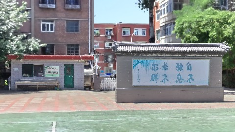

## 优化前 vs 优化后

### chengjian-v7-maxConcurrent（基线 `chengjian-v7-maxConcurrent-1`）

| case | lodMode | lodRuntime | firstFrameMs | kf-1 blur | kf-2 blur | blur P90 | vramPeak | poolEvictions |
|------|---------|------------|--------------|-----------|-----------|----------|----------|---------------|
| chengjian-v7-maxConcurrent-1 | - | refinement | 30505 (—) | 27001 (—) | - | 27001 | 300 | - |
| chengjian-v7-maxConcurrent-2 | - | refinement | 32883 (7.8%) | 26801 (-0.7%) | - | 26801 | 311 | - |
| chengjian-v7-maxConcurrent-4 | - | refinement | 30547 (0.1%) | 29200 (8.1%) | 36201 | 36201 | 346 | - |
| chengjian-v7-maxConcurrent-8 | - | refinement | 35560 (16.6%) | 32600 (20.7%) | 23600 | 32600 | 381 | - |

## 结论

- 见上方对比表；`bottleneckHint` 见 `results.json`（scheduler / asset-http / mixed）