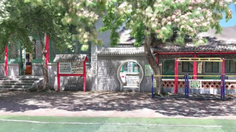
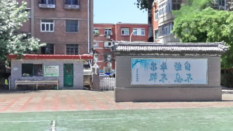
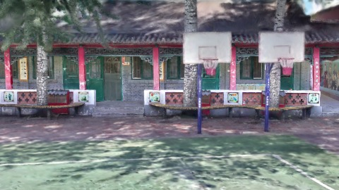
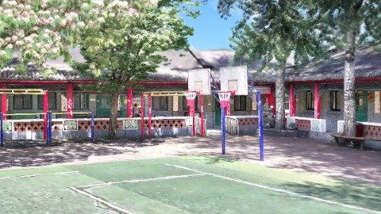
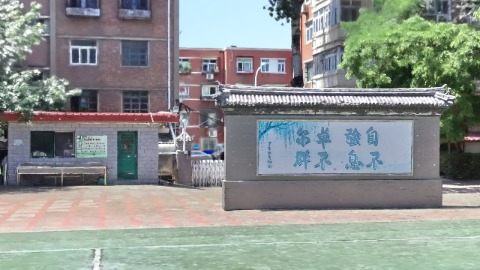

# Scene Profile Benchmark — 2026-08-12

## 本轮维度: profile

Suite: `public/benchmark-suites/scene-chengjian-v7-budget-2.5-4.json`

Renderer: `webgpu`

## 运行条件

- Cold start: yes
- Browser session: fresh-chromium-per-case
- Chromium HTTP cache: disabled-cdp-clearBrowserCache-zero-disk-cache
- Cold start (default): fresh Chromium per case, HTTP cache disabled
- OS 页缓存 / GPU 编译缓存：脚本不控制，跨次运行可能仍有差异

| label | presetId | budget | lodMode | lodRuntime | firstFrameMs | jsHeap@1st | vram@1st | jsHeapPeak | vramPeak | fpsP50 | fpsP95 | gsplatsAvgM |
|-------|----------|--------|---------|------------|--------------|------------|----------|------------|----------|--------|--------|-------------|
| chengjian-v7-distance-budget-2.5 | undefined | 2.5 | - | refinement | 14019.900000095367 | 136 | 140 | 389 | 311 | 60.0 | 60.0 | 2.35 |
| chengjian-v7-distance-budget-4 | undefined | 4 | - | refinement | 14719.5 | 122 | 183 | 402 | 372 | 60.0 | 60.0 | 3.12 |

## 交互巡检（糊→清晰）

### chengjian-v7-distance-budget-2.5

播放段 FPS: P50=60.0, P95=60.0, min=59.0, 总播放=2898ms

| waypoint | animTimeSec | moveMs | pendingPeak | blurToClearMs | fpsP50(refine) | fpsP95(refine) | fpsMin | gsplatsAtClearM | jsHeap@clear | vram@clear | jsHeapPeak | vramPeak | timeout |
|----------|-------------|--------|-------------|---------------|----------------|----------------|--------|-----------------|--------------|------------|------------|----------|---------|
| kf-0 | 0.00 | 0 | 64 | 20000 | 60.0 | 60.0 | 59.0 | 2.41 | 244 | 205 | 244 | 217 | N |
| kf-1 | 1.00 | 966 | 29 | 25598 | 60.0 | 60.0 | 59.0 | 2.43 | 299 | 257 | 301 | 263 | N |
| kf-2 | 2.00 | 966 | 27 | 18399 | 60.0 | 60.0 | 59.0 | 2.46 | 315 | 284 | 325 | 284 | N |
| kf-3 | 3.00 | 965 | 45 | 25800 | 60.0 | 60.0 | 59.0 | 2.09 | 376 | 310 | 389 | 311 | N |

变清晰截图（480×270 JPEG）：

**kf-0**

**kf-1**

**kf-2**

**kf-3**

### chengjian-v7-distance-budget-4

播放段 FPS: P50=60.0, P95=60.0, min=60.0, 总播放=2882ms

| waypoint | animTimeSec | moveMs | pendingPeak | blurToClearMs | fpsP50(refine) | fpsP95(refine) | fpsMin | gsplatsAtClearM | jsHeap@clear | vram@clear | jsHeapPeak | vramPeak | timeout |
|----------|-------------|--------|-------------|---------------|----------------|----------------|--------|-----------------|--------------|------------|------------|----------|---------|
| kf-0 | 0.00 | 0 | 64 | 24001 | 60.0 | 60.0 | 59.0 | 2.55 | 178 | 232 | 294 | 251 | N |
| kf-1 | 1.00 | 967 | 42 | 25000 | 60.0 | 60.0 | 58.0 | 3.86 | 298 | 315 | 320 | 319 | N |
| kf-2 | 2.00 | 966 | 36 | 23600 | 60.0 | 60.0 | 59.0 | 3.90 | 379 | 364 | 382 | 366 | N |
| kf-3 | 3.00 | 949 | 40 | 20000 | 60.0 | 60.0 | 59.0 | 2.17 | 359 | 344 | 402 | 372 | N |

变清晰截图（480×270 JPEG）：

**kf-0**

**kf-1**

**kf-2**

**kf-3**

## 优化前 vs 优化后

### chengjian-v7-budget（基线 `chengjian-v7-distance-budget-2.5`）

| case | lodMode | lodRuntime | firstFrameMs | kf-1 blur | kf-2 blur | blur P90 | vramPeak | poolEvictions |
|------|---------|------------|--------------|-----------|-----------|----------|----------|---------------|
| chengjian-v7-distance-budget-2.5 | - | refinement | 14020 (—) | 25598 (—) | 18399 | 25800 | 311 | - |
| chengjian-v7-distance-budget-4 | - | refinement | 14720 (5.0%) | 25000 (-2.3%) | 23600 | 25000 | 372 | - |

## 结论

- 见上方对比表；`bottleneckHint` 见 `results.json`（scheduler / asset-http / mixed）