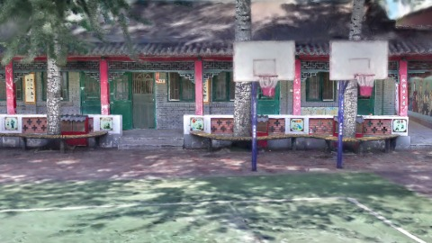
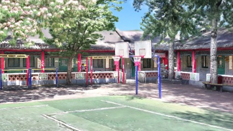
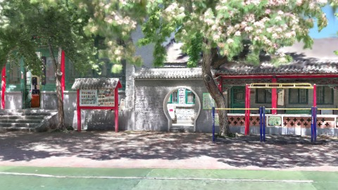
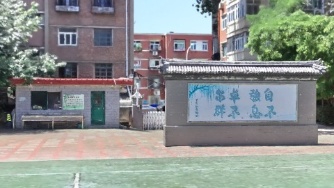

# Scene Profile Benchmark — 2026-08-12

## 本轮维度: profile

Suite: `public/benchmark-suites/scene-chengjian-v7-budget-6.json`

Renderer: `webgpu`

## 运行条件

- Cold start: yes
- Browser session: fresh-chromium-per-case
- Chromium HTTP cache: disabled-cdp-clearBrowserCache-zero-disk-cache
- Cold start (default): fresh Chromium per case, HTTP cache disabled
- OS 页缓存 / GPU 编译缓存：脚本不控制，跨次运行可能仍有差异

| label | presetId | budget | lodMode | lodRuntime | firstFrameMs | jsHeap@1st | vram@1st | jsHeapPeak | vramPeak | fpsP50 | fpsP95 | gsplatsAvgM |
|-------|----------|--------|---------|------------|--------------|------------|----------|------------|----------|--------|--------|-------------|
| chengjian-v7-distance-budget-6 | undefined | 6 | - | refinement | 14226.899999856949 | 131 | 232 | 458 | 464 | 59.0 | 60.0 | 3.79 |

## 交互巡检（糊→清晰）

### chengjian-v7-distance-budget-6

播放段 FPS: P50=59.0, P95=60.0, min=50.0, 总播放=2879ms

| waypoint | animTimeSec | moveMs | pendingPeak | blurToClearMs | fpsP50(refine) | fpsP95(refine) | fpsMin | gsplatsAtClearM | jsHeap@clear | vram@clear | jsHeapPeak | vramPeak | timeout |
|----------|-------------|--------|-------------|---------------|----------------|----------------|--------|-----------------|--------------|------------|------------|----------|---------|
| kf-0 | 0.00 | 0 | 64 | 19401 | 60.0 | 60.0 | 59.0 | 2.55 | 257 | 279 | 257 | 301 | N |
| kf-1 | 1.00 | 966 | 45 | 18198 | 60.0 | 60.0 | 58.0 | 4.62 | 284 | 367 | 307 | 367 | N |
| kf-2 | 2.00 | 950 | 48 | 32201 | 59.0 | 60.0 | 44.0 | 5.90 | 424 | 452 | 434 | 456 | N |
| kf-3 | 3.00 | 963 | 36 | 19801 | 60.0 | 60.0 | 53.0 | 2.09 | 346 | 401 | 458 | 464 | N |

变清晰截图（480×270 JPEG）：

**kf-0**

**kf-1**

**kf-2**

**kf-3**

## 优化前 vs 优化后

### chengjian-v7-budget（基线 `chengjian-v7-distance-budget-6`）

| case | lodMode | lodRuntime | firstFrameMs | kf-1 blur | kf-2 blur | blur P90 | vramPeak | poolEvictions |
|------|---------|------------|--------------|-----------|-----------|----------|----------|---------------|
| chengjian-v7-distance-budget-6 | - | refinement | 14227 (—) | 18198 (—) | 32201 | 32201 | 464 | - |

## 结论

- 见上方对比表；`bottleneckHint` 见 `results.json`（scheduler / asset-http / mixed）