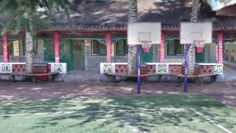
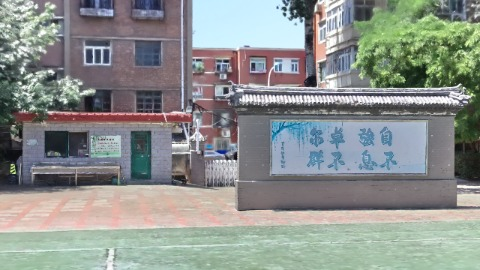
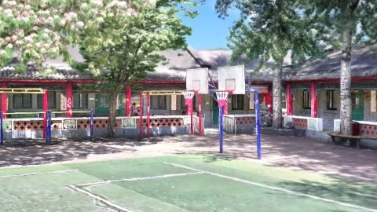
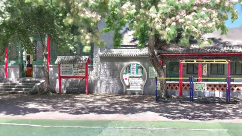
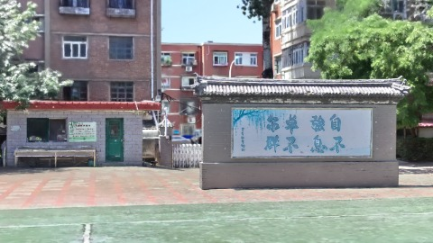
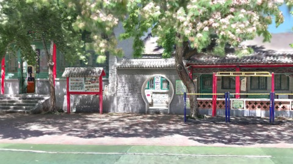

# Scene Profile Benchmark — 2026-08-12

## 本轮维度: profile

Suite: `public/benchmark-suites/scene-chengjian-v7-budget-ab.json`

Renderer: `webgpu`

## 运行条件

- Cold start: yes
- Browser session: fresh-chromium-per-case
- Chromium HTTP cache: disabled-cdp-clearBrowserCache-zero-disk-cache
- Cold start (default): fresh Chromium per case, HTTP cache disabled
- OS 页缓存 / GPU 编译缓存：脚本不控制，跨次运行可能仍有差异

| label | presetId | budget | lodMode | lodRuntime | firstFrameMs | jsHeap@1st | vram@1st | jsHeapPeak | vramPeak | fpsP50 | fpsP95 | gsplatsAvgM |
|-------|----------|--------|---------|------------|--------------|------------|----------|------------|----------|--------|--------|-------------|
| chengjian-v7-distance-budget-2.5 | undefined | 2.5 | - | refinement | 15179.5 | 113 | 140 | 379 | 321 | 60.0 | 60.0 | 2.35 |
| chengjian-v7-distance-budget-4 | undefined | 4 | - | refinement | 14644.200000047684 | 133 | 187 | 412 | 375 | 60.0 | 60.0 | 3.12 |
| chengjian-v7-distance-budget-6 | undefined | 6 | - | refinement | 15210.5 | 135 | 238 | 440 | 453 | 59.0 | 60.0 | 3.80 |

## 交互巡检（糊→清晰）

### chengjian-v7-distance-budget-2.5

播放段 FPS: P50=60.0, P95=60.0, min=59.0, 总播放=2898ms

| waypoint | animTimeSec | moveMs | pendingPeak | blurToClearMs | fpsP50(refine) | fpsP95(refine) | fpsMin | gsplatsAtClearM | jsHeap@clear | vram@clear | jsHeapPeak | vramPeak | timeout |
|----------|-------------|--------|-------------|---------------|----------------|----------------|--------|-----------------|--------------|------------|------------|----------|---------|
| kf-0 | 0.00 | 0 | 64 | 19801 | 60.0 | 60.0 | 59.0 | 2.41 | 212 | 196 | 233 | 208 | N |
| kf-1 | 1.00 | 967 | 28 | 23200 | 60.0 | 60.0 | 59.0 | 2.43 | 260 | 247 | 284 | 247 | N |
| kf-2 | 2.00 | 966 | 32 | 16198 | 60.0 | 60.0 | 59.0 | 2.45 | 314 | 286 | 332 | 288 | N |
| kf-3 | 3.00 | 965 | 45 | 26401 | 60.0 | 60.0 | 59.0 | 2.09 | 355 | 319 | 379 | 321 | N |

变清晰截图（480×270 JPEG）：

**kf-0**

**kf-1**

**kf-2**

**kf-3**

### chengjian-v7-distance-budget-4

播放段 FPS: P50=60.0, P95=60.0, min=59.0, 总播放=2882ms

| waypoint | animTimeSec | moveMs | pendingPeak | blurToClearMs | fpsP50(refine) | fpsP95(refine) | fpsMin | gsplatsAtClearM | jsHeap@clear | vram@clear | jsHeapPeak | vramPeak | timeout |
|----------|-------------|--------|-------------|---------------|----------------|----------------|--------|-----------------|--------------|------------|------------|----------|---------|
| kf-0 | 0.00 | 0 | 64 | 33001 | 60.0 | 60.0 | 59.0 | 2.55 | 273 | 232 | 296 | 265 | N |
| kf-1 | 1.00 | 966 | 50 | 24400 | 60.0 | 60.0 | 59.0 | 3.87 | 316 | 320 | 352 | 320 | N |
| kf-2 | 2.00 | 967 | 34 | 32601 | 60.0 | 60.0 | 59.0 | 3.88 | 350 | 352 | 376 | 361 | N |
| kf-3 | 3.00 | 949 | 35 | 24800 | 60.0 | 60.0 | 59.0 | 2.17 | 367 | 360 | 412 | 375 | N |

变清晰截图（480×270 JPEG）：

**kf-0**

**kf-1**

**kf-2**

**kf-3**

### chengjian-v7-distance-budget-6

播放段 FPS: P50=59.0, P95=60.0, min=49.0, 总播放=2864ms

| waypoint | animTimeSec | moveMs | pendingPeak | blurToClearMs | fpsP50(refine) | fpsP95(refine) | fpsMin | gsplatsAtClearM | jsHeap@clear | vram@clear | jsHeapPeak | vramPeak | timeout |
|----------|-------------|--------|-------------|---------------|----------------|----------------|--------|-----------------|--------------|------------|------------|----------|---------|
| kf-0 | 0.00 | 0 | 64 | 22600 | 60.0 | 60.0 | 59.0 | 2.55 | 202 | 304 | 249 | 304 | N |
| kf-1 | 1.00 | 966 | 40 | 13400 | 60.0 | 60.0 | 59.0 | 4.62 | 267 | 337 | 277 | 340 | N |
| kf-2 | 2.00 | 950 | 44 | 37001 | 59.0 | 60.0 | 45.0 | 5.87 | 408 | 440 | 424 | 451 | N |
| kf-3 | 3.00 | 948 | 45 | 23806 | 60.0 | 60.0 | 52.0 | 2.17 | 412 | 391 | 440 | 453 | N |

变清晰截图（480×270 JPEG）：

**kf-0**

**kf-1**

**kf-2**

**kf-3**

## 优化前 vs 优化后

### chengjian-v7-budget（基线 `chengjian-v7-distance-budget-2.5`）

| case | lodMode | lodRuntime | firstFrameMs | kf-1 blur | kf-2 blur | blur P90 | vramPeak | poolEvictions |
|------|---------|------------|--------------|-----------|-----------|----------|----------|---------------|
| chengjian-v7-distance-budget-2.5 | - | refinement | 15180 (—) | 23200 (—) | 16198 | 26401 | 321 | - |
| chengjian-v7-distance-budget-4 | - | refinement | 14644 (-3.5%) | 24400 (5.2%) | 32601 | 33001 | 375 | - |
| chengjian-v7-distance-budget-6 | - | refinement | 15211 (0.2%) | 13400 (-42.2%) | 37001 | 37001 | 453 | - |

## 结论

- 见上方对比表；`bottleneckHint` 见 `results.json`（scheduler / asset-http / mixed）