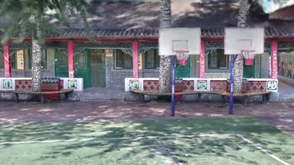
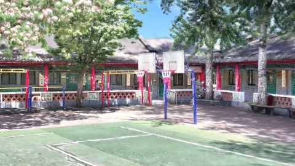
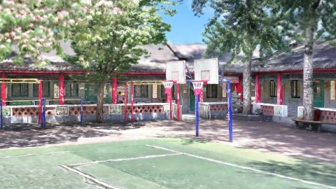
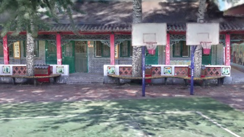
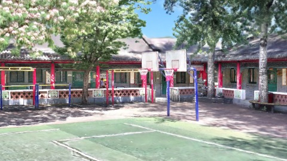
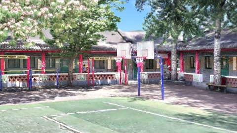
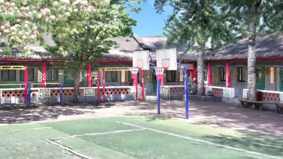

# Scene Profile Benchmark — 2026-08-12

## 本轮维度: profile

Suite: `public/benchmark-suites/scene-chengjian-v7-kf1-budget-repeats.json`

Renderer: `webgpu`

## 运行条件

- Cold start: yes
- Browser session: fresh-chromium-per-case
- Chromium HTTP cache: disabled-cdp-clearBrowserCache-zero-disk-cache
- Cold start (default): fresh Chromium per case, HTTP cache disabled
- OS 页缓存 / GPU 编译缓存：脚本不控制，跨次运行可能仍有差异

| label | presetId | budget | lodMode | lodRuntime | firstFrameMs | jsHeap@1st | vram@1st | jsHeapPeak | vramPeak | fpsP50 | fpsP95 | gsplatsAvgM |
|-------|----------|--------|---------|------------|--------------|------------|----------|------------|----------|--------|--------|-------------|
| cj-b2.5-r1 | undefined | 2.5 | - | refinement | 4456.100000143051 | 122 | 148 | 298 | 260 | 60.0 | 60.0 | 2.42 |
| cj-b2.5-r2 | undefined | 2.5 | - | refinement | 4831.5 | 120 | 148 | 313 | 255 | 60.0 | 60.0 | 2.43 |
| cj-b2.5-r3 | undefined | 2.5 | - | refinement | 4542.600000143051 | 128 | 144 | 246 | 226 | 60.0 | 60.0 | 2.41 |
| cj-b4-r1 | undefined | 4 | - | refinement | 97418.79999995232 | 157 | 185 | 343 | 316 | 60.0 | 60.0 | 3.20 |
| cj-b4-r2 | undefined | 4 | - | refinement | 3867.5999999046326 | 123 | 187 | 304 | 313 | 60.0 | 60.0 | 3.23 |
| cj-b4-r3 | undefined | 4 | - | refinement | 3684 | 122 | 189 | 325 | 327 | 60.0 | 60.0 | 3.21 |
| cj-b6-r1 | undefined | 6 | - | refinement | 3794.7000000476837 | 123 | 240 | 301 | 354 | 60.0 | 60.0 | 3.59 |
| cj-b6-r2 | undefined | 6 | - | refinement | 3886.300000190735 | 122 | 242 | 300 | 352 | 59.0 | 60.0 | 3.59 |
| cj-b6-r3 | undefined | 6 | - | refinement | 4111.800000190735 | 121 | 240 | 311 | 364 | 60.0 | 60.0 | 3.59 |

## 交互巡检（糊→清晰）

### cj-b2.5-r1

播放段 FPS: P50=60.0, P95=60.0, min=60.0, 总播放=966ms

| waypoint | animTimeSec | moveMs | pendingPeak | blurToClearMs | fpsP50(refine) | fpsP95(refine) | fpsMin | gsplatsAtClearM | jsHeap@clear | vram@clear | jsHeapPeak | vramPeak | timeout |
|----------|-------------|--------|-------------|---------------|----------------|----------------|--------|-----------------|--------------|------------|------------|----------|---------|
| kf-0 | 0.00 | 0 | 64 | 5201 | 60.0 | 60.0 | 60.0 | 2.41 | 222 | 221 | 239 | 224 | N |
| kf-1 | 1.00 | 966 | 30 | 3400 | 60.0 | 60.0 | 59.0 | 2.43 | 273 | 253 | 298 | 260 | N |

变清晰截图（480×270 JPEG）：

**kf-0**

**kf-1**

### cj-b2.5-r2

播放段 FPS: P50=60.0, P95=60.0, min=60.0, 总播放=950ms

| waypoint | animTimeSec | moveMs | pendingPeak | blurToClearMs | fpsP50(refine) | fpsP95(refine) | fpsMin | gsplatsAtClearM | jsHeap@clear | vram@clear | jsHeapPeak | vramPeak | timeout |
|----------|-------------|--------|-------------|---------------|----------------|----------------|--------|-----------------|--------------|------------|------------|----------|---------|
| kf-0 | 0.00 | 0 | 64 | 4801 | 60.0 | 60.0 | 59.0 | 2.41 | 216 | 219 | 224 | 221 | N |
| kf-1 | 1.00 | 950 | 21 | 3206 | 60.0 | 60.0 | 59.0 | 2.45 | 279 | 253 | 313 | 255 | N |

变清晰截图（480×270 JPEG）：

**kf-0**

**kf-1**

### cj-b2.5-r3

播放段 FPS: P50=60.0, P95=60.0, min=59.0, 总播放=966ms

| waypoint | animTimeSec | moveMs | pendingPeak | blurToClearMs | fpsP50(refine) | fpsP95(refine) | fpsMin | gsplatsAtClearM | jsHeap@clear | vram@clear | jsHeapPeak | vramPeak | timeout |
|----------|-------------|--------|-------------|---------------|----------------|----------------|--------|-----------------|--------------|------------|------------|----------|---------|
| kf-0 | 0.00 | 0 | 64 | 19401 | 60.0 | 60.0 | 59.0 | 2.41 | 217 | 212 | 227 | 212 | N |
| kf-1 | 1.00 | 966 | 28 | - | 60.0 | 60.0 | 58.0 | - | - | - | 246 | 226 | Y |

变清晰截图（480×270 JPEG）：

**kf-0**

**kf-1**

### cj-b4-r1

播放段 FPS: P50=60.0, P95=60.0, min=60.0, 总播放=966ms

| waypoint | animTimeSec | moveMs | pendingPeak | blurToClearMs | fpsP50(refine) | fpsP95(refine) | fpsMin | gsplatsAtClearM | jsHeap@clear | vram@clear | jsHeapPeak | vramPeak | timeout |
|----------|-------------|--------|-------------|---------------|----------------|----------------|--------|-----------------|--------------|------------|------------|----------|---------|
| kf-0 | 0.00 | 0 | 64 | 3601 | 60.0 | 60.0 | 59.0 | 2.55 | 246 | 263 | 254 | 263 | N |
| kf-1 | 1.00 | 966 | 36 | 4601 | 59.0 | 60.0 | 59.0 | 3.85 | 299 | 313 | 343 | 316 | N |

变清晰截图（480×270 JPEG）：

**kf-0**

**kf-1**

### cj-b4-r2

播放段 FPS: P50=60.0, P95=60.0, min=60.0, 总播放=950ms

| waypoint | animTimeSec | moveMs | pendingPeak | blurToClearMs | fpsP50(refine) | fpsP95(refine) | fpsMin | gsplatsAtClearM | jsHeap@clear | vram@clear | jsHeapPeak | vramPeak | timeout |
|----------|-------------|--------|-------------|---------------|----------------|----------------|--------|-----------------|--------------|------------|------------|----------|---------|
| kf-0 | 0.00 | 0 | 64 | 3601 | 60.0 | 60.0 | 59.0 | 2.55 | 203 | 263 | 256 | 263 | N |
| kf-1 | 1.00 | 950 | 37 | 5000 | 60.0 | 60.0 | 59.0 | 3.91 | 304 | 312 | 304 | 313 | N |

变清晰截图（480×270 JPEG）：

**kf-0**

**kf-1**

### cj-b4-r3

播放段 FPS: P50=60.0, P95=60.0, min=59.0, 总播放=966ms

| waypoint | animTimeSec | moveMs | pendingPeak | blurToClearMs | fpsP50(refine) | fpsP95(refine) | fpsMin | gsplatsAtClearM | jsHeap@clear | vram@clear | jsHeapPeak | vramPeak | timeout |
|----------|-------------|--------|-------------|---------------|----------------|----------------|--------|-----------------|--------------|------------|------------|----------|---------|
| kf-0 | 0.00 | 0 | 64 | 3608 | 60.0 | 60.0 | 59.0 | 2.55 | 226 | 253 | 232 | 272 | N |
| kf-1 | 1.00 | 966 | 38 | 3999 | 60.0 | 60.0 | 59.0 | 3.86 | 315 | 318 | 325 | 327 | N |

变清晰截图（480×270 JPEG）：

**kf-0**

**kf-1**

### cj-b6-r1

播放段 FPS: P50=60.0, P95=60.0, min=60.0, 总播放=966ms

| waypoint | animTimeSec | moveMs | pendingPeak | blurToClearMs | fpsP50(refine) | fpsP95(refine) | fpsMin | gsplatsAtClearM | jsHeap@clear | vram@clear | jsHeapPeak | vramPeak | timeout |
|----------|-------------|--------|-------------|---------------|----------------|----------------|--------|-----------------|--------------|------------|------------|----------|---------|
| kf-0 | 0.00 | 0 | 64 | 3600 | 60.0 | 60.0 | 60.0 | 2.55 | 196 | 310 | 236 | 310 | N |
| kf-1 | 1.00 | 966 | 33 | 3199 | 60.0 | 60.0 | 60.0 | 4.62 | 266 | 341 | 301 | 354 | N |

变清晰截图（480×270 JPEG）：

**kf-0**

**kf-1**

### cj-b6-r2

播放段 FPS: P50=59.0, P95=60.0, min=59.0, 总播放=950ms

| waypoint | animTimeSec | moveMs | pendingPeak | blurToClearMs | fpsP50(refine) | fpsP95(refine) | fpsMin | gsplatsAtClearM | jsHeap@clear | vram@clear | jsHeapPeak | vramPeak | timeout |
|----------|-------------|--------|-------------|---------------|----------------|----------------|--------|-----------------|--------------|------------|------------|----------|---------|
| kf-0 | 0.00 | 0 | 64 | 3401 | 59.0 | 60.0 | 59.0 | 2.55 | 205 | 310 | 243 | 310 | N |
| kf-1 | 1.00 | 950 | 32 | 2400 | 60.0 | 60.0 | 59.0 | 4.63 | 282 | 340 | 300 | 352 | N |

变清晰截图（480×270 JPEG）：

**kf-0**

**kf-1**

### cj-b6-r3

播放段 FPS: P50=60.0, P95=60.0, min=60.0, 总播放=964ms

| waypoint | animTimeSec | moveMs | pendingPeak | blurToClearMs | fpsP50(refine) | fpsP95(refine) | fpsMin | gsplatsAtClearM | jsHeap@clear | vram@clear | jsHeapPeak | vramPeak | timeout |
|----------|-------------|--------|-------------|---------------|----------------|----------------|--------|-----------------|--------------|------------|------------|----------|---------|
| kf-0 | 0.00 | 0 | 64 | 3600 | 60.0 | 60.0 | 59.0 | 2.55 | 206 | 313 | 227 | 313 | N |
| kf-1 | 1.00 | 964 | 34 | 3600 | 59.0 | 60.0 | 58.0 | 4.62 | 273 | 356 | 311 | 364 | N |

变清晰截图（480×270 JPEG）：

**kf-0**

**kf-1**

## 优化前 vs 优化后

### cj-kf1-b2.5（基线 `cj-b2.5-r1`）

| case | lodMode | lodRuntime | firstFrameMs | kf-1 blur | kf-2 blur | blur P90 | vramPeak | poolEvictions |
|------|---------|------------|--------------|-----------|-----------|----------|----------|---------------|
| cj-b2.5-r1 | - | refinement | 4456 (—) | 3400 (—) | - | 5201 | 260 | - |
| cj-b2.5-r2 | - | refinement | 4832 (8.4%) | 3206 (-5.7%) | - | 4801 | 255 | - |
| cj-b2.5-r3 | - | refinement | 4543 (1.9%) | - (-%) | - | 19401 | 226 | - |

### cj-kf1-b4（基线 `cj-b4-r1`）

| case | lodMode | lodRuntime | firstFrameMs | kf-1 blur | kf-2 blur | blur P90 | vramPeak | poolEvictions |
|------|---------|------------|--------------|-----------|-----------|----------|----------|---------------|
| cj-b4-r1 | - | refinement | 97419 (—) | 4601 (—) | - | 4601 | 316 | - |
| cj-b4-r2 | - | refinement | 3868 (-96.0%) | 5000 (8.7%) | - | 5000 | 313 | - |
| cj-b4-r3 | - | refinement | 3684 (-96.2%) | 3999 (-13.1%) | - | 3999 | 327 | - |

### cj-kf1-b6（基线 `cj-b6-r1`）

| case | lodMode | lodRuntime | firstFrameMs | kf-1 blur | kf-2 blur | blur P90 | vramPeak | poolEvictions |
|------|---------|------------|--------------|-----------|-----------|----------|----------|---------------|
| cj-b6-r1 | - | refinement | 3795 (—) | 3199 (—) | - | 3600 | 354 | - |
| cj-b6-r2 | - | refinement | 3886 (2.4%) | 2400 (-25.0%) | - | 3401 | 352 | - |
| cj-b6-r3 | - | refinement | 4112 (8.4%) | 3600 (12.5%) | - | 3600 | 364 | - |

## 结论

- 见上方对比表；`bottleneckHint` 见 `results.json`（scheduler / asset-http / mixed）