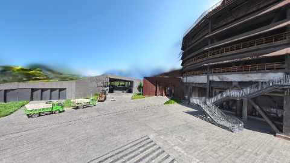
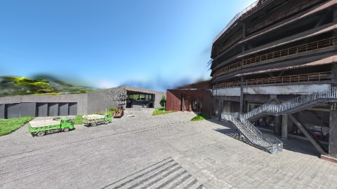
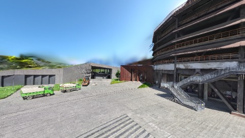

# Scene Profile Benchmark — 2026-08-12

## 本轮维度: profile

Suite: `public/benchmark-suites/scene-nanguangchang-v6-0.5-budget-ab.json`

Renderer: `webgpu`

## 运行条件

- Cold start: yes
- Browser session: fresh-chromium-per-case
- Chromium HTTP cache: disabled-cdp-clearBrowserCache-zero-disk-cache
- Cold start (default): fresh Chromium per case, HTTP cache disabled
- OS 页缓存 / GPU 编译缓存：脚本不控制，跨次运行可能仍有差异

| label | presetId | budget | lodMode | lodRuntime | firstFrameMs | jsHeap@1st | vram@1st | jsHeapPeak | vramPeak | fpsP50 | fpsP95 | gsplatsAvgM |
|-------|----------|--------|---------|------------|--------------|------------|----------|------------|----------|--------|--------|-------------|
| nanguangchang-v6-0.5-budget-2.5 | undefined | 2.5 | - | refinement | 18939.799999952316 | 205 | 171 | 385 | 322 | 60.0 | 60.0 | 2.42 |
| nanguangchang-v6-0.5-budget-4 | undefined | 4 | - | refinement | 25147.799999952316 | 185 | 228 | 484 | 447 | 59.0 | 59.0 | 3.92 |
| nanguangchang-v6-0.5-budget-6 | undefined | 6 | - | refinement | 29691.299999952316 | 220 | 296 | 578 | 571 | 45.0 | 45.0 | 5.84 |

## 交互巡检（糊→清晰）

### nanguangchang-v6-0.5-budget-2.5

播放段 FPS: P50=60.0, P95=60.0, min=60.0, 总播放=986ms

| waypoint | animTimeSec | moveMs | pendingPeak | blurToClearMs | fpsP50(refine) | fpsP95(refine) | fpsMin | gsplatsAtClearM | jsHeap@clear | vram@clear | jsHeapPeak | vramPeak | timeout |
|----------|-------------|--------|-------------|---------------|----------------|----------------|--------|-----------------|--------------|------------|------------|----------|---------|
| kf-0 | 0.00 | 0 | 63 | 26601 | 60.0 | 60.0 | 57.0 | 2.47 | 281 | 256 | 313 | 260 | N |
| kf-1 | 1.00 | 986 | 58 | 32397 | 60.0 | 60.0 | 51.0 | 2.37 | 374 | 322 | 385 | 322 | N |

变清晰截图（480×270 JPEG）：

**kf-0**

**kf-1**

### nanguangchang-v6-0.5-budget-4

播放段 FPS: P50=59.0, P95=59.0, min=59.0, 总播放=974ms

| waypoint | animTimeSec | moveMs | pendingPeak | blurToClearMs | fpsP50(refine) | fpsP95(refine) | fpsMin | gsplatsAtClearM | jsHeap@clear | vram@clear | jsHeapPeak | vramPeak | timeout |
|----------|-------------|--------|-------------|---------------|----------------|----------------|--------|-----------------|--------------|------------|------------|----------|---------|
| kf-0 | 0.00 | 0 | 64 | 33401 | 59.0 | 60.0 | 53.0 | 3.96 | 378 | 356 | 393 | 360 | N |
| kf-1 | 1.00 | 974 | 64 | 48002 | 60.0 | 60.0 | 51.0 | 3.89 | 484 | 447 | 484 | 447 | N |

变清晰截图（480×270 JPEG）：

**kf-0**

**kf-1**

### nanguangchang-v6-0.5-budget-6

播放段 FPS: P50=45.0, P95=45.0, min=45.0, 总播放=948ms

| waypoint | animTimeSec | moveMs | pendingPeak | blurToClearMs | fpsP50(refine) | fpsP95(refine) | fpsMin | gsplatsAtClearM | jsHeap@clear | vram@clear | jsHeapPeak | vramPeak | timeout |
|----------|-------------|--------|-------------|---------------|----------------|----------------|--------|-----------------|--------------|------------|------------|----------|---------|
| kf-0 | 0.00 | 0 | 64 | 48211 | 59.0 | 60.0 | 47.0 | 5.87 | 433 | 480 | 457 | 482 | N |
| kf-1 | 1.00 | 948 | 64 | 59202 | 60.0 | 60.0 | 45.0 | 5.80 | 554 | 567 | 578 | 571 | N |

变清晰截图（480×270 JPEG）：

**kf-0**

**kf-1**

## 优化前 vs 优化后

### nanguangchang-v6-0.5-budget（基线 `nanguangchang-v6-0.5-budget-2.5`）

| case | lodMode | lodRuntime | firstFrameMs | kf-1 blur | kf-2 blur | blur P90 | vramPeak | poolEvictions |
|------|---------|------------|--------------|-----------|-----------|----------|----------|---------------|
| nanguangchang-v6-0.5-budget-2.5 | - | refinement | 18940 (—) | 32397 (—) | - | 32397 | 322 | - |
| nanguangchang-v6-0.5-budget-4 | - | refinement | 25148 (32.8%) | 48002 (48.2%) | - | 48002 | 447 | - |
| nanguangchang-v6-0.5-budget-6 | - | refinement | 29691 (56.8%) | 59202 (82.7%) | - | 59202 | 571 | - |

## 结论

- 见上方对比表；`bottleneckHint` 见 `results.json`（scheduler / asset-http / mixed）