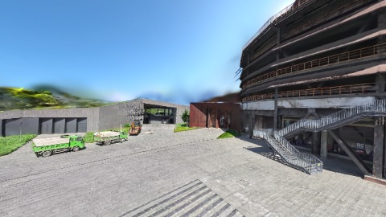

# Scene Profile Benchmark — 2026-08-12

## 本轮维度: profile

Suite: `public/benchmark-suites/scene-nanguangchang-v6-0.5.json`

Renderer: `webgpu`

## 运行条件

- Cold start: yes
- Browser session: fresh-chromium-per-case
- Chromium HTTP cache: disabled-cdp-clearBrowserCache-zero-disk-cache
- Cold start (default): fresh Chromium per case, HTTP cache disabled
- OS 页缓存 / GPU 编译缓存：脚本不控制，跨次运行可能仍有差异

| label | presetId | budget | lodMode | lodRuntime | firstFrameMs | jsHeap@1st | vram@1st | jsHeapPeak | vramPeak | fpsP50 | fpsP95 | gsplatsAvgM |
|-------|----------|--------|---------|------------|--------------|------------|----------|------------|----------|--------|--------|-------------|
| nanguangchang-v6-0.5-current-profile | undefined | - | - | refinement | 20495.700000047684 | 177 | 177 | 387 | 327 | 55.0 | 60.0 | 2.43 |

## 交互巡检（糊→清晰）

### nanguangchang-v6-0.5-current-profile

播放段 FPS: P50=55.0, P95=60.0, min=55.0, 总播放=969ms

| waypoint | animTimeSec | moveMs | pendingPeak | blurToClearMs | fpsP50(refine) | fpsP95(refine) | fpsMin | gsplatsAtClearM | jsHeap@clear | vram@clear | jsHeapPeak | vramPeak | timeout |
|----------|-------------|--------|-------------|---------------|----------------|----------------|--------|-----------------|--------------|------------|------------|----------|---------|
| kf-0 | 0.00 | 0 | 63 | 25600 | 60.0 | 60.0 | 59.0 | 2.48 | 315 | 260 | 319 | 265 | N |
| kf-1 | 1.00 | 969 | 55 | 32001 | 60.0 | 60.0 | 55.0 | 2.37 | 386 | 325 | 387 | 327 | N |

变清晰截图（480×270 JPEG）：

**kf-0**

**kf-1**

## 优化前 vs 优化后

### default（基线 `nanguangchang-v6-0.5-current-profile`）

| case | lodMode | lodRuntime | firstFrameMs | kf-1 blur | kf-2 blur | blur P90 | vramPeak | poolEvictions |
|------|---------|------------|--------------|-----------|-----------|----------|----------|---------------|
| nanguangchang-v6-0.5-current-profile | - | refinement | 20496 (—) | 32001 (—) | - | 32001 | 327 | - |

## 结论

- 见上方对比表；`bottleneckHint` 见 `results.json`（scheduler / asset-http / mixed）