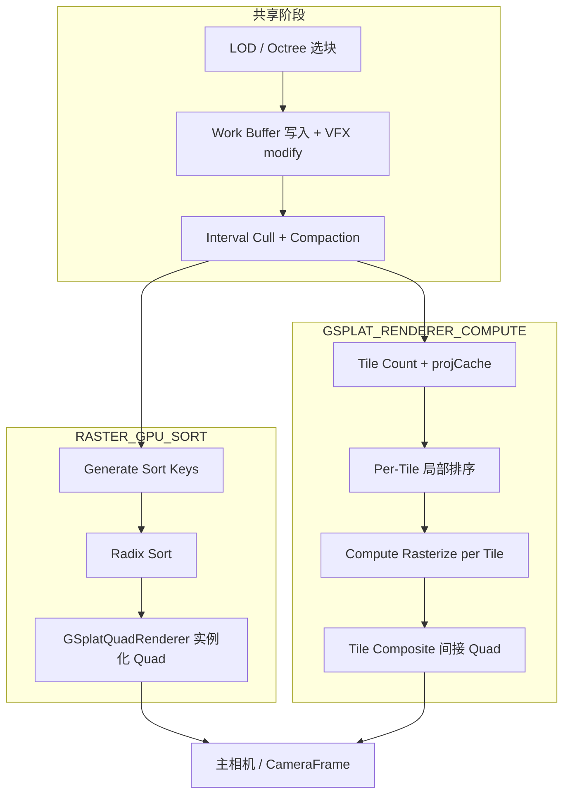

# Compute 高斯（GSplat）渲染原理说明

本文说明 **supersplat-viewer** 中基于 **WebGPU Compute** 的高斯点云渲染原理，以及与光栅（Raster）路径的差异。实现主体在依赖库 **PlayCanvas** 的 `scene/gsplat-unified/` 模块；本仓库负责 WebGPU 设备、Unified 加载、CameraFrame、VFX 与 Picker 等接入。

**相关文档**：

- [场景 GSplat 特效扩展指南](./场景GSplat特效扩展指南.md) — VFX 如何挂到 `gsplatModifyVS` / Work Buffer
- [标注放置 Picker 问题根因说明](./标注放置Picker问题根因说明.md) — unified / pick 与深度拾取
- [Bloom 与 NightMode 适配说明](./Bloom与NightMode适配说明.md) — 与 compute + CameraFrame 的时序

---

## 1. 背景：3D Gaussian Splatting 在画什么

每个高斯点（splat）大致包含：

| 属性 | 含义 |
|------|------|
| **center** | 3D 世界/模型空间位置 |
| **rotation + scale** | 协方差（椭圆形状与朝向） |
| **color + opacity** | 基色与不透明度；常带球谐（SH）随视角变化 |

渲染时需要：

1. 按 **深度从远到近** 排序（或等价地保证正确 alpha 合成顺序）；
2. 将每个 splat 投影为屏幕上的 **2D 高斯**（conic 形式）；
3. 对每个像素做 **front-to-back alpha 混合**（与半透明层叠类似）。

经典 3DGS 论文路径：**全局排序 + 每个 splat 画一个 instanced quad（四边形）**。

PlayCanvas 在 WebGPU 上提供另一条路径：**在 Compute 中完成投影、按屏幕 tile 分桶、局部排序与光栅化**，最后仅用 **稀疏 tile quad** 合成到主缓冲。

---

## 2. 本仓库中的分层结构

| 层级 | 位置 | 职责 |
|------|------|------|
| **引擎核心** | `node_modules/playcanvas` → `scene/gsplat-unified/` | Work Buffer、剔除/压缩、Compute 分块管线、`GSplatTileComposite` |
| **Viewer 接入** | `src/index.ts`、`src/viewer.ts`、`src/vfx/` | WebGPU 设备、`unified: true`、CameraFrame、VFX shader、Picker 分支 |
| **URL 开关** | `src/index.html` | `?compute`、`?webgpu`、`?gpu-sort`、`?cpu-sort` 等 |

业务逻辑（Reveal、Bloom、标注等）**不实现** Compute 光栅本身，而是通过 **Unified Work Buffer 阶段的 shader hook** 修改 splat 数据，再由引擎读取。

---

## 3. 四种渲染模式（`GSPLAT_RENDERER_*`）

引擎在 `app.scene.gsplat.renderer` 上配置（常量见 PlayCanvas `GSPLAT_RENDERER_*`）：

| 常量 | 值 | 含义 |
|------|-----|------|
| `GSPLAT_RENDERER_AUTO` | 0 | 自动；WebGL 回退 CPU 排序光栅 |
| `GSPLAT_RENDERER_RASTER_CPU_SORT` | 1 | **光栅**：Worker 计数排序，顶点着色器读 `orderBuffer` |
| `GSPLAT_RENDERER_RASTER_GPU_SORT` | 2 | **光栅**：GPU 剔除/压缩 → sort key → Radix 排序 → instanced quad |
| `GSPLAT_RENDERER_COMPUTE` | 3 | **Compute 分块管线**（仅 WebGPU，实验性） |

`GSplatManager`（引擎）文档中的分工：

- **CPU / GPU 光栅**：共享或部分共享 **interval compaction** 后，由 `GSplatQuadRenderer` 按排序结果画 quad。
- **Compute**：共享 **compaction**，之后走 `GSplatComputeLocalRenderer` 的 **tiled pipeline**，**不做全局 radix sort**。

### 3.1 URL 参数与 Viewer 行为

`src/index.html` 中：

- `?compute` → `config.renderer = 'compute'`
- `?webgpu` → macOS 用 `compute`，其它平台用 `gpu-sort`（注释：Mac 上 raster gpu-sort 易 stall）
- `?gpu-sort` / `?cpu-sort` → 对应字符串
- 默认 → `webgl`（CPU 排序光栅）

`src/index.ts` 中：

- `config.renderer !== 'webgl'` 时创建 **WebGPU** 设备；
- **未**在 `src/` 内将 `config.renderer` 映射到 `app.scene.gsplat.renderer`。若需强制 Compute，启动后应设置，例如：

```ts
import {
  GSPLAT_RENDERER_COMPUTE,
  GSPLAT_RENDERER_RASTER_GPU_SORT,
  GSPLAT_RENDERER_RASTER_CPU_SORT
} from 'playcanvas';

// 与 URL 对齐的示例
app.scene.gsplat.renderer = GSPLAT_RENDERER_COMPUTE;           // ?compute
// app.scene.gsplat.renderer = GSPLAT_RENDERER_RASTER_GPU_SORT; // ?gpu-sort
// app.scene.gsplat.renderer = GSPLAT_RENDERER_RASTER_CPU_SORT; // ?cpu-sort
```

`src/viewer.ts` 在 `rendererMode === 'compute'` 时会 **强制启用 CameraFrame**（含 `sceneDepthMap`），供 tile composite 与深度相关后处理使用，即使 `?nofx` 也会走该路径的 CameraFrame 壳子。

---

## 4. Unified 模式与 Work Buffer

本仓库加载主场景 splat 时使用 **`unified: true`**（见 `src/index.ts` `loadGsplat`）。

### 4.1 含义

- 多个 `gsplat` 实体共享 **场景级 Work Buffer** 与按 **相机 × Layer** 的材质；
- 每帧先把各 LOD / octree 选中的 splat **写入 Work Buffer**（MRT / storage），再由此供排序或 Compute 读取。

### 4.2 坐标空间（与 VFX 相关）

`src/viewer.ts` 注释（与引擎 `gsplatCopyToWorkbuffer` 一致）：

| `unified` | `modifySplatCenter` 等 hook 收到的坐标 |
|-----------|----------------------------------------|
| `true` | **世界空间**（CopyToWorkbuffer 内 `matrix_model * center` 之后） |
| `false` | **模型空间**（`getCenter()` 直接传入 VS） |

Reveal / persistent 等特效的 AABB、波前半径须与上述空间一致（见 `RevealController` 与 `viewer.ts` 中 `revealBbox` 分支）。

### 4.3 Work Buffer 写入

片段阶段（WGSL 概念，见 `gsplatCopyToWorkbuffer`）：

1. 按 splat 索引读源数据（center、rotation、scale、color、SH）；
2. 变换到世界空间，执行 **`modifySplatCenter` / `modifySplatRotationScale` / `modifySplatColor`**；
3. 编码写入 Work Buffer 各 stream（含可选 `GSPLAT_ID`）。

本仓库 VFX（`GsplatShaderEffect`）在 unified 下监听 `material:created`，向材质注入 `gsplatModifyVS` chunk，改的是 **进入 Work Buffer 之前** 的数据；Compute 光栅读到的已是修改后的 splat。

---

## 5. 共享阶段：Interval Compaction（可见 splat 列表）

**Compute** 与 **RASTER_GPU_SORT** 在排序前共享 `GSplatIntervalCompaction`（WebGPU only）：

```text
1. Cull + count（compute）
   每个 octree interval 的包围球 vs 视锥（或鱼眼锥）→ 写入 count buffer（剔除则为 0）

2. Prefix sum
   对 count 做 exclusive prefix sum → 每段偏移 + 总可见数 visibleCount

3. Scatter（compute）
   每 interval 一个 workgroup，将可见 splat 的 Work Buffer 像素索引写入 compactedSplatIds
```

**Compute 路径**：`GSplatManager` 在 `activeRenderer === GSPLAT_RENDERER_COMPUTE` 时 **只执行 compaction**，不生成全局 sort key、不做 radix sort。

---

## 6. Compute 分块管线（`GSplatComputeLocalRenderer`）

实现类：`GSplatComputeLocalRenderer`（PlayCanvas `scene/gsplat-unified/gsplat-compute-local-renderer.js`）。

下列步骤对应引擎类型注释中的 pass 列表。

### 6.1 Pass 1 — Tile count：投影 + projCache + 统计 tile 相交

Shader：`compute-gsplat-local-tile-count`（每线程一个可见 splat）。

- 从 Work Buffer 读 splat，投影到屏幕，计算 **2D conic**（`coeffX, coeffY, coeffXY`）、深度、颜色等；
- 写入 **`projCache`**（每 splat 固定 stride，供 raster 复用，避免重复读纹理）；
- 遍历 splat 在屏幕上覆盖的 **tile**（通常 **16×16 像素** 一块）：
  - 对 `tileSplatCounts` 做 `atomicAdd`；
  - 向 **pair buffer** 写入 `(tileIdx << 16 | localOffset)`；
- **大 splat**（屏幕 AABB 超过 **64 个 tile**）：推迟到 **Pass 1b**（256 线程协作），避免单线程扫 tile 造成 wave 发散。

### 6.2 Pass 2 — Prefix sum

对 **每个 tile 的 splat 计数** 做 exclusive prefix sum，得到 `tileEntries` 起始偏移与总 entry 数。

### 6.3 Pass 3 — Place entries

- 普通 splat：每线程读 pair，**无原子**写入 `tileEntries`（offset + localOffset）；
- **Pass 3b**：大 splat 协作写入。

### 6.4 Pass 3.5 — Classify

扫描 tile，生成 **small / large / rasterize** 列表，写入 **indirect dispatch** 参数与非空 tile 列表 `rasterizeTileList`。

### 6.5 Pass 4 — 按 tile 深度排序

| 子 pass | 适用 | 算法 |
|---------|------|------|
| **4a Small tile sort** | 每 tile ≤ 4096 entries | Workgroup 内 **bitonic sort** |
| **4b Bucket pre-sort** | 大 tile | 对数深度 bucket 直方图 + scatter |
| **4c Chunk sort** | bucket 后的块 | 对每块 bitonic sort |

排序键为 **深度**，保证 tile 内 **从前到后** 混合。

### 6.6 Pass 5 — Rasterize（Compute 光栅）

Shader：`compute-gsplat-local-rasterize`（**一个 workgroup ≈ 一个非空 tile**）。

- 从 `tileEntries` 按批（如 64 splat）载入 **workgroup shared memory**；
- 每线程对应像素邻域，对 batch 内 splat 计算 2D 高斯：
  - `power = coeffX*dx² + coeffXY*dx*dy + coeffY*dy²`
  - `alpha = opacity * gaussian(power)`，更新透射率 `T` 与累积颜色；
- 支持：**early-out**（像素饱和）、**场景 depth test**、**fog**、**pick 模式**（`pickId` + 加权 depth 纹理）。

输出：**RGBA16F** 的整屏 splat 纹理（及 pick 用的 r32uint / depth 纹理）。

### 6.7 Tile Composite — 合成到主帧

`GSplatTileComposite`：

- **不**画全屏 quad，仅对 **非空 tile** 做 **间接绘制**；
- 顶点着色器 `gsplatTileCompositeVS` 用 `rasterizeTileList` + 内置 `vertexIndex` **程序化生成** 16×16 tile 的两个三角形；
- 片段着色器采样 compute 输出纹理，**预乘 alpha** 混合进 CameraFrame / 主 RT。

`FramePassGSplatComputeLocal` 注册在相机 **beforePass**：先 dispatch compute，再进入常规场景合成。

---

## 7. 与光栅 + GPU 排序的对比



| 维度 | 光栅 + GPU Sort | Compute Tiled |
|------|-----------------|-----------------|
| 排序范围 | **全局** radix（所有可见 splat） | **按 tile 局部** bitonic / bucket |
| 绘制 API | 顶点 + 片段（大量 instance） | Compute + storage texture |
| Overdraw | 每 splat 一个 quad | 仅处理含 splat 的 tile |
| 平台 | WebGPU（sort）/ WebGL（CPU sort） | **仅 WebGPU** |
| macOS 策略 | `?webgpu` 默认倾向 **compute** | 同左 |

设备创建时 PlayCanvas 会跑 **`WebgpuComputeBenchmark`**，将 `computePerfIndex` 供 AUTO 选型参考（共享内存 + barrier + atomic 负载）。

---

## 8. 本仓库接入要点

### 8.1 VFX（Reveal / Persistent / Bloom 等）

- 基类：`src/vfx/effects-runtime/gsplat-shader-effect.ts`
- Unified：监听 `app.systems.gsplat` 的 `material:created`，patch `gsplatModifyVS` / `gsplatModifyPS`
- 与 **NightMode** 互斥、与 **compute 黑闪** 相关的 `frameend` 延后恢复，见 `docs/工作记录.md` 与 `reveal-controller.ts`

### 8.2 Picker

`src/picker.ts`：

| 渲染器 | 策略 |
|--------|------|
| **Compute** | 引擎 `Picker` + depth（tile composite / compute pick 已写 depth） |
| **光栅** | 自定义 `pickPS` + `RGBA16F` alpha 加权深度（见 [标注放置 Picker 问题根因说明](./标注放置Picker问题根因说明.md)） |

判断：`app.scene.gsplat.currentRenderer === GSPLAT_RENDERER_COMPUTE`。

### 8.3 CameraFrame 与 Gamma

`viewer.ts` 在 compute 或后处理需求下启用 `CameraFrame`，并 patch：

- `gsplatOutputVS` — 强制 gamma 空间输出；
- `gsplatTileCompositePS` — tile 合成；
- `skyboxPS` — 与 CameraFrame 色调映射一致。

### 8.4 性能与 LOD

- `app.scene.gsplat.splatBudget`、`lodRangeMin/Max`：大场景预算（`viewer.ts`）；
- `minContribution`、`minPixelSize`：Compute 剔除强度（引擎 `GSplatParams`）；
- `?budget=` URL 可覆盖百万 splat 量级预算。

---

## 9. 引擎侧关键文件索引（PlayCanvas）

| 模块 | 路径（相对 `node_modules/playcanvas/build/playcanvas/`） |
|------|----------------------------------------------------------|
| 管理器与模式切换 | `src/scene/gsplat-unified/gsplat-manager.js` |
| Compute 渲染器 | `src/scene/gsplat-unified/gsplat-compute-local-renderer.js` |
| Tile 合成 | `src/scene/gsplat-unified/gsplat-tile-composite.js` |
| Compaction | `src/scene/gsplat-unified/gsplat-interval-compaction.js` |
| Work Buffer | `src/scene/gsplat-unified/gsplat-work-buffer.js` |
| Compute WGSL | `src/scene/shader-lib/wgsl/chunks/gsplat/compute-gsplat-local-*.js` |
| 参数 API | `src/scene/gsplat-unified/gsplat-params.js` |

类型声明（`.d.ts`）与 dbg 源码（`playcanvas.dbg`）便于阅读注释，与 min 包逻辑一致。

---

## 10. 一句话总结

**Compute 高斯渲染** = Work Buffer 中的世界空间 splat → GPU 剔除压成可见列表 → **按屏幕 tile 分桶并局部深度排序** → **在 Compute 中对每个 tile 做 3DGS 式高斯混合** → **用稀疏 tile quad 合成到 CameraFrame**。

与经典路径的差别：把「**全局排序 + 每 splat 一个 draw**」改为「**每 tile 一组 compute + 间接合成**」，更适合 WebGPU 大场景，并缓解 macOS 上 raster gpu-sort 的 stall 问题。

---

*文档版本：与 PlayCanvas 引擎 gsplat-unified / compute-local 管线对齐；若引擎升级 pass 或常量名，请以 `node_modules/playcanvas` 内注释为准。*
