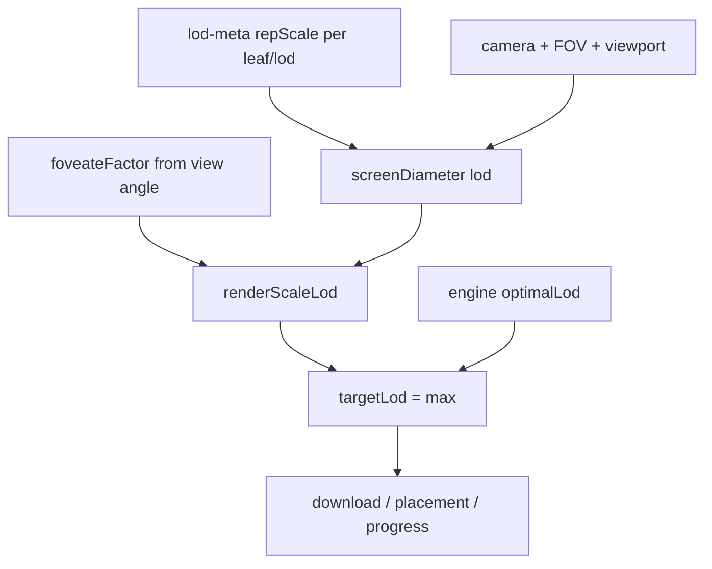

# lodRenderScale 机制说明（Chunk LOD 离散近似）

Spark 风格的「屏幕尺寸选档」在本仓库 Chunk LOD（leaf × L0…LN）上的落地设计。  
**不重做** splat tree / page pool；父节点兜底继续用「同叶更粗独立文件 + underfill」。

相关代码（P0 纯函数）：[`src/loaders/gsplat/lod/octree/lod-render-scale.ts`](../src/loaders/gsplat/lod/octree/lod-render-scale.ts)

---

## 1. 目标语义

当前主路径（见 [SCENE_PROFILE.md](SCENE_PROFILE.md)）：

```text
米制 d0/m → evaluateNodeLods → budget balancer → nodeInfo.optimalLod
→ refinement 下载/上屏（edgeFactor 只改 score / jumpSteps）
```

目标：

```text
renderScaleLod   ← 屏幕投影「清晰需要多少」
budgetOptimalLod ← 设备「最多承受多少」（引擎 balancer 后的 optimalLod）
targetLod = max(renderScaleLod, budgetOptimalLod)   // index 越大越粗
```

| 情况 | 行为 |
|------|------|
| budget 充足 | 停在 `renderScaleLod`，不追亚像素 |
| budget 不足 | 允许比视觉目标更粗 |
| budget 富余 | **不能**突破视觉目标继续填满 |

下载、上屏、bootstrap 收条全部以 `targetLod` 为准。

**为何可不拆「纯 budget」字段**：引擎 `optimalLod` 已含距离目标 + 预算加减档。与视觉目标取 max（更粗者胜）后：

- 距离/预算追得比视觉更细 → 被 `renderScaleLod` 拉回
- 预算被迫更粗 → 保留预算结果



---

## 2. 离线 `repScale`（P2 ✅，2026-08-07 口径优化）

每个 leaf、每个 LOD 档写入世界尺度直径分位数（`splat-transform` `write-lod`）：

```json
"lods": {
  "0": {
    "file": 12, "offset": 0, "count": 540,
    "repScale": { "p50": 0.012, "p75": 0.018, "p90": 0.031 }
  }
}
```

并写顶栏旁路（引擎会把 `tree` 置 null，viewer 读此表）：

```json
"leafRepScale": [ [0.012, 0.02, ...], ... ]
```

叶顺序与 PlayCanvas DFS extract 一致。旁路值为**选档直径**（见下），不是整 SOG 汇总。

统计定义：

- 单 Gaussian 直径：最大两根 covariance 轴（`exp(scale)` top-2）几何平均 ×2 → `2√(r1×r2)`
- 权重：**仅** `sigmoid(opacity)`（去掉 `×(r1×r2)`，避免大块覆盖高斯主导）
- 分位：P50 / P75 / P90；再做密度帽  
  `cap = 0.45 × leafAabbDiagonal / cbrt(count)`，各分位 `min` 到 cap
- **选档主用旁路 `leafRepScale` = 帽后 P50**；`lods[].repScale` 仍保留帽后 P50/P75/P90 供调试
- 协议字段名从 `leafRepScaleP75` **升级为** `leafRepScale`（无旧字段兼容；需重导资产）

旧资产无字段时运行时走 AABB fallback。

---

## 3. 运行时投影与选档

```text
pixelFactor = viewportHeight / (2 × tan(verticalFov / 2))

screenDiameter[lod] =
    representativeDiameter[lod]   // leafRepScale[leaf][lod]（帽后 P50）
    × pixelFactor
    / max(distanceToLeaf, eps)
```

约定 **LOD0 最细**。选满足：

- `screenDiameter[lod] >= effectiveRenderScale`
- 且下一细档：`lod === 0` 或 `screenDiameter[lod - 1] < effectiveRenderScale`

的那一档。直观例（`lodRenderScale = 1` → LOD1）：

| LOD | 约屏上直径 |
|-----|------------|
| 5 | 20px |
| 4 | 10px |
| 3 | 5px |
| 2 | 2.5px |
| 1 | 1.2px |
| 0 | 0.6px |

全部小于阈值时退到最粗档。

**Fallback（无 repScale）**：`k × leafAabbDiagonal / cbrt(count[lod])`，仅联调。

---

## 4. Foveation

```text
effectiveRenderScale = baseRenderScale / foveateFactor
```

按视线夹角连续插值（对齐 Spark `coneFov0 / coneFov / coneFoveate / behindFoveate`）：

| 参数 | 默认 | 含义 |
|------|------|------|
| `lodRenderScale` | `1.0` | 中央目标屏上直径（px） |
| `coneFov0` | `20°` | 全细节锥（factor=1） |
| `coneFov` | `80°` | 外锥边缘（factor→`coneFoveate`） |
| `coneFoveate` | `0.5` | 外锥边缘因子 |
| `behindFoveate` | `0.2` | 身后因子 |

中央目标更小 px → 更细；边缘/身后因子下降 → 更大 px 目标 → 更粗 LOD。  
相对现有 `edgeFactor`：选档改由 foveation 驱动；下载排序后续用 `visualUrgency`（P3）。

---

## 5. 与 budget / refinement 合并（P1 ✅）

挂点：`refinement-controller` 在读完引擎 `optimalLod` 之后、`computeRefinementTargetLod` 之前：

```ts
const budgetOptimalLod = nodeInfo.optimalLod;
const renderScaleLod = selectRenderScaleLod(...);
const visualBudgetLod = Math.max(renderScaleLod, budgetOptimalLod);
nodeInfo.optimalLod = visualBudgetLod;
```

上屏路径：挂在 OOF `applyLodChanges` 稳定器钩子上（`lod-render-scale-runtime.bindRenderScaleApplyHooks`）：

```text
hold 前快照（仅统计）→ lodViewHold / OOF → renderScale 钳制 → 引擎 apply
```

- 须在 hold **之后**钳制，否则 hold 会撤掉变粗。
- merge 基准用 **OOF 之后的** `optimalLod`，禁止用 hold 前细档快照覆盖视锥外 bootstrap（否则 Out fill / 总 opt 虚高）。
- 扫描路径只算下载 `targetLod`（`writeBack: false`），不写回 `nodeInfo`。

`sceneProfile` 开关（默认保持距离选档）：

```json
{
  "sceneProfile": {
    "lodSelectMode": "renderScale",
    "lodRenderScale": 1.0,
    "coneFov0": 20,
    "coneFov": 80,
    "coneFoveate": 0.5,
    "behindFoveate": 0.2
  }
}
```

URL（**高于 settings**）：

- `?lodRenderScale=4` 或 `?renderScale=4` → 覆盖中央目标 px
- `?lodSelectMode=renderScale|distance` → 覆盖选档模式
- 仅写 `lodRenderScale`/`renderScale`、未写 `lodSelectMode` → 视为开启 `renderScale`

代表直径：优先 `resource.data.leafRepScale`（顶栏旁路，因 `tree` 会被引擎置 null）；否则 AABB/`count` fallback。调试：`globalThis.__lodRenderScaleDebug`。
---

## 6. 下载优先级（P3 ✅）

```text
visualUrgency =
    log2(currentScreenDiameter / targetScreenDiameter)
    × projectedArea
    × foveationWeight

filePriority = visualUrgency / max(splatCount, 1)   // 暂无 compressedBytes
```

仅 `lodSelectMode: "renderScale"` 时用上述评分；否则保留原 edgeWeight 评分。

- **中央**：`jumpSteps = current - target`，一次请求最终目标档
- **边缘**：仍 ladder / backlog（`?ladder=` 可覆盖）
- 粗档 underfill 保留至细档落地再替换（引擎既有路径）

benchmarkHud（`?benchmarkHud`）在 RenderScale 开启时显示：`rs`（`lodRenderScale` px）、`clamp` 叶数、`avgVisualUrgency`、表来源（meta / aabb-fallback）。

---

## 7. 落地阶段

| 阶段 | 内容 |
|------|------|
| **P0** ✅ | 本文档 + `lod-render-scale.ts` 纯函数与自检 |
| **P1** ✅ | refinement 接入 max 合并、foveation 改档、settings、`applyLodChanges` 补丁 |
| **P2** ✅ | splat-transform 写入 `repScale` / `leafRepScale`（opacity 加权 + 密度帽 + 旁路 P50） |
| **P3** ✅ | visualUrgency 优先级 + 中央直达 + HUD |
| **P4** | 默认切 `renderScale`，弱化米制 align（**暂缓**：chengjian-v6 实测 rs=1～4 与 distance 接近，rs≥16 才明显 clamp；根因是叶 `repScale` 偏大，需先修离线量级再切默认） |

自检：

```bash
npx --yes tsx src/loaders/gsplat/lod/octree/test/lod-render-scale.test.ts
```
