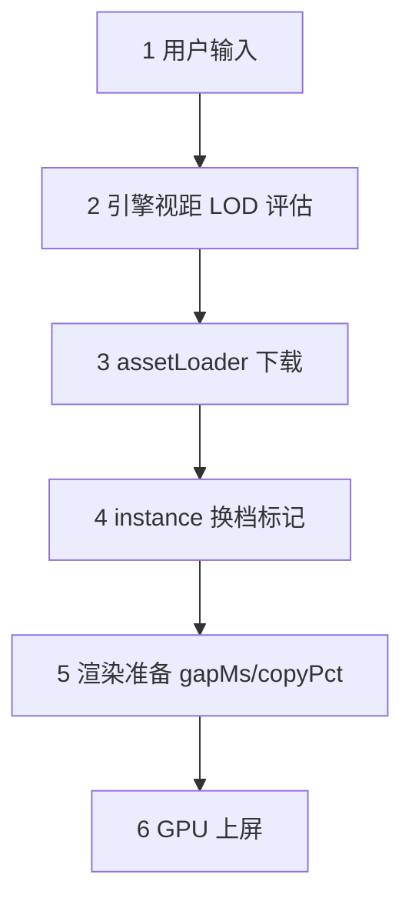

# Native 瓶颈归因（含帧内流程）— Poland 96k vs 512k（追到细档）

> 本文把 **native fineLod profiling 数据** 与 **引擎原生 octree streaming 帧内流程** 对齐，并和 refinement 同场景数据做 **drawCalls / copyPct / 清晰度** 对照。  
> 录制：`--lodRuntime=native --fineLod=1`（animTrack 等清晰 + 标定移动）。

## 摘要

| 场景 | 日志 | 帧数 | fps P50 | 清晰帧占比（gsplats≥2M） | drawCalls P50（清晰段） | 上传帧 copy≥99%∧dc≥10 | 140–200ms 慢档 |
|------|------|------|---------|------------------------|------------------------|----------------------|---------------|
| **Poland 96k native** | `native_poland_v3_finelod.txt` | 3873 | **49** | **78.1%** | **2** | **0（0%）** | **1（0.03%）** |
| **Poland-v2 512k native** | `native_poland-v2_v3_finelod.txt` | 4949 | **60** | **74.2%** | **2** | **0（0%）** | **0** |
| Poland 96k refinement（对照） | `refinement_poland_v3.txt` | 536 | 8 | **0%**（max 1.2M） | 2（稳态）/ **27（慢档）** | **209（39%）** | **192（35.8%）** |
| Poland-v2 512k refinement（对照） | `refinement_poland-v2_v3.txt` | 1766 | 60 | **0%**（max 1.37M） | **10–18** | 高 copyPct 但 gapMs 低 | 0 |

animTrack 清晰时点数（native）：

| 关键帧 | 96k `gsplatsAtClearM` | 96k blurToClear | 512k `gsplatsAtClearM` | 512k blurToClear |
|--------|----------------------|-----------------|------------------------|------------------|
| kf-0 | 2.12 M | 18.4 s | 2.34 M | 25.4 s |
| kf-1..9 avg | **2.35 M** | 0–1.4 s | **2.60 M** | 0–1.4 s |

---

## 一、Native 帧内流程：从相机移动到上屏

native 路径在 `unlockStreamingLod()` 后 **销毁 refinement controller**，`splatBudget=0`，完全交给 PlayCanvas 引擎 octree streaming。与 refinement 的 7 步相比，**没有 JS 侧 scan / burst / sync**，流程可压成 **5 步**：

```text
用户输入（animTrack / 标定 move_5m / 键鼠）
    |
    v
[1] 引擎 octree 视距评估（内部）
    |-- 按相机距离 + LOD 曲线决定每叶目标档
    |-- 无 viewer refinement-controller、无 burst 18 帧窗口
    |
    v
[2] 后台文件下载（assetLoader，引擎内部队列）
    |-- loadingCount 由 EVENT_FRAMEREADY 上报
    |-- NativeStreamingObserver 仅观测，不干预调度
    |
    v
[3] 文件落地 → 引擎标记 instance needsLodUpdate
    |-- 无 syncOctreePendingPlacements / burst_lod_switch
    |-- 换档请求由引擎按帧消化，不集中 burst 引爆
    |
    v
[4] 渲染准备：整理高斯点 + 写入显卡
    |-- assignSplatOffsets / writeBuffer（gapMs 主因）
    |-- copyPct = 本帧 buffer copy 饱和度
    |
    v
[5] GPU 绘制上屏（WebGPU splat pass，~13–19ms）
```



### 各步对应代码 / 观测入口

| 步骤 | 做什么 | 代码 / 观测 |
|------|--------|------------|
| 第 1 步 | bootstrap 解锁后 native 不交 refinement | `bootstrap.ts` → `unlockStreamingLod()`，`isNativeLod` 时 `splatBudget=0`，`refinementController?.destroy()` |
| 第 2 步 | 引擎内部下载与 loading 计数 | PlayCanvas `octree.assetLoader`；`NativeStreamingObserver` 监听 `EVENT_FRAMEREADY` |
| 第 3 步 | 换档触发（引擎内部） | PlayCanvas `gsplatManager.applyLodChanges` 等，**无** `burst_lod_switch` |
| 第 4 步 | CPU 侧准备 + 显存上传 | `frame-profiler` → `cpu.gsplatBufferCopyPct`、`refinement.gapMs`（native 下 tick 恒为 0） |
| 第 5 步 | GPU 绘制 | `gpu.totalMs`、splat sort/cull passes |

> **与 refinement 的根本差异**：refinement 在 [2]–[3] 之间多了 **burst 18 帧 + 每帧 scan/sync**，会把多块换档 **集中排队**到同一帧的 [4]；native 由引擎 **按帧摊平**，同屏 2.3M 点时 `drawCalls` 仍多为 **2**。

---

## 二、名词解释（native 语境）

| 指标 | 通俗说法 |
|------|---------|
| **native / 引擎路径** | `lodRuntime=native`，解锁后无 JS refinement，LOD 由引擎距离曲线 + 内部 streaming 决定 |
| **fineLod 协议** | animTrack 10 关键帧，每点 `waitForRefinementClear`，再标定移动；保证测到细档而非粗档稳态 |
| **gsplatsM** | 本帧 renderer 提交/排序点数（百万）；**≥2M** 视为「追到细档」 |
| **drawCalls** | 本帧高斯绘制块数；native 清晰稳态多为 **2**，换档爬升时短暂升高 |
| **copyPct** | 第 ④ 步显存 copy 饱和度；**≥99% 且 dc≥10** 定义为「上传帧」（refinement 慢档强相关） |
| **gapMs** | `frameMs` 减去已计时的 update/render/gpu/tick；第 ④ 步引擎内部未细分工作 |
| **blurToClearMs** | animTrack 关键帧从模糊到 `loadingCount=0` 的墙钟；首帧 kf-0 最慢（18–25s） |
| **loadingCount** | `NativeStreamingObserver` 读的引擎在飞节点数；0 = 当前视角无待落地文件 |

---

## 三、Profiler 指标落在 native 哪一步

| 指标 | 落在哪一步 | native 96k 清晰段 P50 | native 96k 全量 P50 | refinement 96k 慢档 P50 | 说明 |
|------|-----------|----------------------|--------------------|-----------------------|------|
| `refinement.tick.*` | （无） | **0** | **0** | scan 1.1ms / sync 0 | native 无调度 tick |
| `cpu.renderMs` | 第 ④ 步（部分） | **0.4 ms** | 0.4 ms | **45.1 ms** | native 渲染 CPU 极轻 |
| `cpu.gsplatBufferCopyPct` | 第 ④ 步 | **0%** | 0% | **100%** | native 清晰段几乎无 copy 饱和 |
| `refinement.gapMs` | 第 ④ 步（未细分） | **2.0 ms** | 3.3 ms | **119 ms** | 慢帧差距主因 |
| `gpu.totalMs` | 第 ⑤ 步 | **14.1 ms** | 12.7 ms | 16.1 ms | GPU 随点数升，非瓶颈 |
| `drawCalls` | 第 ④–⑤ 步 | **2** | 2 | **27** | 清晰稳态 vs 换档爆发 |
| `gsplatsM` | 输出侧 | **2.31 M** | 2.31 M | 0.97 M（refine） | native 细档更高 |
| `frameMs` | ①–⑤ 合计 | **16.7 ms** | 16.7 ms | **183.3 ms** | 用户感知帧时 |

### 一句话总结 native 清晰稳态

> animTrack 等到 `loadingCount=0` 后，**2.3M+ 点、drawCalls=2、copyPct=0**，整帧 **~17ms**；偶发 `drawCalls` 升高时 gapMs 会到 **70–140ms**，但 **copyPct 仍接近 0**——与 refinement「dc 高 + copyPct≈100」的慢档模式不同。

---

## 四、按清晰度分段：drawCalls / copyPct / 帧时

### 4.1 Native 96k（`native_poland_v3_finelod.txt`）

| 清晰度段 | 帧占比 | gsplatsM P50 | drawCalls P50 | copyPct P50 | frameMs P50 | gapMs P50 |
|---------|--------|-------------|--------------|------------|------------|----------|
| 粗档 <0.1M | 0.7% | 0.05 M | 2 | 0% | 16.7 ms | 9.9 ms |
| 过渡 0.1–1M | 9.8% | 0.70 M | 2 | 0% | 16.7 ms | 9.3 ms |
| 细档 ≥1M | 89.5% | 2.31 M | 2 | 0% | 16.7 ms | 2.5 ms |
| **清晰 ≥2M** | **78.1%** | **2.31 M** | **2** | **0%** | **16.7 ms** | **2.0 ms** |

### 4.2 Native 512k（`native_poland-v2_v3_finelod.txt`）

| 清晰度段 | 帧占比 | gsplatsM P50 | drawCalls P50 | copyPct P50 | frameMs P50 | gapMs P50 |
|---------|--------|-------------|--------------|------------|------------|----------|
| 粗档 <0.1M | 1.8% | 0.05 M | 2 | 0% | 16.7 ms | 12.8 ms |
| 过渡 0.1–1M | 14.8% | 0.67 M | 2 | 0% | 16.7 ms | 10.0 ms |
| 细档 ≥1M | 83.5% | 2.57 M | 2 | 0% | 16.7 ms | 2.6 ms |
| **清晰 ≥2M** | **74.2%** | **2.57 M** | **2** | **0%** | **16.7 ms** | **2.5 ms** |

### 4.3 Refinement 96k 对照（`refinement_poland_v3.txt`，noanim）

| 清晰度段 | 帧占比 | gsplatsM P50 | drawCalls P50 | copyPct P50 | frameMs P50 | gapMs P50 |
|---------|--------|-------------|--------------|------------|----------|
| 粗档 <0.1M | 1.1% | 0.05 M | 4 | **100%** | 241.8 ms | 143 ms |
| 过渡 0.1–1M | 59.5% | 0.73 M | **16** | **100%** | **167 ms** | **106 ms** |
| 细档 ≥1M | 39.4% | 1.07 M | 2 | 0% | 50.5 ms | 15 ms |
| **清晰 ≥2M** | **0%** | — | — | — | — | — |

**读数要点**：

1. **native 追到 ≥2M 后 drawCalls 稳在 2**——引擎把多块合成极少 draw batch；refinement 同场景最高只到 **1.2M**，且过渡段 dc P50=**16**、copyPct=**100%**。
2. refinement 的慢帧集中在 **0.1–1M 过渡段**（占 59.5% 录制），正是 budget 强追、burst _fan-out_ 最猛的阶段；native 同段仍 **16.7ms / dc=2**。
3. native 清晰段 GPU **14ms**（2.3M 点）vs refinement 慢档 GPU **16ms**（0.5–1M 点）——**不是 GPU 绘制差，是 CPU 第 ④ 步模式差**。

---

## 五、按 drawCalls 分桶：换档形态对比

| drawCalls | native 96k 帧占比 | native 96k frameMs P50 | native 96k copyPct P50 | refinement 96k 帧占比 | refinement 96k frameMs P50 | refinement copyPct P50 |
|-----------|------------------|----------------------|----------------------|----------------------|--------------------------|----------------------|
| **dc=2** | **94.4%** | 16.7 ms | 0% | 59.1% | 50.1 ms | 0% |
| dc 3–10 | 3.8% | 17.1 ms | 0% | 1.5% | 241.8 ms | 100% |
| dc 11–25 | 0.3% | 83.9 ms | 0% | **19.4%** | **183.9 ms** | **100%** |
| dc 26+ | 1.5% | 100 ms | **3.3%** | **20.0%** | **183.4 ms** | **100%** |

### 5.1 核心发现：高 drawCalls 不等于同一种慢帧

**Refinement 96k**：`dc≥11` 的帧 **39.4%**，几乎 **100% copyPct≈100** → 典型「多块同时换档 + 显存大批量上传」慢档（gapMs P50 **118–130ms**）。

**Native 96k**：`dc≥10` 仅 **1.8%**（69 帧），其中：

| 子集 | 帧数 | frameMs P50 | copyPct P50 | gapMs P50 | gsplatsM P50 |
|------|------|------------|------------|----------|-------------|
| dc 26+ | 57 | 100 ms | **3.3%** | **90 ms** | 2.35 M |
| dc 11–25 | 12 | 83.9 ms | 0% | 74 ms | 2.39 M |
| 全 dc≥10 | 69 | 100 ms | **2.7%** | **89 ms** | 2.35 M |

→ native 的高 dc 帧出现在 **已清晰（2.3M）** 时，**copyPct 接近 0**，慢在 **gapMs（引擎内部整理/偏移计算）**，**不是** refinement 那种 copy 饱和上传尖刺。  
→ 全录制 **上传帧（copy≥99%∧dc≥10）= 0**；refinement 为 **209 帧（39%）**。

**Native 512k**：`dc≥10` 仅 **1.0%**（50 帧），frameMs P50 仍 **16.6ms**，copyPct P50 **8.3%**，gapMs P50 **1.2ms**——粗分块进一步摊平换档。

---

## 六、帧时间分布与慢帧归因

### 6.1 Native 96k 帧时间分布

| 桶 | 帧数 | 占比 | 典型场景 |
|----|------|------|---------|
| ≤20ms | 3718 | **96.0%** | 清晰稳态 dc=2 |
| 70–140ms | 112 | 2.9% | 换档爬升 dc 3–57，copyPct 低 |
| 140–200ms | 1 | 0.03% | dc=53，copyPct=1.2%，gapMs=140ms |
| ≥200ms | 1 | 0.03% | 首帧启动 766ms（粗档冷启动） |

### 6.2 Native 512k 帧时间分布

| 桶 | 帧数 | 占比 |
|----|------|------|
| ≤20ms | 4947 | **100.0%** |
| 70–140ms | 1 | 0.02% |
| 140–200ms | 0 | 0% |

### 6.3 与 refinement 96k 慢档对比

| 归因 | native 96k | refinement 96k 慢档（192 帧） |
|------|-----------|------------------------------|
| 显存大批量上传 copy≥99% | **0 帧** | **183 帧（95.3%）** |
| gapMs 高但 copy 低 | 69 帧（dc≥10） | 9 帧 |
| burst_lod_switch 触发 | **无** | **359 次** |
| 双模态 140–200ms | **0.03%** | **35.8%** |

---

## 七、animTrack 关键帧：清晰时 drawCalls / 点数

每关键帧等待 `loadingCount=0` 后采样（`gsplatsAtClearM`）：

### 7.1 Native 96k

| KF | gsplatsAtClearM | blurToClearMs | 说明 |
|----|----------------|---------------|------|
| kf-0 | 2.12 M | 18388 ms | 首点最慢，冷启动拉细档 |
| kf-1 | 2.34 M | 0 ms | 已缓存，瞬时清晰 |
| kf-2..4 | 2.32–2.49 M | 0.8–1.0 s | 小幅位移仍需拉新区块 |
| kf-5..9 | 2.30–2.42 M | 0–1.0 s | 稳态清晰 |
| **avg** | **2.35 M** | — | fps P50=49 |

清晰时 **未见** drawCalls 与 gsplats 强绑定（profiler 在关键帧间采样，稳态 dc=2）；变清晰过程由引擎分散在多帧，不形成 refinement 式单帧 dc=27 尖刺。

### 7.2 Native 512k

| KF | gsplatsAtClearM | blurToClearMs |
|----|----------------|---------------|
| kf-0 | 2.34 M | 25400 ms |
| kf-2 | 2.74 M | 1000 ms |
| kf-7 | 2.67 M | 1200 ms |
| **avg** | **2.60 M** | fps P50=60 |

512k 清晰点数略高于 96k（块更大、单块点数更多），帧时仍 **16.7ms**。

---

## 八、Native 96k vs 512k（同协议）

| 指标 | 96k native | 512k native | 说明 |
|------|-----------|------------|------|
| 清晰帧占比 ≥2M | 78.1% | 74.2% | 均追到细档 |
| 清晰段 drawCalls P50 | 2 | 2 | 稳态一致 |
| 清晰段 frameMs P50 | 16.7 ms | 16.7 ms | 同帧预算 |
| 清晰段 gapMs P50 | 2.0 ms | 2.5 ms | 均低 |
| dc≥10 帧占比 | 1.8% | 1.0% | 96k 细粒度更易短暂高 dc |
| dc≥10 时 frameMs P50 | **100 ms** | **16.6 ms** | **96k 细块换档尖刺更明显** |
| jsHeap P50 | 1077 MB | 191 MB | 96k 细文件多，Heap 高 |
| kf-0 blurToClear | 18.4 s | 25.4 s | 首帧拉细档都慢 |

**结论**：追到细档后两者稳态均为 **60fps 档**；96k 在 **换档爬升瞬间**（dc 26+）可出现 **~100ms** 帧，但仍 **无 copy 饱和**；512k 几乎全程 ≤20ms。

---

## 九、Native vs Refinement：同场景「清晰能力 + 换档形态」

| 维度 | native 96k fineLod | refinement 96k budget=2.5 | 差异解读 |
|------|-------------------|--------------------------|---------|
| 最高 gsplatsM | **2.50 M** | 1.20 M | native 距离曲线可上更多点 |
| 清晰 ≥2M 占比 | **78%** | **0%** | refinement budget 封顶更早 |
| 稳态 drawCalls | **2** | 2（快档）/ **27（慢档）** | refinement 慢档多块并行 |
| 上传帧占比 | **0%** | **39%** | burst fan-out 集中上传 |
| frameMs P50 | **16.7 ms** | **58 ms**（双模态） | — |
| 慢档 140–200ms | **0.03%** | **35.8%** | — |
| 调度 scan/sync | **无** | scan 1.1ms + burst sync | JS 调度开销小头，fan-out 是大头 |
| jsHeap P50 | 1077 MB | 1520 MB | refinement pin/队列更胀 |

| 维度 | native 512k fineLod | refinement 512k budget=2.5 |
|------|--------------------|-----------------------------|
| 最高 gsplatsM | **2.74 M** | 1.37 M |
| 稳态 drawCalls P50 | **2** | **10–18**（持续 copy 活跃） |
| copyPct P50（全量） | **0%** | **103%** |
| gapMs P50 | **3.7 ms** | **5.0 ms** |
| frameMs P50 | **16.7 ms** | **16.7 ms** |
| 上传帧 copy≥99%∧dc≥10 | **0** | 多帧 copy 高但 gap 低，故仍 60fps |

**512k 上两者帧时接近**，差别在 **native 用 dc=2 扛 2.6M 点**，refinement 用 **dc=10–18 + 持续高 copyPct** 只到 **0.65–1.37M**。

---

## 十、因果链（native 清晰稳态为何能 17ms）

```text
fineLod 等清晰 → loadingCount=0
  → 引擎已落地视锥内各叶目标档
  → 每帧仅增量换档（若有），不 burst 集中 sync
  → drawCalls 合并为 2，copyPct≈0
  → gapMs≈2ms，gpu≈14ms（2.3M 点）
  → frameMs≈17ms，fps≈50–60

对比 refinement 96k：
  相机移动 → burst 18 帧 → scan 1765 叶 → 多块同时 sync
  → drawCalls 25+，copyPct≈100%，gapMs≈120ms
  → frameMs≈180ms（即使 gsplats 仅 0.5–1M）
```

---

## 十一、优化与产品含义

1. **测 native 必须 fineLod**：noanim 粗档（0.05M / dc=2）测不到换档行为；本次 78% 帧在 ≥2M 才有意义。
2. **drawCalls 是换档「形态」探针**：native 清晰段 dc=2；refinement 慢档 dc=27+。只看 gsplats 无法区分二者帧率差。
3. **copyPct 区分慢帧类型**：refinement 慢帧 ≈ copy 饱和上传；native 偶发慢帧 ≈ 高 dc + 低 copy + 高 gap（引擎内部整理），**96k 更明显**。
4. **若要坚持 96k 细分块 + refinement**：应学 native **摊平换档**（限制 burst 内 sync 块数、合并 draw batch），而不是只压 scan。
5. **首帧 kf-0 blurToClear 18–25s**：native 与 refinement 都慢，属于冷启动拉细档，与移动后 180ms 尖刺是不同问题。

---

## 十二、相关文件

| 文件 | 说明 |
|------|------|
| `docs/logs/native_poland_v3_finelod.txt` | 96k native fineLod 原始 profiling |
| `docs/logs/native_poland-v2_v3_finelod.txt` | 512k native fineLod 原始 profiling |
| `docs/logs/refinement_poland_v3-bottleneck.md` | refinement 对照文档（§十 有摘要交叉引用） |
| `scripts/chrome-performance-profile.mjs` | `--lodRuntime=native --fineLod=1` 录制入口 |

录制命令：

```bash
node scripts/chrome-performance-profile.mjs --scene=poland --lodRuntime=native --fineLod=1
node scripts/chrome-performance-profile.mjs --scene=poland-v2 --lodRuntime=native --fineLod=1
```
