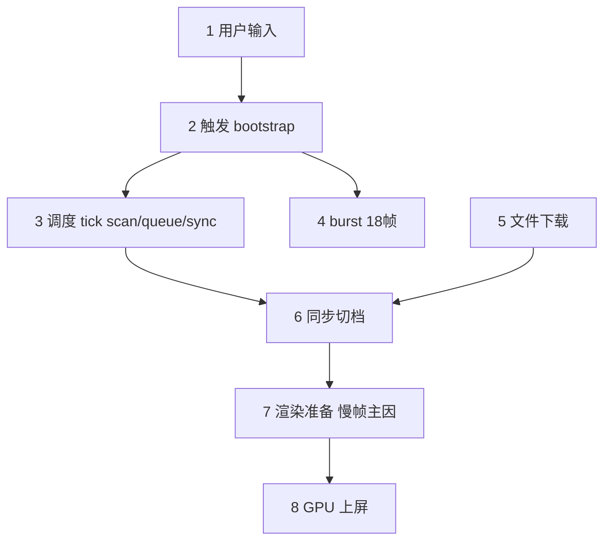

# Refinement 瓶颈归因（含流程说明）— Poland 96k vs Poland-v2 512k

> 本文把 **Poland profiling 数据** 和 **refinement 从调度到上屏的流程** 对齐，尽量用中文说明每类耗时发生在哪一步。  
> **96k 细粒度**：`refinement_poland_v3.txt`（536 帧）。**512k 粗粒度**：`refinement_poland-v2_v3.txt`（1766 帧，2026-07-06 同脚本复跑）。  
> **落地计划**：viewer / 引擎优化路线与验收口径见 Cursor plan「细粒度 LOD：稳帧 + 中心更快变清」；下文 §七 用**工作项名称**描述（非对称 sync、**文件保活与回收**、驻留池、引擎轻路径等），§九、§十一、§十二 已同步（2026-07-07）。

## Poland 96k（`refinement_poland_v3.txt`）摘要

- 有效帧：535 / 536
- **慢档**（140–200ms）：192 帧 — 用户感到明显卡顿的一档
- **快档**（40–70ms）：288 帧 — 正常流畅的一档
- **显存上传帧**（copy≥99% 且 drawCalls≥10）：209 帧 — 与慢档高度重合

## 一、从相机移动到上屏：一帧里发生什么

下面按**时间顺序**拆成 7 步。左侧是「调度侧」（我们的 refinement 代码），右侧是「引擎侧」（PlayCanvas 高斯渲染）。**Poland 的 180ms 慢帧，瓶颈几乎都在第 6 步，而不是第 2 步扫描。**

```text
用户输入（相机移动 / 标定步 / 键鼠）
    |
    v
[1] 触发：平移>3cm 或 转向>10度 -> 通知 refinement
    |
    v
[2] 调度 tick（每帧 update）
    |-- 2A 视锥扫描 scan（~1ms）
    |-- 2B 维护待下载列表
    |-- 2C 调整下载队列 / 并发 / **文件保活**
    `-- 2D 决定是否 sync（~0ms）
    |
    +-- [3] burst 窗口：移动后 18 帧加速
    +-- [4] 文件下载（可跨多帧，落地后再 sync）
    |
    v
[5] 同步切档：标记 needsLodUpdate（调度很轻，~0ms）
    |
    v
[6] 渲染准备：整理高斯点 + 写入显卡  <-- Poland 慢帧主因（~100ms+）
    |
    v
[7] GPU 绘制上屏（~16ms，不高）
```





### 各步对应代码位置（便于对照源码）


| 步骤    | 做什么                  | 代码入口                                                  |
| ----- | -------------------- | ----------------------------------------------------- |
| 第 1 步 | 检测相机是否「值得」重新调度 LOD   | `bootstrap.ts` 平移 3cm / 转向 10° 阈值                     |
| 第 2 步 | 每帧调度：扫描→队列→是否 sync   | `refinement-controller.ts` → `runPriorityPrefetch()`  |
| 第 3 步 | 移动后 18 帧加速窗口         | `notifyCameraMoved` 设置 `cameraBurstFrames=18`         |
| 第 4 步 | 后台下载 LOD 文件          | `assetLoader` + `prioritizeFileLoad`                  |
| 第 5 步 | 标记 instance 要换档并排队更新 | `syncOctreePendingPlacements` → `scheduleDeferred...` |
| 第 6 步 | 把新高斯数据写入 GPU 并准备绘制   | PlayCanvas `gsplatManager`（`applyLodChanges` 等）       |
| 第 7 步 | 实际画到屏幕               | WebGPU forward / splat pass                           |


## 二、名词解释（尽量不用英文缩写）


| 报告里的词                       | 通俗说法                                                            |
| --------------------------- | --------------------------------------------------------------- |
| **refinement / 调度器**        | 相机一动，就重新算「眼前该用哪一档清晰度、该下哪些文件」的那套逻辑                               |
| **tick**                    | 上面这套逻辑在**每一帧 update** 里跑一轮，叫一次 tick（≠ 整帧时间）                     |
| **scan（扫描）**                | 从八叉树里找视锥内的叶子，算每块该用 LOD0/1/2… 哪档                                 |
| **burst（移动后加速窗口）**          | 相机刚动完后的 **18 帧**，下载更积极、也更容易触发「换档上屏」                             |
| **sync（同步切档）**              | 通知引擎：这些空间块该换 LOD 了，给每个块打 `needsLodUpdate`                       |
| **instance**                | 空间里的一块 LOD 贴片，有自己的高斯点数据和 GPU 资源                                 |
| **buffer upload / copyPct** | 把 CPU 里整理好的高斯点**拷贝到显卡**；`copyPct≈100` 表示本帧拷贝任务很重（**不是 100 毫秒**） |
| **drawCalls**               | 本帧绘制调用次数；慢帧从 2 涨到 27+，说明**多块同时换档上屏**                            |
| **gapMs（未计入耗时）**            | 见 **§2.5**：`frameMs` 减去 profiler 已采样项后的**残差**；Poland 慢帧里 ≈**65% 整帧时间**，主因是第 ⑥ 步 **bake**（`assignSplatOffsets` + work buffer 写入），不是 scan/sync |
| **jsHeap**                  | 浏览器 JS 堆内存；Poland 常驻 1.5–2.8GB，会让卡顿更容易出现，但**不是 180ms 慢帧的直接主因**  |
| **双模态**                     | 帧时间呈两档：快档 ~50ms、慢档 ~180ms，不是单一平均值                               |
| **fan-out（扇出）**              | 一次相机移动后，从单个输入**展开**出的下游工作量（见下节）                                  |
| **skip（跳过扫描）**             | 静止且无 `tracked` 缺文件时，本 tick **不 scan、不 sync**；placement 冻结（见 §十一）     |
| **staleLodNodes**           | 扫描口径：**显示档比 target 更粗**（该升还没升），不是「该降没降」                          |
| **文件保活（代码里叫 pin）**        | 调度器对某个 SOG 文件调用 `incRefCount`，等于告诉引擎：**「这个文件我还需要，先别卸载」**；同时记入 `prefetch.pinned` 集合 |
| **保活泄漏（pin 泄漏）**          | **只加「别卸」、从不减**：相机移动时只清空 viewer 侧的 `pinned` 列表，**没有**配对调用 `decRefCount` → 引擎以为文件仍被引用 → `unloadResource` 永远进不去 → **Heap 只增不减** |
| **bake（换档整理）**            | 换 LOD 时引擎在 CPU 侧整理 work buffer：为每个 octree interval 分配槽位、写入 splat 属性、发起 GPU `writeBuffer`；详见 **§2.5** |
| **copyPct**                  | `stats.frame.gsplatBufferCopy` = `bufferCopyUploaded / bufferCopyTotal × 100`，是**拷贝完成度比例**，**不是毫秒**；≈100% 表示本帧 render 阶段几乎全在做 buffer 拷贝 |

### 2.5 gapMs 与 bake 计算量（精确定义）

本节回答：`gapMs` **怎么算**、里面**具体算什么**、Poland 慢帧 **119ms 对应多少工作量**。

#### 2.5.1 gapMs 公式（viewer 侧）

`frame-profiler.ts` 每帧采样后计算：

```text
accountedMs = cpu.updateMs
            + cpu.renderMs
            + gpu.totalMs
            + refinement.tick.timingsMs.total
            + refinement.deferredInstUpdateMs

gapMs = max(0, frameMs - accountedMs)
```

| 项 | 来源 | Poland 慢帧 P50 | 是否计入 accountedMs |
|----|------|----------------:|---------------------|
| `frameMs` | PlayCanvas `stats.frame.ms` | **183.3 ms** | —（被减数） |
| `cpu.updateMs` | `stats.frame.updateTime` | ~0 ms | ✅ |
| `cpu.renderMs` | `stats.frame.renderTime` | **45.1 ms** | ✅（仅覆盖 render 阶段**部分**墙钟） |
| `gpu.totalMs` | GPU profiler 各 pass 之和 | **16.1 ms** | ✅ |
| `tick.total` | refinement scan+queue+sync | **1.1 ms** | ✅ |
| `deferredInstUpdateMs` | frameend 推迟的 `inst.update()` 入口 | **0.1 ms** | ✅ |
| **`gapMs`** | 上式残差 | **119.0 ms** | ❌（**未单独计时的主线程工作**） |

**要点**：`gapMs` 不是 PlayCanvas 提供的字段，而是**残差估计**。慢帧里它占 `frameMs` 的 **~65%**（119 / 183），说明瓶颈在 **stats 未拆分的 CPU 路径**，而不是 GPU 绘制（`gpu.totalMs` 仅 ~16ms）。

#### 2.5.2 gapMs 里主要是第 ⑥ 步的哪些 CPU 工作

当 `copyPct≈100%` 且 `drawCalls≥10`（上传帧 / 慢档）时，`gapMs` 对应 PlayCanvas `GSplatWorld` / `gsplatManager` 在 **render 阶段前后**做的 **bake**，链路如下（与 §一 第 ⑥ 步对齐）：

```text
needsLodUpdate（refinement sync 标记，§2.5.1 中 tick≈0ms）
    │
    ├─ ① interval 切换
    │     每个 octree 叶：placement.intervals[node] = Vec2(offset, offset+count-1)
    │     计算量：O(换档块数) ≈ O(drawCalls)
    │
    ├─ ② assignSplatOffsets（Chrome trace 常见热点）
    │     为「本帧新增/变更 interval」里的每个 splat 分配 work buffer 槽位
    │     维护 compaction 用的 per-interval 元数据（可见段 → work buffer 索引）
    │     计算量：O(Σ count_i)，count_i = 第 i 块目标 LOD 的 splat 数
    │
    ├─ ③ work buffer 属性写入（CPU staging → GPU writeBuffer）
    │     从已解码 SOG Resource 读 position / rotation / scale / color 等 stream
    │     写入 WebGPU work buffer 纹理（unified splat 布局，每 splat 多 channel）
    │     计算量：O(Σ count_i × bytesPerSplat)，bytesPerSplat ≈ 32–64 B
    │
    ├─ ④ work buffer 扩容 / 版本 bump（换档后 active splat 总数变化时）
    │     重新分配 GPU buffer、更新 bind group
    │     计算量：O(新总 splat 数)，可能触发整 buffer 搬迁
    │
    └─ ⑤ 提交给后续 compaction / draw（pass 本身计入 gpu.totalMs，不在 gapMs）
```

**不在 gapMs 里的**：第 ⑦ 步 GPU compaction、radix sort、forward（已计入 `gpu.totalMs`）；第 ② 步 refinement scan/sync（已计入 `tick.total`）。

**`assignSplatOffsets` 具体算什么（人话）**：

- work buffer 是一块「本帧要画的所有 splat 的大数组」；
- 每个 octree 叶只占其中一段 **interval**（连续槽位 `[offset, offset+count)`）；
- 换 LOD = 换 `(file, slice offset, count)` → 必须 **重新计算** 这 `count` 个 splat 在 work buffer 里的起始下标，并更新 interval compaction 表；
- 这是 **按 splat 数线性增长** 的主线程循环，**不**在 `stats.frame.renderTime` 里完整体现，因此落入 `gapMs`。

#### 2.5.3 与 `copyPct`、`renderMs` 的关系

| 指标 | 含义 | 与 gapMs 关系 |
|------|------|---------------|
| `cpu.gsplatBufferCopyPct` | 本帧 render 阶段「buffer 拷贝任务」完成比例 | ≈100% ⇒ 本帧 render **类型**是 upload 帧，但**比例≠耗时** |
| `cpu.renderMs` | PlayCanvas 对 render 阶段的墙钟采样 | 慢帧 ~45ms，**小于** gapMs ~119ms ⇒ bake 大头在 renderTime **未覆盖**的路径 |
| `gpu.totalMs` | GPU pass 墙钟 | 慢帧 ~16ms，说明 **GPU 不是 180ms 主因** |

三者合读：**慢帧 = CPU 侧大量 splat 写入（gapMs）+ 部分计入 renderMs 的 render 开销 + 正常 GPU 绘制**。

**上传量如何度量（2026-07-08）**：引擎真实字段是 **`bufferCopyUploaded` / `bufferCopyTotal`（单位：work-buffer MemBlock / allocId 数，不是字节）**。`gsplatBufferCopy% = uploaded/total×100`。frameProfile 现增加 `bufferUpload`：

| 字段 | 含义 |
|------|------|
| `uploadedBlocks` / `totalBlocks` | 引擎原生块计数 |
| `activeSplatSlots` | `_allocationMap` 各 block.size 之和（work buffer 槽位） |
| `uploadSplatSlotsEst` | 全量 rebuild＝active；增量＝按块比例估算 |
| `uploadMbEst` | `slots × 40 B`（默认 format：center32F+color/scale/rot16F） |

Poland 慢帧粗算（§2.5.4）：~1.35M slots × 40B ≈ **~54 MB/帧**（与 `drawCalls≈26 × ~52k` 一致）。复跑带 `frameProfile=1` 可从导出 JSON 读 `bufferUpload.uploadMbEst`。

#### 2.5.3b Allocator grow + defrag → fullRebuild（2026-07-08 补：此前 plan 未单列）

引擎在换档时**优先走增量 bake**（只烤 dirty alloc）。但 Work Buffer 槽位由 **`BlockAllocator`** 管理；一旦「装不下或必须压碎片」，会把本次升级成 **`fullRebuild`**——**所有块 offset 可能已变，必须整表重烤**。这是「大移动 burst 把增量变全量」的关键机关。

**初始容量**（`GSplatWorld` 构造）：

```text
budget > 0  → capacity0 = ceil(splatBudget × 1.15)   // ALLOCATOR_GROW_MULTIPLIER
budget = 0  → capacity0 = 0，随后随 grow 涨
```

URL `budget=2.5` → 起步约 **2.875M slots**。

**换档时 allocator 在干什么**（`GSplatWorldState` → `computeAllocationDiff` → `updateAllocation`）：

```text
每个变脏的 interval（叶换 LOD）:
  旧 (offset,count) 尺寸变了
    → free(旧 MemBlock)
    → allocate(新 count)          // 细档常比粗档大很多

同帧 N 个叶一起升档（burst）:
  → 一批 free + 一批更大的 allocate
```

**何时 `updateAllocation` 返回 `fullRebuild=true`**（引擎注释原文语义）：

```text
for 每个待 allocate:
  block = allocate(size)
  if 成功 → 继续（仍可增量）
  if 失败（碎片缝不够 / 总容量不够）:
      needed = usedSize + 剩余待分配总和
      grow(ceil(needed × 1.15))     // 扩容
      defrag(0)                      // 全量压紧：所有已分配块 offset 重排
      再 allocate 剩余
      return true  → worldState.fullRebuild = true
                     → rebuildWorkBuffer(renderAll=true)
                     → 整表 writeBuffer（不只 dirty 块）
```

另外还有两条「扩大重烤范围」的路径（不一定整表 `fullRebuild`，但也会变贵）：

| 路径 | 条件 | 结果 |
|------|------|------|
| 增量碎片整理 | `!fullRebuild && fragmentation > 0.3` | 搬一批块 → 被搬的 allocId 进 `needsUpload` |
| placement 集合变 | `_placementSetChanged` | `newState.fullRebuild = true` |
| format / `gsplat.dirty` | invalidate workBuffer | `_workBufferRebuildRequired` → 整 buffer 再 render |

**为何大移动 burst 容易撞上**：

```text
burst 18 帧内，refinement 积极 sync
  → 同帧 drawCalls 25+（很多叶粗→细）
  → free 小块 + allocate 大块（count 暴涨）
  → ① 总占用逼近/超过 capacity0
  → ② 或总空闲够但空洞碎片，allocate 失败
  → grow + defrag(0) → fullRebuild
  → 本帧不只烤「新升的 25 块」，还可能重写已驻留块
  → copyPct≈100%，uploadMbEst 尖刺，gapMs~120ms
```

**和「增量路径」的关系（避免再混）**：

```text
未撞 grow/defrag：增量（只 dirty）——引擎默认能力
撞上 grow/defrag：被迫全量——burst 扇出放大后的次生灾难
plan §7.2 摊平 sync：降低同帧 free/allocate churn → 降低撞 fullRebuild 概率
（此前只写了「少 bake 次数」，没写「少触发 allocator 洗牌」——本节补上）
```

**观测（接 frameProfile `bufferUpload` + benchmarkHud）**：

| 信号 | 解读 |
|------|------|
| `fullRebuild=true`（`fullRebuildSource=engine\|inferred`） | 本帧整表 / 视作 fullRebuild |
| `uploadEstMode=full_rebuild` 且 `uploadedBlocks≈totalBlocks` | 高度疑似本帧 fullRebuild / 整表重烤 |
| `uploadedBlocks << totalBlocks` 且 copyPct 高 | 增量路径，但 dirty 块本身很大 |
| `allocatorCapacity` / `allocatorUsed` / `fragmentation` | 软容量与碎片；capacity 随 grow 上涨 |
| `hardCapSlots = maxTextureSize²` | 纹理方形硬上限（如 8192²≈67M） |
| 慢帧簇出现在 `move_5m` 后 burst | 与 churn→grow/defrag 时间线一致 |

**HUD 行**：`WB Cap`（used/capacity · hard）、`WB Frag`、`WB Upload`（MB · blocks · FULL）、`FULL rebuild`（会话累计次数 / 总帧 · peak MB）。

**验收补充**：摊平 sync 后除 gapMs/drawCalls 外，应报 **fullRebuild 帧次数与占比**、**peak uploadMbEst** 是否明显下降。

**实测（2026-07-08 `refinement_poland_v3_buf.txt`，同标定脚本）**：

完整分档表见 **[refinement_poland_v3_buf-buffer-table.md](refinement_poland_v3_buf-buffer-table.md)**（`node scripts/analyze-buffer-upload.mjs` 自动生成）。

| 项 | 值 |
|----|---:|
| 样本帧 | ~900–1000 |
| `allocatorCapacity` | **恒定 2.875M**（= budget 2.5M × 1.15）→ **本趟未发生 grow** |
| `allocatorUsed` max | ~2.16M（未顶满 capacity） |
| `hardCapSlots` | 16384² ≈ **268M**（设备纹理硬顶） |
| 有上传帧 `uploadMbEst` P50 / peak | **~28 MB / ~80 MB**（×N 表示同帧多趟 bake） |
| 慢档（140–200ms）有上传时 `uploadMbEst` P50 | **~19 MB**（peak ~42 MB） |
| `fullRebuild`（engine `worldState.fullRebuild`） | **≈0**（与未 grow 一致） |
| `fullRebuild`（inferred：uploaded 覆盖 ≥95% 块，或 uploaded>total） | **~190 帧 / ~20%** |

解读：本趟慢帧主因更接近 **近全表/多趟 writeBuffer（②a 升级版）**，不是 allocator grow+defrag（②b）。`copyPct>100` = 同帧 `rebuildWorkBuffer`/`applyWorkBufferUpdates` 多次累加 `_bufferCopyUploaded`。

#### 2.5.4 Poland 96k 慢帧量化（`refinement_poland_v3.txt`，192 帧 140–200ms）

| 量 | 慢档 P50 | 快档 P50 | 解读 |
|----|---------:|---------:|------|
| `frameMs` | 183.3 ms | 50.0 ms | 用户感知整帧 |
| `gapMs` | **119.0 ms** | 13 ms | 残差；慢档 **65%** 帧时间 |
| `cpu.renderMs` | 45.1 ms | 23.2 ms | 已计入部分 render |
| `gpu.totalMs` | 16.1 ms | 12.7 ms | GPU 绘制稳定 |
| `drawCalls` | **26** | 2 | 同时参与 compaction 的 interval 数 |
| `gsplatsM` | **0.70 M** | 1.01 M | 同屏点数**不是**慢因 |
| `copyPct` | **100%** | 0% | upload 型帧 |
| `syncedInstances` | 1 | 0 | refinement **本 tick 只 sync 1 块**，但引擎同帧仍 reconcile **~26 interval** |

**按块摊销（慢档 P50）**：

```text
gapMs / drawCalls ≈ 119 ms / 26 ≈ 4.6 ms · block⁻¹
```

**按 splat 摊销（粗估）**：

- Poland L0 单块约 **~52k splats**（96k/10m 分块，实测最细档略低于 96k）；
- 26 块同时换档 ⇒ 本帧 bake 约 **26 × 52k ≈ 1.35M splat-slot** 分配 + 属性写入；
- `119 ms / 1.35M ≈ 0.09 µs · splat⁻¹`（含 assign + staging + writeBuffer 发起）；
- 按 **~40 B/splat** 估算 ⇒ 本帧 CPU→GPU 搬运量 **~54 MB**，等效吞吐 **~450 MB/s**（主线程 + staging）。

**与「sync=1 但 drawCalls=26」**：refinement 每 tick 可能只 `sync` 1 个 instance，但引擎在 `applyLodChanges` / frame:ready 路径会把 **pending 的多个 interval 变更合并在同一帧 bake**；因此 `drawCalls` 才是 **bake 并行度** 的直接观测，`syncedInstances` 低估实际工作量。

#### 2.5.5 512k 对照：同 copyPct 不同 gapMs 的原因

| | 96k upload 帧 P50 | 512k upload 帧 P50 |
|--|------------------:|-------------------:|
| `drawCalls` | **25** | **10** |
| `gapMs` | **123.9 ms** | **5.1 ms** |
| `gsplatsM` | 0.69 M | 0.65 M |

同屏点数接近，但 96k **同帧换档块数 2.5×** → Σcount_i 与 interval 元数据更新次数更高 → gapMs **24×**。优化方向是 **摊平 bake**（限制同帧换档块数），而非压 scan。

### fan-out（扇出）是什么

在本报告里，**fan-out** 指：相机一动，调度器从 octree 上展开出多少**一对多**的后续工作——不是只更新一个点，而是同时牵出叶子、候选文件、下载队列和换档块。

```text
一次相机移动（一个输入）
        │
        ├─ 视锥内叶子变多          → visibleLeaves
        ├─ 每叶可能对应多档文件      → candidateFileRefs
        ├─ 下载队列 / 在飞 URL 变多  → queueLen / inFlight
        └─ 同时换档的 instance 变多 → drawCalls、gapMs
```

**和 `Gsplats` 的区别**：`splatBudget` 可以压住**同屏点数**，但压不住**块的数量**；块越细，fan-out 越大，移动后仍可能同时换十几到几十块（`drawCalls` 25+），从而触发 `gapMs≈120ms` 的慢帧。

**本报告中的对照（96k vs 512k）**：

| 指标 | 96k（细） | 512k（粗） | 说明 |
|------|----------|-----------|------|
| `visibleLeaves` P50 | 1765 | 72 | 视锥内叶子盒 |
| `candidateFileRefs` max | 1049 | 58 | 扫描产生的候选文件引用（未去重） |
| `drawCalls`（上传帧 P50） | 25 | 10 | 同时换档/绘制的块数 |

因此文档里说「瓶颈在 fan-out，不在 scan」是指：`scan` 本身仅 ~1ms；贵的是 scan 之后扇出去的一串事——排队下载、**文件保活**、多块 `applyLodChanges`、显存上传。详见 §八。


## 三、profiler 指标落在哪一步


| 指标                                | 落在哪一步           | Poland 慢帧 P50 | Poland 快帧 P50 | 说明                                                  |
| --------------------------------- | --------------- | ------------- | ------------- | --------------------------------------------------- |
| `refinement.tick.timingsMs.scan`  | 第 ②-A 步         | 1.1 ms        | 1.1 ms        | 扫描几乎不随移动距离变，**不是慢帧原因**                              |
| `refinement.tick.timingsMs.sync`  | 第 ②-D + 第 ⑤ 步入口 | 0.00 ms       | 0.00 ms       | 只是「决定并排队切档」，**几乎不耗时**                               |
| `refinement.deferredInstUpdateMs` | 第 ⑤ 步 frameend  | 0.10 ms       | 0.20 ms       | WebGPU 推迟执行切档入口，仍很短                                 |
| `cpu.renderMs`                    | 第 ⑥ 步（部分）       | 45.1 ms       | 23.2 ms       | 渲染阶段墙钟，慢帧明显变长                                       |
| `cpu.gsplatBufferCopyPct`         | 第 ⑥ 步           | 100%          | 0%            | **拷贝完成度比例**（非 ms）；≈100% = upload 型帧，见 **§2.5.3** |
| `refinement.gapMs`                | 第 ⑥ 步（未细分部分）    | 119 ms        | 13 ms         | **bake 残差**：`assignSplatOffsets` + work buffer 写入等，见 **§2.5** |
| `gpu.totalMs`                     | 第 ⑦ 步           | 16.1 ms       | 12.7 ms       | **GPU 绘制不高**；慢是 CPU 侧准备数据                           |
| `drawCalls`                       | 第 ⑥–⑦ 步         | 27            | 2             | 多块同时换档时上升                                           |
| `frameMs`                         | 第 ①–⑦ 步合计       | 183.3 ms      | 50.0 ms       | 用户感知的整帧时间                                           |


### 一句话总结 Poland 慢帧

> 相机**大移动**（尤其标定 `move_5m`）→ 开启 **18 帧 burst** → 调度器每帧决定「要换档」（**scan/sync 仍 ~1ms**）→ 真正耗时在 **第 ⑥ 步 bake**（`copyPct≈100`，**~26 块 × ~4.6 ms/块 ≈ gapMs 119ms**，见 **§2.5.4**）→ GPU 画上屏 ~16ms。

## 四、Poland 实测：慢档 vs 快档差在哪几步


| 对比项           | 快档 40–70ms（288 帧）     | 慢档 140–200ms（192 帧）                    |
| ------------- | --------------------- | -------------------------------------- |
| 第 ② 步 scan    | ~1.1 ms，与快档相同量级       | ~1.1 ms，**没有变慢**                       |
| 第 ⑤ 步 sync 调度 | ~0 ms                 | ~0 ms，**不是瓶颈**                         |
| 第 ⑥ 步 显存上传    | copyPct≈0，drawCalls≈2 | copyPct≈100%，drawCalls≈27，**95% 慢帧命中** |
| 第 ⑦ 步 GPU     | ~13 ms                | ~16 ms，**差别不大**                        |
| 内存            | Heap ~1525 MB         | Heap ~1642 MB，偏高但非主因                   |


## 五、慢帧是哪种相机交互触发的

> **读数注意**：profiler 的「当帧平移/转向」是**相邻两帧**的差值。标定 `move_5m` 那一帧可能显示 5m，但**后面十几帧往往显示「静止」**——慢帧常出现在移动**之后**的 burst 窗口，不要只看当帧位移。


| 指标                       | 慢帧计数 | 占比    |
| ------------------------ | ---- | ----- |
| 本帧刚过 LOD 阈值              | 75   | 39.1% |
| 处于 cameraBurst 窗口        | 147  | 76.6% |
| 录制前半段（标定+早期交互，index<280） | 163  | 84.9% |


### 慢帧所处交互阶段


| 阶段                          | 帧数  | 占比    | 说明                            |
| --------------------------- | --- | ----- | ----------------------------- |
| burst 窗口：前 18 帧内有过 LOD 触发   | 47  | 24.5% | 代码: `burst_after_lod_trigger` |
| 稳态（无 burst、近期无 LOD 触发）      | 45  | 23.4% | 代码: `steady`                  |
| 触发帧：大移动(>1m)或大转向(>10°)      | 44  | 22.9% | 代码: `trigger_frame_big`       |
| 触发帧：小步移动/转向（刚过 3cm/10° 阈值）  | 31  | 16.1% | 代码: `trigger_frame_small`     |
| burst 窗口：相机已静止（滞后切档/upload） | 25  | 13.0% | 代码: `burst_idle`              |


### 慢帧当帧平移量（易误判：滞后帧多为「静止」）


| 平移桶           | 帧数  | 占比    |
| ------------- | --- | ----- |
| 静止            | 102 | 53.1% |
| 大于 5m         | 30  | 15.6% |
| 3–20cm        | 18  | 9.4%  |
| ≤3cm（未触发 LOD） | 15  | 7.8%  |
| 1–5m          | 14  | 7.3%  |
| 20cm–1m       | 13  | 6.8%  |


### 慢帧当帧转向量


| 转向桶           | 帧数  | 占比    |
| ------------- | --- | ----- |
| 静止            | 159 | 82.8% |
| ≤10°（未触发 LOD） | 33  | 17.2% |


### 常见组合（平移 + 转向）

- 静止 + 静止：**93** 帧（48.4%）
- 3–20cm + 静止：**17** 帧（8.9%）
- 大平移(>5m) + 小转向：**16** 帧（8.3%）
- ≤3cm（未触发 LOD） + 静止：**15** 帧（7.8%）
- 大平移(>5m) + 静止：**14** 帧（7.3%）
- 1–5m + 静止：**11** 帧（5.7%）
- 20cm–1m + 静止：**9** 帧（4.7%）
- 静止 + ≤10°（未触发 LOD）：**9** 帧（4.7%）

### 标定/大动作后 22 帧内的慢帧（时序归因）


| 交互类型                   | 触发次数 | 后续 22 帧均慢帧 | 后续 22 帧均 upload 帧 | 均慢帧占比 |
| ---------------------- | ---- | ---------- | ----------------- | ----- |
| 标定 move_5m             | 52   | 14.8       | 14.7              | 67%   |
| 标定 move_1m+ / combo 平移 | 22   | 12.6       | 12.4              | 57%   |
| 标定 move_20cm           | 19   | 6.6        | 6.0               | 30%   |


对应录制脚本：`move_5m`、`move_1m`、`yaw_30deg`、`combo_2m_20deg` 及键鼠 W/拖拽。
**结论**：`move_5m` 每次标定后约 **15/22 帧**为慢档（≈68%），是主要交互来源；单帧 `rotateSinceLastDeg` 峰值仅 ~9°（30° 标定可能被拆帧/缓动），转向标定在本日志中未形成独立慢帧簇。

### 快档对照：同样处于 burst 窗口，为何有的快有的慢？

快档里也有约 **27%** 帧处于「burst 后 LOD 触发」阶段，但 **copyPct=0、drawCalls=2**——说明**同一轮移动后**，是否碰上「多块同时换档 + 显存大批量上传」决定快/慢，而不是「有没有移动」本身。

### 快档交互阶段分布


| 阶段                          | 快帧数 | 占比    |
| --------------------------- | --- | ----- |
| burst 窗口：前 18 帧内有过 LOD 触发   | 79  | 27.4% |
| 稳态（无 burst、近期无 LOD 触发）      | 75  | 26.0% |
| burst 窗口：相机已静止（滞后切档/upload） | 69  | 24.0% |
| 触发帧：小步移动/转向（刚过 3cm/10° 阈值）  | 35  | 12.2% |
| 触发帧：大移动(>1m)或大转向(>10°)      | 30  | 10.4% |


## 六-A、慢档明细（192 帧）


| 指标           | 含义（对应第几步）     | P50   | P90   | Max   |
| ------------ | ------------- | ----- | ----- | ----- |
| frameMs      | 整帧墙钟 ①–⑦ 合计   | 183.3 | 191.7 | 199.2 |
| gapMs        | 第 ⑥ 步未细分耗时    | 119.0 | 143.0 | 157.1 |
| copyPct      | 第 ⑥ 步 显存上传饱和度 | 100.0 | 101.7 | 126.5 |
| drawCalls    | 第 ⑥–⑦ 步 绘制块数  | 27    | 65    | 81    |
| scan tick ms | 第 ②-A 步       | 1.10  | 1.30  | 3.90  |
| sync tick ms | 第 ②-D/⑤ 步     | 0.00  | 0.00  | 0.10  |
| cpu.renderMs | 第 ⑥ 步（部分）     | 45.1  | 47.8  | 50.0  |
| gpu.totalMs  | 第 ⑦ 步         | 16.1  | 21.0  | 30.4  |
| jsHeap Mb    | 背景内存压力        | 1642  | 2426  | 2812  |


**主因分布（自动分类）**

- 第 ⑥ 步：显存大批量上传（慢帧主因）：**183** 帧（95.3%）
- 第 ⑥ 步或其他：未计时主线程/GC：**9** 帧（4.7%）

**切档触发原因（第 ⑤ 步为何执行）**

- 移动后 burst 窗口内，且当前视角需要换 LOD 档：**359** 次命中
- 某一 LOD 文件刚加载完，引擎通知 loading 减少：**10** 次命中

## 六-B、快档明细（288 帧）


| 指标           | 含义（对应第几步）     | P50  | P90  | Max  |
| ------------ | ------------- | ---- | ---- | ---- |
| frameMs      | 整帧墙钟 ①–⑦ 合计   | 50.0 | 57.7 | 59.3 |
| gapMs        | 第 ⑥ 步未细分耗时    | 12.7 | 18.3 | 25.0 |
| copyPct      | 第 ⑥ 步 显存上传饱和度 | 0.0  | 0.0  | 0.0  |
| drawCalls    | 第 ⑥–⑦ 步 绘制块数  | 2    | 2    | 3    |
| scan tick ms | 第 ②-A 步       | 1.10 | 1.20 | 2.50 |
| sync tick ms | 第 ②-D/⑤ 步     | 0.00 | 0.00 | 0.00 |
| cpu.renderMs | 第 ⑥ 步（部分）     | 23.2 | 34.4 | 58.0 |
| gpu.totalMs  | 第 ⑦ 步         | 12.7 | 18.9 | 27.6 |
| jsHeap Mb    | 背景内存压力        | 1525 | 2301 | 2576 |


**主因分布（自动分类）**

- 稳态：未碰上换档上传：**278** 帧（96.5%）
- 第 ⑤ 步：调度器触发切档（本身很轻）：**10** 帧（3.5%）

**切档触发原因（第 ⑤ 步为何执行）**

- 移动后 burst 窗口内，且当前视角需要换 LOD 档：**17** 次命中
- 某一 LOD 文件刚加载完，引擎通知 loading 减少：**3** 次命中

## 六-C、显存上传帧明细（209 帧）


| 指标           | 含义（对应第几步）     | P50   | P90   | Max   |
| ------------ | ------------- | ----- | ----- | ----- |
| frameMs      | 整帧墙钟 ①–⑦ 合计   | 183.6 | 208.3 | 274.5 |
| gapMs        | 第 ⑥ 步未细分耗时    | 123.4 | 150.4 | 196.7 |
| copyPct      | 第 ⑥ 步 显存上传饱和度 | 100.0 | 102.2 | 168.0 |
| drawCalls    | 第 ⑥–⑦ 步 绘制块数  | 26    | 65    | 81    |
| scan tick ms | 第 ②-A 步       | 1.20  | 1.40  | 3.90  |
| sync tick ms | 第 ②-D/⑤ 步     | 0.00  | 0.00  | 0.10  |
| cpu.renderMs | 第 ⑥ 步（部分）     | 45.5  | 48.5  | 86.0  |
| gpu.totalMs  | 第 ⑦ 步         | 16.0  | 21.0  | 30.4  |
| jsHeap Mb    | 背景内存压力        | 1546  | 2419  | 2812  |


**主因分布（自动分类）**

- 第 ⑥ 步：显存大批量上传（慢帧主因）：**209** 帧（100.0%）

**切档触发原因（第 ⑤ 步为何执行）**

- 移动后 burst 窗口内，且当前视角需要换 LOD 档：**408** 次命中
- 某一 LOD 文件刚加载完，引擎通知 loading 减少：**15** 次命中

---

## 八、分块粒度如何影响帧率（机制）

**空间粒度 = 加载粒度**：分块越细，octree **叶子数越多**、**独立 SOG 文件越多**、移动后 **同时换档的块数越多**。即便 `splatBudget` 把同屏点数压住，帧率仍会因下列因素拉开差距。

### 8.1 资产侧（Poland 同场景两种导出）


| 指标                  | Poland **96k / 10m**（细） | Poland-v2 **512k / 16m**（粗） | 倍数       |
| ------------------- | ----------------------- | --------------------------- | -------- |
| 总 SOG 文件数           | **2166**                | **362**                     | **6.0×** |
| L0 叶子文件数            | **1079**                | **171**                     | **6.3×** |
| 场景总点数（meta `count`） | **2.13 亿**              | （meta 未写 count，同源场景）        | —        |


### 8.2 调度侧（full scan 时）


| 指标                      | 96k P50          | 512k P50   | 说明                              |
| ----------------------- | ---------------- | ---------- | ------------------------------- |
| `visibleLeaves`         | **1765**         | **72**     | 视锥内叶子盒数量；细粒度 **24×**            |
| `leavesEvaluated`       | **2048**（触顶 cap） | **84**     | 细粒度扫描**打满 2048 上限**，粗粒度仅评 84 叶  |
| `scan` 墙钟               | **1.1 ms**       | **0.1 ms** | 有 cap 时 scan 仍可控，但细粒度**顶满 cap** |
| `candidateFileRefs` max | **1049**         | **58**     | 移动后 fan-out；细粒度 **18×**         |
| `scoredLeaves` P50      | **1183**         | **58**     | 参与评分的叶子数                        |


**结论（调度）**：分块变细后，主要代价不是 scan 从 0.1ms 涨到 1.1ms，而是 **视锥内叶子数暴涨 → 候选文件 fan-out → 下载队列/换档块数变多**。96k 的 scan 已被 `maxLeafEvaluationsCap=2048` 钳住，**真实叶子评估需求远高于 2048**。

### 8.3 渲染侧（第 ⑥ 步：显存上传）

两场景在移动后都会出现 `copyPct≈100` 的上传帧，但**尖刺幅度完全不同**：


| 指标           | 96k（上传帧 P50） | 512k（上传帧 P50） | 说明                          |
| ------------ | ------------ | ------------- | --------------------------- |
| 整帧 `frameMs` | **183.7 ms** | **16.7 ms**   | 细粒度上传帧 ≈ **11× 更慢**         |
| `gapMs`      | **123.9 ms** | **5.1 ms**    | bake 残差：O(Σ splat) 主线程写入，见 **§2.5.4–2.5.5** |
| `drawCalls`  | **25**       | **10**        | 同时换档的块更少                    |
| `gsplatsM`   | **0.69 M**   | **0.65 M**    | 同屏点数接近，**不是**帧率差主因          |


**结论（渲染）**：细粒度时，一次 burst 往往触发 **十几到几十块同时换档**（drawCalls 25+），每块虽更小，但 **合计 gapMs≈120ms**，形成 140–200ms 慢档。粗粒度同时换档块数少（drawCalls≈10），单帧上传工作量小，**copyPct 仍高但整帧只需 ~17ms**，可维持 60fps。

### 8.4 内存侧


| 指标             | 96k P50     | 512k P50  |
| -------------- | ----------- | --------- |
| `jsHeapMb`     | **1520 MB** | **89 MB** |
| `queueLen` P90 | **102**     | **0**     |
| `inFlight` P90 | **31**      | **11**    |


细粒度带来更多 URL / asset 对象、更长下载队列与 **保活文件集合**，Heap 常驻 **1.5–2.8GB**；粗粒度队列更易排空，Heap **<200MB**（同 budget=2.5、同交互脚本）。

### 8.5 因果链（一张图）

```text
分块变细（96k/10m）
  → L0 文件 1079 vs 171
  → 视锥 visibleLeaves 1765 vs 72（扫描顶 cap 2048）
  → 移动后 candidateFileRefs 峰值 1049 vs 58
  → burst 内多块同时 applyLodChanges（drawCalls 25 vs 10）
  → gapMs 124ms vs 5ms → frameMs 184ms vs 17ms
  → 双模态 8 FPS / 60 FPS 交替 vs 稳态 60 FPS
```

---

## 九、Poland 96k vs Poland-v2 512k 实测对比（同脚本、同 budget=2.5）

录制条件：`chrome-performance-profile.mjs`，标定 `move_5m` / `yaw_30deg` / 键鼠交互；`settings-finland-p0-benchmark.json`；WebGPU；`frameProfile=1`。


| 对比项                            | Poland **96k** (`refinement_poland_v3.txt`) | Poland-v2 **512k** (`refinement_poland-v2_v3.txt`) |
| ------------------------------ | ------------------------------------------- | -------------------------------------------------- |
| 录制帧数                           | 536                                         | 1766                                               |
| **fps P50**                    | **8**                                       | **60**                                             |
| **frameMs P50**                | **58 ms**                                   | **16.7 ms**                                        |
| 帧时间分布                          | 54% 在 40–70ms，**36% 在 140–200ms**           | **99.9% ≤20ms**，无 140–200ms 慢档                     |
| **慢档 140–200ms**               | **192 帧（35.8%）**                            | **0 帧（0%）**                                        |
| `gsplatsM` P50                 | 0.97 M                                      | 0.65 M                                             |
| `visibleLeaves` P50（full scan） | 1765                                        | 72                                                 |
| `scan` P50（full scan）          | 1.1 ms                                      | 0.1 ms                                             |
| `candidateFileRefs` max        | 1049                                        | 58                                                 |
| 上传帧占比（copy≥99%）                | 39.0%                                       | 62.2%                                              |
| 上传帧 `frameMs` P50              | **183.7 ms**                                | **16.7 ms**                                        |
| 上传帧 `gapMs` P50                | **123.9 ms**                                | **5.1 ms**                                         |
| `jsHeapMb` P50                 | **1520 MB**                                 | **89 MB**                                          |


### 9.1 现象归纳

1. **同屏点数不是帧率差的主因**：96k 的 `gsplatsM` P50（0.97M）与 512k（0.65M）同量级，但 96k 出现 **35.8% 慢档**，512k **全程 60fps**。
2. **scan ~1ms 不能解释 180ms 慢帧**：两场景 scan 均 <2ms；瓶颈在 **第 ⑥ 步多块换档上传的 gapMs**（124ms vs 5ms）。
3. **细粒度放大 fan-out**：`candidateFileRefs` 峰值 1049 vs 58，队列与换档块数叠加，形成 Poland 双模态。
4. **粗粒度换清变慢、帧率更稳**：512k 单文件解码/上传更重，但**同时换档块数少**，尖刺被摊平到 ~17ms/帧；符合「变清慢、帧率高」的产品取舍。
5. **内存差异显著**：96k Heap P50 **1.5GB** vs 512k **89MB**，细粒度在调度层与 loader 层的对象数量是独立风险。

### 9.2 对「分块粒度 vs 帧率」的直接回答


| 问题            | 答案                                                                                               |
| ------------- | ------------------------------------------------------------------------------------------------ |
| 分块变细为何降帧？     | 视锥叶子数↑ → 移动后**同时换档块数↑** → `applyLodChanges`/`assignSplatOffsets` 合计耗时↑（gapMs 120ms 级），而非 scan 本身 |
| 粗分块为何能 60fps？ | 视锥仅 **~72 叶**；burst 后 drawCalls **~10**；单帧 gapMs **~5ms**                                        |
| budget 为何挡不住？ | budget 限的是**点数**，不限**换档块数**与**文件数**；细粒度仍可在同点数下换更多块                                               |
| 能否只压 scan？    | 不能；96k scan 已顶 cap，再压 scan 不解决 180ms 上传尖刺                                                        |


### 9.3 优化方向（与落地 plan 对齐，2026-07-07）

**根因（人话）**：PlayCanvas 成本 = **① file 首载 upload（一次）** + **② 换档 bake（可同帧叠加）**。96k 慢帧是 **② bake 风暴**（25 叶/帧），不是 scan。  
**② 可再拆两层**（2026-07-08 补，见 **§2.5.3b**）：**(2a)** 同帧大量 dirty 的增量 writeBuffer；**(2b)** allocator **grow+全量 defrag → fullRebuild**，把增量升级成整表重烤。§7.2 摊平 sync 同时压 (2a) 与 (2b) 的触发率。

| 层级 | plan 阶段 | 做什么 | 96k 目标（相对 T0 基线） |
|------|-----------|--------|-------------------------|
| **内存** | **A** | **保活** `incRef`/`decRef` 配对；idle **C 类** `reclaimIdleLoadedFiles`；移动中仅 **B 类**软取消 | jsHeap 移动一圈后 **回落**（600–900MB） |
| **稳帧** | **B** | **非对称** sync/下载：critical 优先；burst 外围截断；`maxSyncsPerFrame` + gapMs/drawCalls 门控；父档兜底 | 慢档 **<5%**；gapMs **<40ms**；drawCalls P90 **≤12**；**full_rebuild 帧占比↓**（§2.5.3b） |
| **scale** | **C** | `LodResourcePool` file LRU + `fpsGuard`；先砍外围驻留/并发 | resident 有界；512k **fps 保持 60** |
| **观测** | **D** | HUD：`syncSuppressed`、`residentFiles`、`criticalPending`、`gapMs`、**DrawCalls**；frameProfile：`bufferUpload`（blocks + uploadMbEst + full_rebuild 推断） | §15 双轨 A/B 验收 |
| **引擎** | **E** | submodule `vendor/playcanvas-engine` @ `release-2.20`；**同 resource** 换档跳过 work buffer 全量 rebuild；可选：减少误 fullRebuild / 预留 capacity | `bakeSkipped`↑；回访区 gapMs↓；fullRebuild 更少（**不换新资产**） |

**本 plan 刻意不做（仍可作为产品选项，非本次 viewer 范围）**：

- PCSLD / 新容器（Spark 传输层）
- 换资产粗分块（512k 已验证；非必须才能救 96k）
- skip 时盲卸上屏 file；调度主动推显示降档

**资产层（可选，非 plan 前提）**：亿级稳帧基线可用 512k/16m；96k/10m 留给变清优先子场景。

**观测层（验收必报）**：`visibleLeaves`、`candidateFileRefs`、`gapMs`、`drawCalls`、`syncSuppressed`、中心 `blurToClear`；**勿仅用 Gsplats 判断帧率**。

### 9.4 相关日志


| 文件                                                | 场景                             |
| ------------------------------------------------- | ------------------------------ |
| `docs/logs/refinement_poland_v3.txt`              | Poland 96k profiling           |
| `docs/logs/refinement_poland-v2_v3.txt`           | Poland-v2 512k profiling（本次新跑） |
| `docs/logs/refinement_poland-v2_v3-bottleneck.md` | 512k 单场景自动归因（无 140–200ms 慢档）   |
| `docs/logs/chrome-cpu-profile-poland-v2.json`     | 512k CDP CPU profile           |


---

## 七、优化建议（按流程步骤）

> **术语**：**bake** = 换档时 work buffer 重建 / `assignSplatOffsets`（profiler 里 `copyPct≈100%` 的主因）。**摊平 bake** = 仍要 bake，但**拆到多帧、每帧少量**（学 native 引擎节奏）。

### 7.0 根因与优化边界

```text
PlayCanvas：① 新 file 首载 upload（可缓存）
           ②a 换档增量 bake（dirty blocks）
           ②b allocator grow+defrag → fullRebuild（整表重烤）  ← §2.5.3b
Spark：     ① 新 chunk 进页池（一次） + ② 换档多数只改 indices

Poland 96k 慢帧：同帧 ~25 叶换档 → ②a 叠加，并提高撞 ②b 的概率 → gapMs≈124ms

本次优化主战场：
  · 非对称 sync / 下载限流 → 摊平同帧 bake + 降低 grow/defrag 触发（救 96k 慢档，主杠杆）
  · **文件保活配对释放** + 静止时安全卸文件 → Heap 不再只增不减
后续可选：
  · 引擎：同 resource 跳过 bake；可选预留 capacity / 减少误 fullRebuild
不在本次范围：PCSLD 新容器、Spark 页池、换粗分块资产
```

### 7.1 按流程步骤（建议实施顺序）

| 步骤 | 现象 | 优化做什么 | 具体手段 | 预期 |
|------|------|------------|----------|------|
| **③–⑤ burst + sync** | 68% 慢帧在 burst 后；359 次 burst_lod_switch | **非对称 sync：中心优先、外围限流，摊平 bake** | `maxSyncsPerFrame=1`、burst 间隔 N 帧；critical `fileJustLanded` 旁路；合并同帧重复 sync | 同帧 bake 块数 25→~12；**同帧 free/alloc churn↓ → fullRebuild↓**（§2.5.3b） |
| **③–⑤ 下载 fan-out** | candidateFileRefs 峰值 1049 | **非对称下载：中心占满槽位，外围 burst 截断** | critical 优先 enqueue；移动时 purge suspended / 软取消旧 in-flight | 中心先到、少无效首载 |
| **⑥ bake / gapMs** | gapMs P50≈119ms；copyPct≈100% | **主：摊平 bake（压 ②a+②b）**；**辅：同资源轻路径；观测 full_rebuild 占比** | 见 §7.2、§2.5.3b、§7.5 | gapMs 124ms→<40ms；`uploadEstMode=full_rebuild` 帧占比↓ |
| **④ 内存** | Heap P50 1520MB；**保活只增不减** | **保活配对释放 + 静止时安全卸文件**；长跑加 **驻留上限** | `incRef`/`decRef` 配对；idle 回收；`LodResourcePool` + fpsGuard | Heap **回落**；不单独解 180ms 尖刺 |
| **② scan** | ~1ms/帧 | — | **不优先** | — |
| **⑦ GPU** | gpu ~18ms | — | **不优先** | — |

### 7.2 非对称 sync 与下载（稳帧主杠杆）

**目标**：移动后不要一帧内触发 ~25 次 bake；**中心变清不能**被「一刀切限流」拖慢。

| 触发 | sync 是否放行 |
|------|--------------|
| 中心关键文件刚落地（`fileJustLanded` ∩ critical） | **立即**（占本帧配额） |
| burst 窗口内常规 tick | 间隔 N 帧才 sync 一批 |
| 上帧已卡顿（`gapMs>80` 或 `drawCalls>12`） | 抑制**外围** sync，不挡中心 |
| 细档未 ready / sync 被抑制 | **父档继续画**（不空洞、不闪） |

**下载侧**：burst 期间外围 enqueue 截断；并发槽优先给中心 critical URL；相机移动时取消非 priority 的在飞请求；**静止 idle 后** purge suspended / 软取消无 keep 的 stale in-flight（plan **§B.5**，解决 HUD Downloads fly/q/stale 长期不降）。

`tunables` 草案：`sync.maxPerFrame=1`、`burstMinIntervalFrames=4`、`drawCallHoldThreshold=12`、`gapMsHoldThreshold=80`、`loader.idleQueueDrainSkipFrames=30`。

### 7.3 内存：文件保活配对释放 + 静止时回收（见 §十一）

**目标**：jsHeap 移动一圈后能回落，而不是 **保活泄漏**（只告诉引擎「别卸」、从不取消）导致 1.5GB+ 只增不减。

**文件保活是什么？**  
中心/前景要用的 SOG 下载或已加载后，调度器调用 `incRefCount(文件)`，相当于给文件贴一张 **「我还需要，先别删」** 的标签，防止引擎 cooldown 把它卸掉、刚下完又变糊。

**保活泄漏是什么？**  
代码里 `retainCriticalDownloadFiles` 等会 **加** 保活（`incRefCount`），但相机移动时只 `prefetch.pinned.clear()` **清本地列表**，**没有**配对 `decRefCount` → 引擎侧引用计数永远 >0 → 文件 **卸不掉** → 移动一圈 Heap 从 89MB（512k）涨到 1520MB（96k）。

**要做的**：

- **配对释放**：`notifyCameraMoved` / `destroy` 时对曾保活的文件 `decRefCount`，与 `incRefCount` 成对。
- **idle 安全回收**（skip/idle 连续 ≥24–30 帧）：卸「确定无引用」的已加载 file；**keep** 仍绑 placement、**仍在保活列表**、in-flight、permanent、视野内 loaded 的文件。
- **移动 / burst 中**：只做 in-flight 软取消，**不** unload 正在上屏的 file。

### 7.4 长跑 scale：文件驻留池与 fps 保护

**目标**：场景变大或长时间漫游时，Heap/VRAM 有硬顶，且掉帧时自动收紧外围预算。

- `LodResourcePool`：LRU + `maxResidentFiles` / `maxResidentVramMb`；enqueue 前驱逐**非 keep** 文件。
- `fpsGuard`：tier 升高时**先砍外围**并发与驻留，最后才动中心 critical 配额。

### 7.5 引擎：同资源换档跳过 bake（viewer 改完后、可选）

**目标**：数据已在显存、换档只是「同一份 SOG 同一段 slice」时，不再 rebuild work buffer。

- 代码库：`vendor/playcanvas-engine/` submodule，基线 [playcanvas/engine `release-2.20`](https://github.com/playcanvas/engine/tree/release-2.20)。
- 改动点：`applyLodChanges` / placement sync——**同 GSplatResource + 同 (offset,count)** 只改 interval 元数据。
- **不换新资产**时：粗→细 **不同 file** 仍走完整 bake（靠 §7.2 摊平）；**回访已加载区域、permanent 切片**等可受益。
- 实施前 PoC：扫现有 `lod-meta.json` 统计「相邻 LOD 同 (file,offset,count)」占比，再决定是否优先做引擎 PR。

### 7.6 数据侧结论

- 慢帧主因是第 ⑥ 步 **bake**，应优先 **摊平 burst 内 sync**，而不是压 scan。
- 76.6% 慢帧处于移动后 18 帧 burst 窗口内的滞后 bake。
- **512k 对照**：无 140–200ms 慢档；gapMs P50≈5ms（同帧换档块少）。
- **native 对照**：引擎把 bake **拆到多帧** + 绘制合并 → 稳态 dc=2、copyPct≈0（见 §十、`native_poland_v3-bottleneck.md`）。
- **内存优化 alone 不够**：保活/回收解决 Heap；180ms 尖刺须与非对称 sync **一起验收**。

### 7.7 验收（优化前后对比）

实现前后用**同一脚本、同一 settings**，只变代码版本：

| 评测 | 命令 / 工具 | 看什么 |
|------|-------------|--------|
| 帧级 profiling | `chrome-performance-profile.mjs` | fps、慢档%、gapMs、drawCalls、jsHeap |
| 产品 KPI | animTrack benchmark（Playwright） | `blurToClear`、播放段 fps、Heap/VRAM 峰值 |

**建议分步验收**（每步相对 T0 基线出 Δ 表）：

1. T0：冻结优化前基线（`refinement_poland_v3.txt`）
2. **文件保活配对释放**落地后 → 看 Heap 是否回落
3. 非对称 sync 落地后 → 看慢档 %、gapMs（**主验收点**）
4. 驻留池 + fpsGuard 落地后 → 长跑 resident / 512k 防回归
5. 引擎轻路径落地后（若做）→ `bakeSkipped`、回访区 gapMs

产出：`benchmark-reports/.../scene-poland-96k-ab-compare/summary.md`（优化前 | 后 | Δ%）。

**数据侧补充**

- 第 ⑤ 步切档主要由「移动后 burst 窗口内需要换档」(359 次) 触发
- 慢帧 gapMs P50≈119ms = 第 ⑥ 步 bake（**~26 interval × ~52k splats × ~4.6 ms/块**，见 **§2.5.4**）

---

## 十、native vs refinement 对照 profiling（2026-07-06）

### 10.0 录制协议（必读）

| 模式 | 命令 | 是否追到细档 |
|------|------|-------------|
| **fineLod（推荐）** | `--lodRuntime=native --fineLod=1` | animTrack 10 关键帧 + 每点 `waitForRefinementClear`，再标定移动 |
| ~~旧 noanim~~ | `--fineLod=0` | **无效**：96k native 全程仅 **0.05M** 粗档，不能用于对比 |

```bash
node scripts/chrome-performance-profile.mjs --scene=poland --lodRuntime=native --fineLod=1
```

native：`splatBudget=0`；refinement：`budget=2.5`。settings：`settings-finland-p0-benchmark.json`（Poland 路径 animTrack）。

### 10.1 追到细档后的四组对照（fineLod native vs 旧 refinement noanim）

| 对比组 | 路径 | 帧数 | fps P50 | frameMs P50 | 140–200ms 慢档 | gsplatsM P50 | anim 清晰时 gsplats | copy≥99% |
|--------|------|------|---------|-------------|----------------|--------------|---------------------|----------|
| **96k** | refinement + budget=2.5 | 536 | **8** | **58 ms** | **192（35.8%）** | 0.97 M | — | 40.1% |
| **96k** | **native fineLod** ✅ | 3873 | **49** | **16.7 ms** | **1（0.03%）** | **2.31 M** | **2.35 M avg** | **0%** |
| **512k** | refinement + budget=2.5 | 1766 | 60 | 16.7 ms | 0 | 0.65 M | — | 98.4% |
| **512k** | **native fineLod** ✅ | 4949 | **60** | **16.7 ms** | **0** | **2.57 M** | **2.60 M avg** | **0%** |

~~作废数据（noanim，未追细档，已删除）~~：旧 `native_poland_v3.txt`、`native_poland-v2_v3.txt`。

日志文件：

| 文件 | 说明 |
|------|------|
| `native_poland_v3_finelod.txt` | 96k + native + animTrack 等清晰 |
| `native_poland-v2_v3_finelod.txt` | 512k + native + animTrack 等清晰 |
| `refinement_poland_v3.txt` | 96k refinement（noanim 标定） |
| `refinement_poland-v2_v3.txt` | 512k refinement（noanim 标定） |
| **`docs/logs/native_poland_v3-bottleneck.md`** | **native 专篇**：帧内 5 步流程 + drawCalls/copyPct 清晰段对比 |

### 10.2 核心结论（追到细档后）

1. **96k + native + 细档**：`gsplatsAtClearM` 各关键帧 **2.1–2.5M**（高于 refinement 的 0.97M P50），**fps P50=49**、**无 140–200ms 慢档**、**无 copy≥99% 上传帧**——同场景追到细档后，native **明显更稳**。
2. **96k + refinement**：budget 追到 0.97M 但 **35.8% 慢档**、gapMs **124ms**——瓶颈仍是 **burst fan-out 多块换档**，不是「native 魔法免疫上传」。
3. **512k 两组**：追到细档后 frameMs P50 均为 **16.7ms**；native **2.57M** 点 vs refinement **0.65M** 点，native 画质更高且 **无 copy 慢帧**。
4. **native 并非没有换档**：animTrack 期间引擎仍在拉档变清晰（kf-0 blurToClear **18–25s**），但换档被引擎**分散到多帧**，不出现 refinement burst 的 **gapMs 120ms 尖刺**。
5. **旧 noanim native 测法无效**：相机停在远距粗档位，`gsplatsM≈0.05M` 不代表 native 性能上限。

### 10.3 回答「native 是否也有大量同屏换档瓶颈」

| 条件 | 实测（追到细档后） |
|------|-------------------|
| 96k native + animTrack 细档 | **2.3M 点，fps~49，无慢档，无 copy 尖刺** |
| 96k refinement + budget=2.5 | **0.97M 点，35.8% 慢档，gapMs 124ms** |
| 512k native + animTrack 细档 | **2.6M 点，fps~60，无慢档** |
| 512k refinement | **0.65M 点，fps~60，98% copy 帧但 gapMs 仅 5ms** |

**一句话**：追到细档后，**native 与 refinement 都会触发引擎换档上传**；差别在于 native **无 burst fan-out 集中引爆**，96k 细档下仍能保持 ~17ms/帧，而 refinement 出现双模态 180ms 慢档。细分块对 refinement 伤害更大；native 在 96k 细档 + 2.3M 点下仍可用，但变清首帧仍需 **~18s**（kf-0 blurToClear）。

---

## 十一、skip、卸载与内存激增

本节补充：**skip 时 Gsplats 为何不降**、**卸载是否也走 GPU 上传**、**96k refinement Heap 1.5GB+ 的机制**与**安全回收方向**。代码入口：`refinement-controller.ts`。

### 11.1 skip 是什么

```text
静止 + prefetch.tracked 为空
    → lastScanMode = 'skip'
    → batch = EMPTY_PRIORITIZED_BATCH
    → 本 tick 不 full/incremental scan
    → 通常也不触发 burst_lod_switch sync
    → 引擎 placement / interval 冻结在上一帧状态
```

因此：

- **Leaves vis 0 + skip** ≠ 视锥真空，只表示**本轮没扫描**。
- **Gsplats 在 skip 时不降**：细档 interval 仍挂在 work buffer 上，统计照常累加。
- skip 是**省 scan 墙钟**的优化，不是「已经卸载远处块」的信号。

### 11.2 三种「卸载」与 GPU 上传

| 类型 | 含义 | 是否走第 ⑥ 步（work buffer / copyPct） | Poland 实测权重 |
|------|------|--------------------------------------|----------------|
| **A 显示换档（bake）** | 细 interval → 粗/细 interval 替换（仍在画） | **会**（`needsLodUpdate` → `inst.update()` → bake） | 升档 burst 是慢帧主因；plan B 摊平同帧 bake |
| **B 视锥剔除** | 块出视锥，compaction 不再画 | **一般不按「换档上传」爆** | 正常每帧剔除 |
| **C 资源卸载** | `unloadResource` / `asset.unload`，SOG 出内存 | **不是**每帧 copyPct≈100 那种热点 | 后台 cooldown；代码刻意避开 WebGPU 竞态 |

profiler 里的**上传慢帧**（`copyPct≥99%` ∧ `drawCalls≥10`）几乎全是 **A 类升档**（`move_5m` 后 burst），不是「看向空处触发降档/卸载」。

`softCancelInflightLoad` 的注释明确：**软取消只释放 loader 槽位，不 `asset.unload()`**，避免与 WebGPU 渲染竞态。

### 11.3 调度为何不主动「降档」

`buildPriorityFiles` 里：

```text
currentLod <= targetLod  → 直接 OK，不 needsLodSwitch
currentLod >  targetLod  → staleLodNodes++，要升档
```

（LOD 数字越大越粗。）

相机走远、`targetLod` 变粗时，若屏幕仍挂着细档（`current=0, target=2`），满足 `current <= target`，**调度器不会为降档去 sync**。  
这也解释：**Gsplats / 内存不会在 skip 时自动回落**——不是「没卸载」，而是**既不降档显示，也不在本 tick 回收文件**。

真正推动变粗的路径主要是：

- 引擎 **`splatBudget`** 分桶（refinement 开着 budget 时）；
- native **距离曲线**（无 JS burst sync）；
- **视锥外**叶子不再参与 compaction。

### 11.4 内存激增机制（96k P50 Heap 1520 MB）

与 180ms 慢帧**叠加但机制不同**：

| 因素 | 说明 |
|------|------|
| **burst 大量下载** | 96k `candidateFileRefs` 峰值 **1049**；每个 SOG 解码 + `fileResources` 对象常驻 Heap/VRAM |
| **保活只增不减（保活泄漏）** | `retainCriticalDownloadFiles` 等调 `incRefCount` **加**「别卸」；`notifyCameraMoved` 只 `prefetch.pinned.clear()` **未** `decRefCount` **减** |
| **引擎 cooldown 失效** | `unloadResource` 需 `refs === 0`；refcount 泄漏 → 文件**永远卸不掉** |
| **skip 冻住需求侧** | 不 scan → 不知道哪些 file 已过期；细档仍占内存 |
| **512k 对照** | 同脚本 Heap P50 **89 MB**——fan-out 小、常驻文件少 |

**结论**：内存尖峰主因是 **「下太多 + 保活住不放手」**，不是 skip 本身；skip 让「何时安全放手」更难判断。

### 11.5 skip 时 unload 会有问题吗？

| 卸什么 | skip 时是否安全 | 风险 |
|--------|----------------|------|
| **仍绑在 instance / 正在上屏的 file** | **不安全** | 空洞、闪烁、WebGPU 竞态 |
| **仅在 queue / suspended、未上屏** | 一般安全 | `softCancelInflightLoad` 已这么做 |
| **已加载、placement 未引用、过期视角** | **较安全** | skip 无并发 `inst.update`，适合回收 |

**不要**在 skip 时盲卸「当前可能还在画」的资源；**应该**在 skip/idle 时卸「确定无引用」的资源。

`abortSafeStaleInflightLoads` 会用 `isFileBoundToOctreeInstance` 跳过仍绑 instance 的 URL——同一原则。

### 11.6 推荐回收策略（与 §七 对齐）

```text
burst / 移动中（配合 §7.2 非对称 sync）：
  下载软取消：只 cancel in-flight / purge suspended
  不 unload 上屏 file
  换档 bake：非对称限 sync → 摊平同帧 bake

skip / idle 连续 ≥24–30 帧（§7.3 静止时回收 + §7.2 B.5 队列排空）：
  1) instance 绑定 fileIndex → keep
  2) permanent / **仍在保活的** / in-flight / 视野 loaded → keep
  3) 其余已加载 file：decRefCount → unloadResource（C 类）
  4) 其余 queue / suspended / 无 keep 的 stale in-flight：purge / softCancel（B.5）
  5) 超驻留上限 → 驻留池 LRU 驱逐非 keep（§7.4）

保活配对释放（§7.3 前置）：
  notifyCameraMoved / destroy → 对曾保活的文件 decRefCount
```

**优先顺序（ROI，= §7 实施顺序）**：

1. **文件保活配对释放 + 静止时回收** → Heap 天花板（§7.3）
2. **非对称 burst 限 sync** → 35.8% 慢档 / gapMs（§7.2，**主杠杆**）
3. **驻留池 + fpsGuard** → 长跑 scale（§7.4）
4. **引擎同资源轻路径** → 回访/permanent 的 bake（§7.5，sync 验收后再做）

### 11.7 与 §七 的对应

| §七 条目 | §十一补充 |
|----------|----------|
| §7.2 非对称 sync | A 类升档 bake 是 copy 慢帧主因；限 sync = 摊平同帧 bake，不消除单次 bake |
| §7.3 / §7.4 内存与驻留 | 先 **保活配对释放**，再 idle 回收；skip 时勿卸上屏 file |
| §7.5 引擎轻路径 | 只有 **同 resource 换档** 可 skip bake；不同 file 升档仍 bake |
| 第 ⑥ 步 | copyPct≈100% ≈ **bake**；C 类 file unload 是后台，不是慢帧主因 |

**一句话**：skip 时盲卸上屏资源会有问题；skip/idle 是 **安全卸文件** 的窗口。Heap 激增 = **保活泄漏 + burst 常驻文件**（§7.3）；180ms 尖刺 = **同帧 bake 过多**（§7.2）。

---

## 十二、实现状态与文档索引（2026-07-07）

| 项 | 状态 |
|----|------|
| 本文 profiling 基线（T0） | ✅ `refinement_poland_v3.txt` / 512k v2 |
| §7 各项优化（viewer + 引擎） | ⏳ 待实现 |
| 优化前后验收 | ⏳ §7.7：`chrome-performance-profile` + animTrack 对比 |
| native 对照专篇 | ✅ [`native_poland_v3-bottleneck.md`](native_poland_v3-bottleneck.md) |
| 引擎 submodule | ⏳ `vendor/playcanvas-engine` @ `release-2.20`（§7.5） |

实现完成后：更新本节状态；将各验收步骤的 `summary.md` Δ 表链到 §7.7。

