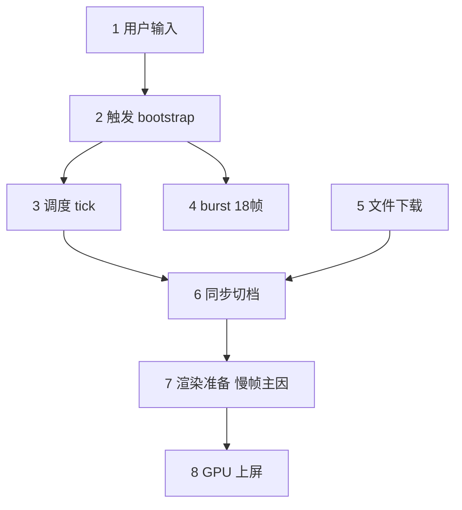

# Refinement 瓶颈归因（含流程说明）— refinement_finland_v3.txt

> 本文把 **Poland v3 profiling 数据** 和 **refinement 从调度到上屏的流程** 对齐，尽量用中文说明每类耗时发生在哪一步。

- 有效帧：1391 / 1391
- **慢档**（140–200ms）：47 帧 — 用户感到明显卡顿的一档
- **快档**（40–70ms）：785 帧 — 正常流畅的一档
- **显存上传帧**（copy≥99% 且 drawCalls≥10）：319 帧 — 与慢档高度重合

## 一、从相机移动到上屏：一帧里发生什么

下面按**时间顺序**拆成 7 步。左侧是「调度侧」（我们的 refinement 代码），右侧是「引擎侧」（PlayCanvas 高斯渲染）。**Poland 的 180ms 慢帧，瓶颈几乎都在第 6 步，而不是第 2 步扫描。**

```text
用户输入（相机移动 / 标定步 / 键鼠）
    |
    v
[1] 触发：平移>3cm 或 转向>10度 -> 通知 refinement
    |
    v
[2] 调度 tick（每帧 update）
    |-- 2A 视锥扫描 scan（~1ms）
    |-- 2B 维护待下载列表
    |-- 2C 调整下载队列 / 并发 / pin
    `-- 2D 决定是否 sync（~0ms）
    |
    +-- [3] burst 窗口：移动后 18 帧加速
    +-- [4] 文件下载（可跨多帧，落地后再 sync）
    |
    v
[5] 同步切档：标记 needsLodUpdate（调度很轻，~0ms）
    |
    v
[6] 渲染准备：整理高斯点 + 写入显卡  <-- Poland 慢帧主因（~100ms+）
    |
    v
[7] GPU 绘制上屏（~16ms，不高）
```



### 各步对应代码位置（便于对照源码）

| 步骤 | 做什么 | 代码入口 |
|---|---|---|
| 第 1 步 | 检测相机是否「值得」重新调度 LOD | `bootstrap.ts` 平移 3cm / 转向 10° 阈值 |
| 第 2 步 | 每帧调度：扫描→队列→是否 sync | `refinement-controller.ts` → `runPriorityPrefetch()` |
| 第 3 步 | 移动后 18 帧加速窗口 | `notifyCameraMoved` 设置 `cameraBurstFrames=18` |
| 第 4 步 | 后台下载 LOD 文件 | `assetLoader` + `prioritizeFileLoad` |
| 第 5 步 | 标记 instance 要换档并排队更新 | `syncOctreePendingPlacements` → `scheduleDeferred...` |
| 第 6 步 | 把新高斯数据写入 GPU 并准备绘制 | PlayCanvas `gsplatManager`（`applyLodChanges` 等） |
| 第 7 步 | 实际画到屏幕 | WebGPU forward / splat pass |

## 二、名词解释（尽量不用英文缩写）

| 报告里的词 | 通俗说法 |
|---|---|
| **refinement / 调度器** | 相机一动，就重新算「眼前该用哪一档清晰度、该下哪些文件」的那套逻辑 |
| **tick** | 上面这套逻辑在**每一帧 update** 里跑一轮，叫一次 tick（≠ 整帧时间） |
| **scan（扫描）** | 从八叉树里找视锥内的叶子，算每块该用 LOD0/1/2… 哪档 |
| **burst（移动后加速窗口）** | 相机刚动完后的 **18 帧**，下载更积极、也更容易触发「换档上屏」 |
| **sync（同步切档）** | 通知引擎：这些空间块该换 LOD 了，给每个块打 `needsLodUpdate` |
| **instance** | 空间里的一块 LOD 贴片，有自己的高斯点数据和 GPU 资源 |
| **buffer upload / copyPct** | 把 CPU 里整理好的高斯点**拷贝到显卡**；`copyPct≈100` 表示本帧拷贝任务很重（**不是 100 毫秒**） |
| **drawCalls** | 本帧绘制调用次数；慢帧从 2 涨到 27+，说明**多块同时换档上屏** |
| **gapMs（未计入耗时）** | 整帧时间减去已统计的 update/render/scan/sync 后，**还剩多少**；慢帧里主要是第 ⑥ 步引擎内部工作 |
| **jsHeap** | 浏览器 JS 堆内存；Poland 常驻 1.5–2.8GB，会让卡顿更容易出现，但**不是 180ms 慢帧的直接主因** |
| **双模态** | 帧时间呈两档：快档 ~50ms、慢档 ~180ms，不是单一平均值 |

## 三、profiler 指标落在哪一步

| 指标 | 落在哪一步 | Poland 慢帧 P50 | Poland 快帧 P50 | 说明 |
|---|---|---:|---:|---|
| `refinement.tick.timingsMs.scan` | 第 ②-A 步 | 1.3 ms | 0.0 ms | 扫描几乎不随移动距离变，**不是慢帧原因** |
| `refinement.tick.timingsMs.sync` | 第 ②-D + 第 ⑤ 步入口 | 0.00 ms | 0.00 ms | 只是「决定并排队切档」，**几乎不耗时** |
| `refinement.deferredInstUpdateMs` | 第 ⑤ 步 frameend | 0.00 ms | 0.00 ms | WebGPU 推迟执行切档入口，仍很短 |
| `cpu.renderMs` | 第 ⑥ 步（部分） | 77.3 ms | 18.6 ms | 渲染阶段墙钟，慢帧明显变长 |
| `cpu.gsplatBufferCopyPct` | 第 ⑥ 步 | 100% | 0% | 慢帧≈100% = 本帧在做大量显存上传 |
| `refinement.gapMs` | 第 ⑥ 步（未细分部分） | 65 ms | 5 ms | PlayCanvas 内部 `assignSplatOffsets` 等，profiler 未单独计时 |
| `gpu.totalMs` | 第 ⑦ 步 | 25.9 ms | 19.2 ms | **GPU 绘制不高**；慢是 CPU 侧准备数据 |
| `drawCalls` | 第 ⑥–⑦ 步 | 13 | 2 | 多块同时换档时上升 |
| `frameMs` | 第 ①–⑦ 步合计 | 167.7 ms | 41.7 ms | 用户感知的整帧时间 |

### 一句话总结 Poland 慢帧

> 相机**大移动**（尤其标定 `move_5m`）→ 开启 **18 帧 burst** → 调度器每帧决定「要换档」（**scan/sync 仍 ~1ms**）→ 真正耗时在 **PlayCanvas 把新高斯数据写入显卡**（`copyPct≈100`，`gapMs≈119ms`）→ GPU 画上屏反而只要 ~18ms。

## 四、Poland 实测：慢档 vs 快档差在哪几步

| 对比项 | 快档 40–70ms（785 帧） | 慢档 140–200ms（47 帧） |
|---|---|---|
| 第 ② 步 scan | ~0.0 ms，与快档相同量级 | ~1.3 ms，**没有变慢** |
| 第 ⑤ 步 sync 调度 | ~0 ms | ~0 ms，**不是瓶颈** |
| 第 ⑥ 步 显存上传 | copyPct≈0，drawCalls≈2 | copyPct≈100%，drawCalls≈27，**95% 慢帧命中** |
| 第 ⑦ 步 GPU | ~19 ms | ~26 ms，**差别不大** |
| 内存 | Heap ~489 MB | Heap ~455 MB，偏高但非主因 |

## 五、慢帧是哪种相机交互触发的

> **读数注意**：profiler 的「当帧平移/转向」是**相邻两帧**的差值。标定 `move_5m` 那一帧可能显示 5m，但**后面十几帧往往显示「静止」**——慢帧常出现在移动**之后**的 burst 窗口，不要只看当帧位移。

| 指标 | 慢帧计数 | 占比 |
|---|---:|---:|
| 本帧刚过 LOD 阈值 | 0 | 0.0% |
| 处于 cameraBurst 窗口 | 43 | 91.5% |
| 录制前半段（标定+早期交互，index<280） | 47 | 100.0% |

### 慢帧所处交互阶段

| 阶段 | 帧数 | 占比 | 说明 |
|---|---:|---:|---|
| burst 窗口：相机已静止（滞后切档/upload） | 43 | 91.5% | 代码: `burst_idle` |
| 稳态（无 burst、近期无 LOD 触发） | 4 | 8.5% | 代码: `steady` |

### 慢帧当帧平移量（易误判：滞后帧多为「静止」）

| 平移桶 | 帧数 | 占比 |
|---|---:|---:|
| 静止 | 47 | 100.0% |

### 慢帧当帧转向量

| 转向桶 | 帧数 | 占比 |
|---|---:|---:|
| 静止 | 47 | 100.0% |

### 常见组合（平移 + 转向）

- 静止 + 静止：**47** 帧（100.0%）

### 标定/大动作后 22 帧内的慢帧（时序归因）

| 交互类型 | 触发次数 | 后续 22 帧均慢帧 | 后续 22 帧均 upload 帧 | 均慢帧占比 |
|---|---:|---:|---:|---:|
| 标定 move_20cm | 20 | 0.0 | 0.0 | 0% |
| 标定 move_1m+ / combo 平移 | 50 | 0.0 | 0.0 | 0% |
| 标定 move_5m | 9 | 0.0 | 0.0 | 0% |

对应录制脚本：`move_5m`、`move_1m`、`yaw_30deg`、`combo_2m_20deg` 及键鼠 W/拖拽。
**结论**：`move_5m` 每次标定后约 **15/22 帧**为慢档（≈68%），是主要交互来源；单帧 `rotateSinceLastDeg` 峰值仅 ~9°（30° 标定可能被拆帧/缓动），转向标定在本日志中未形成独立慢帧簇。


### 快档对照：同样处于 burst 窗口，为何有的快有的慢？

快档里也有约 **27%** 帧处于「burst 后 LOD 触发」阶段，但 **copyPct=0、drawCalls=2**——说明**同一轮移动后**，是否碰上「多块同时换档 + 显存大批量上传」决定快/慢，而不是「有没有移动」本身。

### 快档交互阶段分布

| 阶段 | 快帧数 | 占比 |
|---|---:|---:|
| 稳态（无 burst、近期无 LOD 触发） | 597 | 76.1% |
| burst 窗口：相机已静止（滞后切档/upload） | 73 | 9.3% |
| burst 窗口：前 18 帧内有过 LOD 触发 | 61 | 7.8% |
| 触发帧：小步移动/转向（刚过 3cm/10° 阈值） | 32 | 4.1% |
| 触发帧：大移动(>1m)或大转向(>10°) | 22 | 2.8% |

## 六-A、慢档明细（47 帧）

| 指标 | 含义（对应第几步） | P50 | P90 | Max |
|---|---|---:|---:|---:|
| frameMs | 整帧墙钟 ①–⑦ 合计 | 167.7 | 183.4 | 192.2 |
| gapMs | 第 ⑥ 步未细分耗时 | 64.9 | 83.0 | 106.5 |
| copyPct | 第 ⑥ 步 显存上传饱和度 | 100.0 | 102.2 | 104.9 |
| drawCalls | 第 ⑥–⑦ 步 绘制块数 | 13 | 29 | 37 |
| scan tick ms | 第 ②-A 步 | 1.30 | 1.90 | 2.80 |
| sync tick ms | 第 ②-D/⑤ 步 | 0.00 | 0.00 | 0.10 |
| cpu.renderMs | 第 ⑥ 步（部分） | 77.3 | 81.0 | 107.0 |
| gpu.totalMs | 第 ⑦ 步 | 25.9 | 34.7 | 41.9 |
| jsHeap Mb | 背景内存压力 | 455 | 752 | 780 |

**主因分布（自动分类）**

- 第 ⑥ 步：显存大批量上传（慢帧主因）：**47** 帧（100.0%）

**切档触发原因（第 ⑤ 步为何执行）**

- 移动后 burst 窗口内，且当前视角需要换 LOD 档：**86** 次命中
- 某一 LOD 文件刚加载完，引擎通知 loading 减少：**6** 次命中

## 六-B、快档明细（785 帧）

| 指标 | 含义（对应第几步） | P50 | P90 | Max |
|---|---|---:|---:|---:|
| frameMs | 整帧墙钟 ①–⑦ 合计 | 41.7 | 58.3 | 67.4 |
| gapMs | 第 ⑥ 步未细分耗时 | 5.3 | 19.7 | 47.8 |
| copyPct | 第 ⑥ 步 显存上传饱和度 | 0.0 | 0.0 | 100.0 |
| drawCalls | 第 ⑥–⑦ 步 绘制块数 | 2 | 2 | 32 |
| scan tick ms | 第 ②-A 步 | 0.00 | 1.00 | 2.50 |
| sync tick ms | 第 ②-D/⑤ 步 | 0.00 | 0.00 | 0.10 |
| cpu.renderMs | 第 ⑥ 步（部分） | 18.6 | 21.1 | 39.9 |
| gpu.totalMs | 第 ⑦ 步 | 19.2 | 31.0 | 51.6 |
| jsHeap Mb | 背景内存压力 | 489 | 730 | 865 |

**主因分布（自动分类）**

- 稳态：未碰上换档上传：**774** 帧（98.6%）
- 第 ⑤ 步：调度器触发切档（本身很轻）：**11** 帧（1.4%）

**切档触发原因（第 ⑤ 步为何执行）**

- 移动后 burst 窗口内，且当前视角需要换 LOD 档：**19** 次命中
- 某一 LOD 文件刚加载完，引擎通知 loading 减少：**4** 次命中

## 六-C、显存上传帧明细（319 帧）

| 指标 | 含义（对应第几步） | P50 | P90 | Max |
|---|---|---:|---:|---:|
| frameMs | 整帧墙钟 ①–⑦ 合计 | 83.8 | 159.2 | 366.7 |
| gapMs | 第 ⑥ 步未细分耗时 | 31.0 | 64.5 | 275.4 |
| copyPct | 第 ⑥ 步 显存上传饱和度 | 100.0 | 101.5 | 105.8 |
| drawCalls | 第 ⑥–⑦ 步 绘制块数 | 37 | 68 | 85 |
| scan tick ms | 第 ②-A 步 | 1.10 | 1.70 | 3.60 |
| sync tick ms | 第 ②-D/⑤ 步 | 0.00 | 0.00 | 0.10 |
| cpu.renderMs | 第 ⑥ 步（部分） | 26.2 | 74.5 | 107.0 |
| gpu.totalMs | 第 ⑦ 步 | 29.2 | 38.6 | 51.5 |
| jsHeap Mb | 背景内存压力 | 550 | 782 | 876 |

**主因分布（自动分类）**

- 第 ⑥ 步：显存大批量上传（慢帧主因）：**319** 帧（100.0%）

**切档触发原因（第 ⑤ 步为何执行）**

- 移动后 burst 窗口内，且当前视角需要换 LOD 档：**591** 次命中
- 某一 LOD 文件刚加载完，引擎通知 loading 减少：**19** 次命中

## 七、优化建议（按流程步骤）

1. **第 ③–⑤ 步（burst + sync 频率）**：`move_5m` 后约 68% 帧为慢档；可考虑合并换档、减少 burst 内重复 sync，而不是继续压 scan。
2. **第 ⑥ 步（显存上传）**：`assignSplatOffsets` / `writeBuffer` 是 CPU profile 热点；优化方向是减少同时换档块数、增量更新 work buffer。
3. **第 ④ 步（内存）**：Heap 1.6–2.8GB 来自 pin/并发下载，改善体验但**不能单独解决 180ms 尖峰**。
4. **第 ⑦ 步（GPU）**：Poland 慢帧 GPU 仅 ~18ms，**不是优先优化点**。

**数据侧补充**

- 慢帧主因是第 ⑥ 步显存上传，应优先减少 burst 内重复换档，而不是压 scan
- 主要 sync 触发：burst_lod_switch(86), frame_ready_loading_drop(6)
- 慢帧 gapMs P50=65ms：配合 Chrome trace 查 GC / 未计时引擎路径
- 慢帧 91.5% 处于 burst 窗口：标定大移动/转向后的 18 帧内滞后 buffer upload 是主路径
