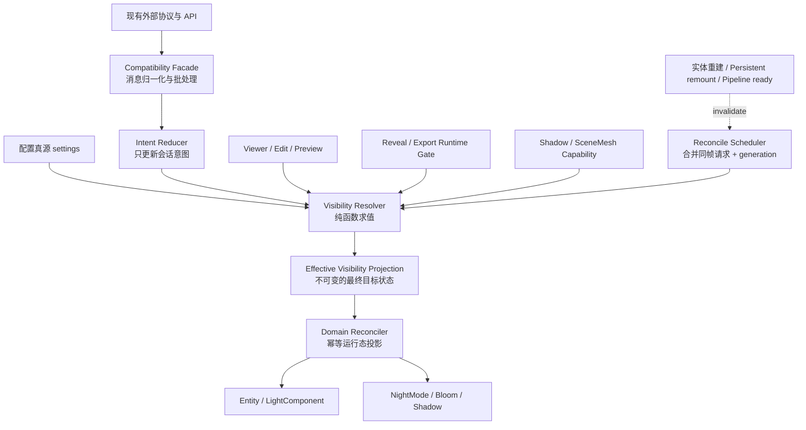

# Viewer Scene Content 显隐系统收敛重构方案

> 状态：方案稿，尚未实施  
> 日期：2026-08-14  
> 目标范围：Viewer 模式下 Scene Content 与 Lighting 显隐管理  
> 核心约束：不修改现有外部消息类型、参数结构、回包名称和公开调用入口

## 1. 结论摘要

这不是一个适合一次性替换的小改动。当前显隐逻辑已经横跨 Scene Content、用户灯实体、NightMode、Bloom、Shadow、Reveal/Persistent、Viewer/Edit 切换和异步 remount。如果直接整体改写，改动较大、回归风险高。

建议采用“兼容外壳 + 分阶段迁移”：

1. 先固化现有外部语义和关键场景。
2. 在现有 API 后面引入纯状态求值器和幂等 Reconciler。
3. 第一阶段只迁移 Lighting，不同时重写 Effects 和 Assets。
4. 保留旧实现作为短期 fallback，经过场景矩阵验证后再删除快照与特殊顺序补丁。

按此方式，第一轮 Lighting 收敛属于**中等规模改动、可控的中高风险重构**。风险主要来自行为时序和异步覆盖，而不是类型或编译层面。

## 2. 改动规模评估

### 2.1 第一轮建议范围

第一轮只处理：

- `contentVisibility.lights` 大类显隐。
- `lightingVisibility.brightness/bloom/shadow` 子项显隐。
- 点光和聚光实体根节点及单灯有效状态。
- Viewer/Edit/Preview 切换后的重放。
- Reveal/导出 runtime gate 对用户灯的约束。
- Persistent remount、实体重建后的光照状态重放。
- 旧消息级联行为的兼容。

第一轮不处理：

- 不重写 Reveal/Persistent/Stylization 的具体 mount/unmount 实现。
- 不改变 Assets、Annotations 的外部语义。
- 不改变 `LIGHT_TOGGLE`、`LIGHT_TOGGLE_ALL` 当前的配置写入语义，除非特征测试证明它属于历史误行为并单独评审。
- 不把 Torch 纳入 `contentVisibility.lights`。
- 不顺带调整 settings schema 或存盘格式。

### 2.2 预计影响文件

核心改动预计集中在 7～10 个生产文件，并新增若干内部模块和测试文件：

- `src/scene-visibility/registry.ts`
- `src/scene-visibility/adapters.ts`
- `src/scene-visibility/lighting-session-visibility.ts`
- `src/scene-visibility/types.ts`
- `src/view-settings.ts`
- `src/light.ts`
- `src/message-bridge.ts`
- `src/viewer.ts`
- `src/editor-modules/protocol-adapters/environment-protocol-adapter.ts`
- `src/vfx/bloom/*`、`src/vfx/shadow/*` 中少量消费端调整

建议新增：

- `src/scene-visibility/visibility-coordinator.ts`
- `src/scene-visibility/lighting-visibility-resolver.ts`
- `src/scene-visibility/lighting-visibility-reconciler.ts`
- 对应的纯函数与行为测试

### 2.3 工程量级

以下仅用于评估复杂度，不作为精确排期承诺：

| 阶段 | 内容 | 参考工作量 |
| --- | --- | ---: |
| Phase 0 | 行为盘点、特征测试、调试快照 | 1～2 人日 |
| Phase 1 | Projection、Resolver、Coordinator 骨架 | 2～3 人日 |
| Phase 2 | Lighting 迁移与兼容入口 | 3～5 人日 |
| Phase 3 | 异步 remount、实体重建收口 | 2～4 人日 |
| Phase 4 | 场景回归、灰度开关、删除旧补丁 | 2～3 人日 |

第一轮 Lighting 收敛整体约为 10～17 人日，其中包含定向回归和问题修正。若缺少可自动运行的 Viewer 场景测试，人工验证成本可能高于编码成本。

## 3. 当前问题模型

当前光照显隐由四层状态共同影响：

1. **配置真源**：`settings.lighting.lights[].enabled`、nightMode、Bloom、Shadow。
2. **Viewer 会话意图**：`contentVisibility.lights`、`lightingVisibility.*`。
3. **临时恢复快照**：`__sceneContentUserLightsEnabledSnap`、`__sceneContentLightsBloomSnap`。
4. **画面运行态**：Entity、LightComponent、nightFade、Bloom/Shadow runtime。

当前的问题不是状态数量多，而是这四层会互相写入：

- 大类隐藏会同步修改光照子 flag。
- 逐灯消息可能先写坏配置真源，再由大类快照尝试恢复。
- 大类恢复会把快照写回 settings。
- 特效 teardown/remount 会重新应用 nightFade，覆盖光照会话门控。
- 光源实体重建后可能绕过 Scene Content 当前 gate。
- 整体显隐依赖 `lights` 必须最后执行，并需要额外 reapply。

因此系统很难稳定回答：一盏灯不可见是因为自身关闭、大类关闭、runtime gate、子项关闭，还是异步重建造成的状态丢失。

## 4. 目标架构



### 4.1 核心求值规则

```text
categoryEffective =
    editMode ? true : contentVisibility.lights

lightRootEffective =
    categoryEffective && runtimeGateOpen

singleLightEffective(id) =
    lightRootEffective && configuredLightEnabled(id)

brightnessEffective =
    categoryEffective && lightingVisibility.brightness

bloomEffective =
    categoryEffective && lightingVisibility.bloom

shadowEffective =
    categoryEffective
    && lightingVisibility.shadow
    && shadowCapabilityAvailable
```

Torch 保持独立，不参与 `contentVisibility.lights` 求值。

### 4.2 设计原则

- Scene Content 大类和 runtime gate 只叠加约束，不反向覆盖配置真源。
- Resolver 不操作实体、不发事件、没有副作用。
- Reconciler 可重复执行，相同 Projection 不产生额外状态变化。
- 所有异步重建完成后只发 invalidation，不直接补写光照状态。
- 整体显隐先批量写完 intent，再执行一次 reconcile。
- 外部 changed 事件保持兼容，但不再作为内部真源。

## 5. 分阶段实施计划

### Phase 0：建立行为基线

#### 目标

在重构前记录当前对外可观察行为，区分“必须兼容的产品语义”和“应该消除的内部偶发行为”。

#### 工作项

- 建立消息序列特征测试。
- 增加只读的 Visibility Debug Snapshot：
  - category intent；
  - lighting sub-intent；
  - runtime gate；
  - settings 单灯 enabled；
  - Entity/LightComponent 实际状态；
  - brightness/bloom/shadow effective 状态。
- 记录 changed 事件的名称、顺序、次数和 payload。
- 明确 `LIGHT_TOGGLE*` 在纯 Viewer 中是否允许修改 settings，以及这是否属于必须保留的现有语义。

#### 退出条件

- 关键消息排列均有明确预期。
- 能定位每个最终显隐结果来自哪一层状态。
- 尚未替换任何生产逻辑。

### Phase 1：引入 Projection 与 Resolver

#### 目标

建立新的纯状态模型，但先以 shadow mode 运行，不控制画面。

#### 工作项

- 定义 `LightingVisibilityProjection`。
- 实现 `resolveLightingVisibility(global)`。
- 在关键显隐操作后同时计算旧结果和新 Projection。
- 开发环境下记录两者不一致，但暂不改变旧画面。
- 将 Viewer/Edit、runtime gate、shadow capability 统一纳入求值输入。

#### 退出条件

- 目标场景中 Projection 与预期一致。
- Resolver 不修改 settings、viewSettings 和运行态实体。
- 不新增外部事件。

### Phase 2：迁移 Lighting Reconciler

#### 目标

让 Projection 成为光照最终运行态的单一入口。

#### 工作项

- 实现幂等 `reconcileLightingVisibility(projection)`。
- 收口点光/聚光根节点和 LightComponent 设置。
- 收口 brightness 的 `nightMode:forceReapply`。
- 收口 Bloom/Shadow 的会话门控刷新。
- `lightsAdapter` 改为只写 intent 和请求 reconcile。
- `setLightingSessionAspectVisible` 改为只写子 intent 和请求 reconcile。
- `setAllCategoriesVisible` 批量写入后只 reconcile 一次。
- 保持现有 changed 回包协议不变。

#### 兼容策略

保留一个短期 feature flag：

```text
legacy visibility apply  <->  projection reconciler
```

feature flag 仅用于开发验证和快速回滚，不对外公开。

#### 退出条件

- 整体显隐不再依赖 `lights` 最后执行。
- 同一 Projection 重放不会改变 settings。
- 单灯自身关闭在大类 hide/show 后仍保持关闭。
- category hide/show 不再需要恢复单灯 settings 快照。

### Phase 3：收口异步重建和跨系统覆盖

#### 目标

消除 Viewer 和 Effects 中直接补写光照状态的旁路。

#### 工作项

- `updatePointLightsFromSettings()` 完成后发内部 invalidation。
- Persistent remount 完成后发内部 invalidation。
- Reveal complete/restore 完成后发内部 invalidation。
- Shadow pipeline ready 后发内部 invalidation。
- Coordinator 在 frame end 合并重复请求。
- 使用 generation/revision，防止旧异步回调覆盖更新后的 intent。
- 删除 Viewer 中直接调用 `applyLightingSessionAspects`、`applySceneContentUserLightRoots` 的补丁入口。

#### 退出条件

- 隐藏状态下 remount 不会闪现一帧光照。
- 实体重建后自动恢复当前有效状态。
- 异步回调执行顺序不影响最终结果。

### Phase 4：删除旧快照和特殊顺序

#### 目标

移除已被 Projection/Reconciler 取代的技术债。

#### 候选删除项

- `__sceneContentUserLightsEnabledSnap`
- `__sceneContentLightsBloomSnap`
- `snapshotUserPointSpotLightsEnabled`
- `ensureUserLightEnabledSnapBeforeViewerToggle`
- Scene Content 恢复时向 settings 写回单灯快照的逻辑
- `SCENE_CONTENT_ALL_SET_*_ORDER` 中为光照建立的特殊顺序约束
- 整体显隐后的额外 `applyLightingSessionAspects()`
- Viewer persistent remount 中的光照专项重放

#### 退出条件

- 全量场景矩阵通过。
- 旧 feature flag 连续关闭一段验证周期后无阻断问题。
- 无代码仍依赖旧快照字段。

### Phase 5：扩展到其他 Scene Content 系统

该阶段不属于第一轮 Lighting 收敛的必做项，应另开评审。

迁移优先级建议：

1. Annotations：结构简单，可验证通用 coordinator 接口。
2. Persistent/Stylization：快照和异步生命周期问题最接近 Lighting。
3. Reveal：需要与导出时间轴、恢复逻辑共同评审。
4. Assets/Media：需要区分“不可见”和“暂停/停止”的副作用语义。

## 6. 主要回归风险

| 风险 | 概率 | 影响 | 典型表现 | 缓解措施 |
| --- | --- | --- | --- | --- |
| 外部消息级联被误判 | 高 | 高 | 父级隐藏后单灯真实 intent 丢失，或用户单灯操作被吞掉 | Phase 0 固化消息序列；兼容层按批次归一化；保留事件回包 |
| 执行顺序变化 | 中 | 高 | 整体隐藏后 nightFade 被 Persistent 恢复 | 最终状态只能由 Reconciler 投影；异步结束后 invalidation |
| 一帧闪现 | 中 | 高 | Reveal/remount 或实体重建时隐藏灯短暂出现 | 新实体创建时默认安全状态；frame-end reconcile；generation 防旧回调 |
| Viewer 状态污染 Edit | 中 | 高 | 进入编辑后灯仍被 Viewer 大类关闭 | Resolver 中 Edit 强制忽略 Viewer overlay；切换矩阵测试 |
| settings 被会话显隐修改 | 当前已存在 | 高 | hide/show 后 needsSave 或存盘单灯状态变化 | 建立 settings deep snapshot；Scene Content 路径禁止写 settings |
| changed 事件不兼容 | 中 | 中高 | 父页面勾选状态不同步 | 对事件名称、顺序、次数做契约测试；Facade 保持原回包 |
| Shadow 意外触发生成 | 低中 | 高 | 只切显隐却发起 sceneMesh generate | Resolver 只读取 capability；reconcile 不调用 generate |
| Bloom local/global 混淆 | 中 | 中高 | 局部亮灯关了但全局 Bloom 仍开，或反向误关 | Projection 分开描述 session visibility、scope 和 settings enabled |
| 单灯关闭无法恢复 | 中 | 高 | 大类重新显示后所有灯被强制打开 | `singleLightEffective = root × configuredEnabled`；禁止 `entity.enabled=true` 粗暴覆盖 |
| 重复事件导致性能下降 | 中 | 中 | 多次 forceReapply、重复重建 shader | scheduler 合并同帧请求；Projection equality 去重 |
| Torch 被误纳入大类 | 低 | 中 | lights 隐藏时手电筒也被关 | Projection 明确排除 torch；独立回归用例 |
| 无灯配置时旧容器残留 | 低中 | 中 | settings 已无灯但画面仍有实体 | entity rebuild 与 visibility reconcile 分责；测试增删灯场景 |

## 7. 必须覆盖的回归矩阵

### 7.1 光照组合

- 单灯：开/关 × 大类：开/关。
- brightness、bloom、shadow 八种组合。
- Bloom scope：local/global。
- sceneMesh：有/无/加载中。
- Torch：开/关。
- 点光、聚光、方向光分别验证。

### 7.2 操作序列

- `SCENE_CONTENT_CATEGORY_SET(false → true)`。
- `SCENE_CONTENT_ALL_SET(false → true)`。
- 先逐灯关，再大类关，再大类开。
- 先大类关，再收到逐灯消息，再大类开。
- 大类已关时修改 brightness/bloom/shadow 子项。
- 连续重复 hide、连续重复 show。
- 同一帧多条 category/sub-light 消息。

### 7.3 生命周期

- Viewer → Edit → Preview → Viewer。
- Reveal 播放前、中、完成后。
- VFX 导出 runtime gate 开关。
- Persistent mount、delete、remount。
- pointLights/spotLights 容器重建。
- Shadow pipeline 延迟 ready。
- settings 恢复、Undo/Redo 后重新建灯。

### 7.4 不变量断言

- Scene Content hide/show 前后，非显式编辑路径下 settings 深比较一致。
- category 关闭时所有受控光照的 effective 状态为 false。
- category 恢复后，单灯 effective 状态严格服从配置真源。
- Edit 模式不受 Viewer category intent 影响。
- Shadow 显隐切换不触发 sceneMesh generate。
- 相同 Projection 连续 reconcile 不产生额外事件和重建。

## 8. 事件与兼容策略

### 8.1 保持不变

- 所有 `SCENE_CONTENT_*` 入站消息。
- 所有 `LIGHTING_*_SHOW_HIDE_SET` 入站消息。
- `LIGHT_TOGGLE`、`LIGHT_TOGGLE_ALL` 入站消息。
- 对外 `*_CHANGED` 消息名称和 payload。
- `SceneContentVisibilityRegistry` 现有公开方法签名。

### 8.2 允许内部调整

- changed 事件的生成位置可移到 Compatibility Facade。
- 多次底层 apply 可合并成一次 reconcile。
- 新增内部 invalidation/reconciled 事件，但不能暴露为新的外部依赖。
- 临时快照可迁移为带类型、带生命周期的 coordinator 内部状态；最终应尽量删除。

### 8.3 需要在 Phase 0 决策的语义

以下两点不能仅靠代码推断，应通过现有父页面行为和产品预期确认：

1. `SCENE_CONTENT_CATEGORY_SET(lights, true)` 是恢复关闭前的光照子项，还是强制把 brightness/bloom/shadow 全部打开？当前实现倾向后者。
2. Viewer 中的 `LIGHT_TOGGLE` 是临时会话操作还是允许修改配置真源的编辑操作？当前实现会写 settings，但又用快照抵御父级级联。

外部接口无需变化，但这两项语义必须固定，否则内部无法稳定区分用户意图和 UI 级联副作用。

## 9. 可观测性与调试支持

建议在开发环境提供只读快照：

```ts
type VisibilityDebugSnapshot = {
    revision: number;
    reason: string;
    mode: 'viewer' | 'edit';
    runtimeGateOpen: boolean;
    intents: {
        lightsCategory: boolean;
        brightness: boolean;
        bloom: boolean;
        shadow: boolean;
    };
    capability: {
        shadowSceneMeshConfigured: boolean;
    };
    projection: LightingVisibilityProjection;
    actual: {
        pointRootEnabled: boolean | null;
        spotRootEnabled: boolean | null;
        lightComponents: Record<string, boolean>;
    };
};
```

该快照只用于诊断，不作为业务状态源，也不写入 settings。

## 10. 回滚策略

- Phase 1 只影子计算，没有运行态风险，可直接移除。
- Phase 2～3 期间保留内部 legacy feature flag，可按场景切回旧 apply。
- 每个阶段独立提交，禁止把“引入新模型”和“删除旧补丁”放在同一个提交中。
- 删除快照逻辑必须是最后阶段，且发生在完整回归之后。
- 若发生阻断问题，优先切回旧 Reconciler，不回滚 intent/schema 结构，降低状态迁移复杂度。

## 11. 推荐提交拆分

1. `test: characterize viewer lighting visibility behavior`
2. `refactor: add lighting visibility projection resolver`
3. `refactor: add idempotent lighting visibility reconciler`
4. `refactor: route scene content lighting through coordinator`
5. `refactor: reconcile lighting after entity and effect remount`
6. `test: add visibility lifecycle regression matrix`
7. `refactor: remove legacy lighting visibility snapshots`
8. `refactor: remove scene content lighting ordering workarounds`

## 12. 第一轮完成标准

第一轮 Lighting 收敛完成需要同时满足：

- 外部接口和回包契约不变。
- 整体显隐不依赖 adapter 遍历顺序。
- Scene Content 和 runtime gate 不修改 settings。
- 单灯自身状态在大类 hide/show 后可确定地恢复。
- Viewer/Edit/Preview 反复切换结果一致。
- Reveal、Persistent remount、实体重建不突破当前门控。
- Shadow 显隐不意外触发 sceneMesh generate。
- Torch 独立语义保持不变。
- 旧全局快照和 Viewer 专项补丁被删除，或有明确的保留原因和删除任务。
- 类型检查、lint、构建以及场景回归矩阵通过。

## 13. 后续系统推广原则

其他系统确实存在类似问题，但不应直接共用一个包含全部业务细节的巨型 Reconciler。

通用层只负责：

```text
接收意图 → 批量更新 → 求值 → 调度领域 Reconciler
```

各领域独立负责：

- Lighting：单灯、NightMode、Bloom、Shadow。
- Assets：单条 visible、morph、媒体暂停。
- Annotations：单条配置、DOM overlay、runtime gate。
- Effects：Reveal/Persistent/Stylization 的 mount/unmount 生命周期。

这样既能收敛跨系统状态覆盖，又不会形成新的全局上帝类。
