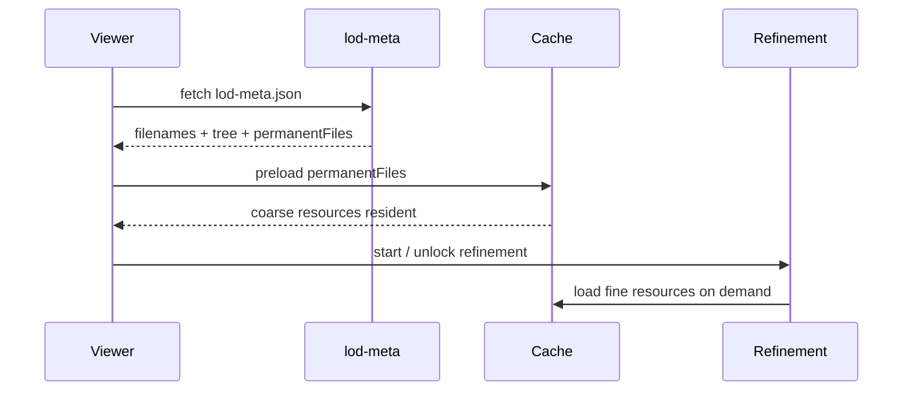

# Supersplat-Viewer 加载侧适配与优化方案

本文档面向 `../supersplat-viewer` 的 streamed octree / `lod-meta.json` 加载路径，整理如何适配 splat-transform 侧已落地的两类离线资产优化：

1. **L3/L4 等最粗档跨块打包常驻**：`--lod-coarse-merge-levels` 写入 `permanentFiles`。
2. **同 file 多切片**：`--lod-pack-mode packed` 让多个空间 leaf 的同档切片落入同一物理 SOG 文件，用 `file/offset/count` 引用。

目标不是把 Supersplat-Viewer 整体替换成 Aholo `LodSplat`，而是在现有 PlayCanvas streamed LOD / refinement 栈上增加资源缓存、常驻保护和 LodProxy 合并，减少重复 HTTP、重复整包解析和重复 placement。

---

## 1. 结论

### 1.1 当前可落地收益

| 优化 | 离线侧来源 | Viewer 侧要做 | 主要收益 |
| --- | --- | --- | --- |
| 粗级常驻 | `meta.permanentFiles` | 预加载并禁止卸载这些 file | 首屏固定拉少量粗档文件，远景不随视锥 node 数增加 HTTP |
| 同 file 多切片 | 多个 `tree` leaf 的 `lods[level].file` 相同但 `offset/count` 不同 | 资源级 cache + ref count 复用整包结果 | 同一物理 SOG 只下载/解析一次 |
| LodProxy | 同 file 且 offset 连续的多个 node | enqueue 前合并为一个 proxy | 减少 loadSplat / placement / draw unit 数 |
| pending 保粗 | runtime 策略 | 目标细档 ready 前不卸当前粗档 | 避免糊到清过程空洞或闪灭 |

### 1.2 不能误判的边界

- SOG packed 不是字节 range / page streaming。首次请求某个大 SOG 时仍要等整文件下载、解码、上传后，才能使用其中的 `offset/count` 切片。
- `--lod-pack-chunk-count` 过大只会把 HTTP 数压低，不一定提升冷启动下的“由粗变细”速度；它会增加 overfetch。
- SPZ 在 Aholo loader 中有 stream decode 能力，但 Aholo `LodSplat` 调度仍以 `resourceIdx + offset + count` 为单位，资源完成加载后再切片。SPZ 不是当前 Supersplat-Viewer 适配的 P0。

---

## 2. 离线资产规格

### 2.1 现有 `lod-meta.json` 字段

`writeLod` 输出保持 PlayCanvas streamed LOD 结构：

```json
{
  "version": 1,
  "filenames": ["5_0.sog", "4_0.sog", "3_0.sog", "..."],
  "permanentFiles": [0, 1],
  "tree": {
    "children": [],
    "lods": {
      "0": { "file": 17, "offset": 0, "count": 98234 },
      "1": { "file": 9, "offset": 0, "count": 40123 },
      "5": { "file": 0, "offset": 512, "count": 418 }
    }
  }
}
```

含义：

| 字段 | 语义 |
| --- | --- |
| `filenames[]` | 相对 `lod-meta.json` 的物理 SOG 文件路径 |
| `permanentFiles[]` | 需要预加载并常驻的 `filenames` 下标 |
| `lod.file` | 当前 leaf 某档引用的物理文件下标 |
| `lod.offset` / `lod.count` | 当前 leaf 在该物理文件内的 splat 切片 |

### 2.2 推荐生成命令

以 `nanguangchang` 为例：

```bash
splat-transform \
  ./assets/nanguangchang/nanguangchang.sog --lod 0 \
  ./assets/nanguangchang/nanguangchang-lod1.sog --lod 1 \
  ./assets/nanguangchang/nanguangchang-lod2.sog --lod 2 \
  ./assets/nanguangchang/nanguangchang-lod3.sog --lod 3 \
  ./assets/nanguangchang/nanguangchang-lod4.sog --lod 4 \
  ./assets/nanguangchang/nanguangchang-lod5.sog --lod 5 \
  --lod-bundled \
  --lod-chunk-count 96 \
  --lod-chunk-extent 10 \
  --lod-coarse-merge-levels 2 \
  --lod-pack-mode packed \
  --lod-pack-chunk-count 1024 \
  --max-workers 2 \
  -w ./assets/nanguangchang/nanguangchang-packed/lod-meta.json
```

参数关系：

| 参数 | 控制对象 | 建议 |
| --- | --- | --- |
| `--lod-chunk-count` | 空间 leaf / 调度粒度，单位 K splats | 不宜过大，否则视锥与替换粒度变粗 |
| `--lod-pack-chunk-count` | 物理 SOG 文件合包粒度，单位 K splats | 必须大于 `lod-chunk-count` 才有文件数收益 |
| `--lod-coarse-merge-levels` | 最粗 N 档每档合为一个全局 file | 生产建议 1～2，避免 L2 过大常驻 |
| `--max-workers` | 离线 SOG 编码 worker 数 | 只影响生成速度/内存，不影响 viewer runtime |

`nanguangchang` 实测 `--lod-pack-chunk-count 2048` 后：

```text
旧 v6: files=630
packed: files=36, permanent=2

Level refs files splats
0     11612    20 40892269
1     11612     8 16356908
2     11612     4  6542763
3     11609     2  2617105
4     11464     1  1046842
5     10675     1   418737
```

但 `2048K` 比较激进，单个 L0 SOG 约 20MB+。冷加载敏感场景建议先测 `512K` 或 `1024K`。

### 2.3 回测命令

```bash
npm run audit:lod -- ./assets/nanguangchang/nanguangchang-packed/lod-meta.json
find ./assets/nanguangchang/nanguangchang-packed -type f -name '*.sog' | wc -l
```

验收指标：

| 指标 | 目标 |
| --- | --- |
| `files` | 相比 classic 明显下降 |
| `permanentFiles` | 只包含最粗 1～2 档的 file |
| 每档 `splats` | 与 baseline 一致 |
| 叶子 `refs` | 不减少，不出现 missing lod |
| 单 file 大小 | L0/L1 不应超过冷加载预算 |

---

## 3. Supersplat-Viewer 加载侧适配

### 3.1 读取并暴露 `permanentFiles`

在 `lod-meta.json` parse 后，保留原始 meta 的：

```ts
type LodMetaExt = {
    filenames: string[];
    permanentFiles?: number[];
};
```

要求：

- `permanentFiles` 是 `filenames` 下标，不是 LOD level。
- 旧资产没有该字段时返回空数组，保持现有行为。
- 多 piece / contentManifest 场景中，`permanentFiles` 必须按 piece 独立解析，不能跨 piece 共用 file index。

### 3.2 Bootstrap 阶段预加载 permanent files

推荐时序：



实现原则：

- 在 refinement 真正开始升档前，尽量先完成 `permanentFiles` 的资源加载。
- `permanentFiles` 加载失败应中断场景加载或降级为旧流程，不能静默进入“无粗档兜底”的状态。
- 进度条可将 meta 下载和 permanent preload 计入 bootstrap 阶段；不要把它当成普通 refinement 细档下载。

### 3.3 防卸载 / 防重复下载

资源缓存需要按 `fileIndex` 建立：

```ts
type FileResourceCache = {
    fileIndex: number;
    url: string;
    refs: number;
    protected: boolean;
    promise: Promise<DecodedSogResource>;
    resource?: DecodedSogResource;
};
```

规则：

1. `protected === true` 的 resource 不进入 cooldown unload。
2. 同一个 `fileIndex` 同时被多个 node 请求时，只能发起一个 fetch/decode promise。
3. `loadSlice(fileIndex, offset, count)` 必须复用完整 file resource。
4. 非 permanent file 在 `refs === 0` 且 cooldown 到期后才释放。

伪代码：

```ts
async function loadFile(fileIndex: number): Promise<DecodedSogResource> {
    let cached = fileCache.get(fileIndex);
    if (!cached) {
        cached = {
            fileIndex,
            url: resolveFileUrl(fileIndex),
            refs: 0,
            protected: permanentFiles.has(fileIndex),
            promise: fetchAndDecodeSog(fileIndex)
        };
        fileCache.set(fileIndex, cached);
    }
    return cached.promise;
}

async function loadSlice(fileIndex: number, offset: number, count: number) {
    const resource = await loadFile(fileIndex);
    return resource.createSlice(offset, count);
}

function releaseFile(fileIndex: number) {
    const cached = fileCache.get(fileIndex);
    if (!cached || cached.protected) return;
    cached.refs--;
    if (cached.refs <= 0) scheduleCooldownUnload(fileIndex);
}
```

---

## 4. 引入 LodProxy

### 4.1 目的

离线 packed 之后，一个物理 SOG 会包含大量 leaf 切片。若 viewer 仍按 leaf 逐个 enqueue：

```text
file=17 offset=0 count=1200
file=17 offset=1200 count=900
file=17 offset=2100 count=1600
```

虽然 HTTP 只会发一次，但 runtime 仍可能产生很多 `loadSplat` / placement / draw unit。LodProxy 的作用是把相邻、同 file、offset 连续的 leaf 合并为一个更大的调度单元：

```text
file=17 offset=0 count=3700
```

### 4.2 合并条件

只允许合并满足全部条件的目标：

| 条件 | 说明 |
| --- | --- |
| 同一 `fileIndex` | 必须引用同一物理 SOG |
| offset 连续 | `prev.offset + prev.count === next.offset` |
| LOD target 一致或可等价替换 | 避免一个 proxy 混合不同可见/预算语义 |
| 同一 piece / same transform | multi-piece 时不能跨 piece 合并 |
| 当前调度轮相邻或同优先级批次 | 避免低优先级区域被高优先级 proxy 带上屏 |

不建议用空间 AABB 相邻作为唯一条件；真正的硬条件是 file + offset 连续。

### 4.3 合并位置

推荐放在 refinement enqueue 前：

```text
compute target lod per node
  -> collect ready changes
  -> sort by priority
  -> group contiguous same-file slices into LodProxy
  -> enqueue proxies
```

伪代码：

```ts
type PendingSlice = {
    nodeId: number;
    fileIndex: number;
    offset: number;
    count: number;
    targetLevel: number;
    priority: number;
};

type LodProxy = {
    fileIndex: number;
    offset: number;
    count: number;
    nodes: PendingSlice[];
    priority: number;
};

function buildLodProxies(slices: PendingSlice[]): LodProxy[] {
    const sorted = slices.slice().sort((a, b) =>
        a.fileIndex - b.fileIndex ||
        a.offset - b.offset
    );

    const result: LodProxy[] = [];
    for (const slice of sorted) {
        const prev = result[result.length - 1];
        if (
            prev &&
            prev.fileIndex === slice.fileIndex &&
            prev.offset + prev.count === slice.offset &&
            prev.nodes[0].targetLevel === slice.targetLevel
        ) {
            prev.count += slice.count;
            prev.nodes.push(slice);
            prev.priority = Math.max(prev.priority, slice.priority);
        } else {
            result.push({
                fileIndex: slice.fileIndex,
                offset: slice.offset,
                count: slice.count,
                nodes: [slice],
                priority: slice.priority
            });
        }
    }
    return result.sort((a, b) => b.priority - a.priority);
}
```

### 4.4 替换语义

Proxy 加载完成后才能更新各 node 的 current state：

```text
before:
  node A current=L4, target=L1 pending
  node B current=L4, target=L1 pending

proxy ready:
  create slice(file, offset, count)
  place proxy
  mark node A/B current=L1
  release old coarse refs if non-permanent
```

如果 proxy 加载失败：

- 保留当前 coarse，不卸载。
- 对 proxy 内各 node 标记 retry/backoff。
- 不得把 node 标记为 target ready。

---

## 5. 调度顺序建议

### 5.1 P0：先接入 permanentFiles

最小改动：

1. 读取 meta 的 `permanentFiles`。
2. bootstrap 时预加载这些 file。
3. cooldown / unload 跳过 permanent file。
4. debug 面板输出 permanent loaded 状态。

验收：

- 首屏请求固定为 meta + 1～2 个粗档 file。
- 相机移动后 permanent file 不被卸载。
- 旧资产无 `permanentFiles` 时完全保持旧行为。

### 5.2 P1：file cache 去重

确保同一 fileIndex 在同一时刻只会产生一个下载/解析任务。

验收：

- Network 面板同一个 `.sog` URL 无并发重复请求。
- 同 file 多 node 升档时，后续 node 命中 pending promise 或 decoded cache。

### 5.3 P1：LodProxy 合并

在 P0/P1 cache 稳定后再加 proxy。

验收：

- packed 资产下 `loadSplat` 调用数明显少于 leaf 变更数。
- 合并后画面无空洞、无跨 piece 错位、无预算超限明显回退。
- proxy 粒度可配置上限，例如单 proxy 不超过 `128K～256K` splats，避免一次 placement 太重。

### 5.4 P2：调度体验增强

- pending 目标未 ready 时保持当前 coarse。
- 先执行已缓存降级，释放 budget，再处理升级。
- 快速相机移动时对细档请求做短暂 hysteresis。
- near focus 可允许跳档，但必须受 budget 硬上限控制。

---

## 6. 风险与调参

### 6.1 `lod-pack-chunk-count` 过大

| 现象 | 原因 | 应对 |
| --- | --- | --- |
| 冷启动拉近仍慢 | 单 file 太大，overfetch 重 | L0/L1 降到 512K 或 1024K |
| 首次细化有长卡顿 | decode / upload 单次成本高 | 限制 proxy 最大 splats；降低 pack size |
| HTTP 少但体感不升 | 请求数不是唯一瓶颈 | 加载耗时拆分为 fetch/decode/upload/sort |

建议测试矩阵：

| `lod-pack-chunk-count` | 适用 |
| --- | --- |
| 256 | 弱网、低端设备、冷加载敏感 |
| 512 | 默认推荐起点 |
| 1024 | 中等激进，适合 CDN 缓存较好 |
| 2048 | URL 数极少，但冷加载 overfetch 明显 |

### 6.2 permanentFiles 过多

不要把 L0/L1 加入 permanent。常驻文件越多，最低内存/显存基数越高。生产建议：

```text
permanentFiles = 最粗 1～2 档
```

### 6.3 LodProxy 过大

Proxy 不是越大越好。建议加上硬限制：

```text
maxProxySplats = 128K～256K
maxProxyNodes = 32～128
```

超过限制就切分成多个 proxy。

---

## 7. 可观测指标

Viewer 侧建议加 debug 统计：

| 指标 | 含义 |
| --- | --- |
| `distinctFileRequests` | 实际发起的唯一 SOG URL 数 |
| `fileCacheHit` / `fileCacheMiss` | 同 file 多切片复用效果 |
| `pendingFilePromises` | 是否存在重复并发下载 |
| `loadSliceCalls` | leaf 级切片加载次数 |
| `lodProxyCount` | proxy 合并后的调度单元数 |
| `avgProxySplats` / `maxProxySplats` | proxy 粒度是否过大 |
| `permanentLoaded` | 常驻粗档是否完成 |
| `coarseFallbackFrames` | pending 保粗是否生效 |
| `fetch/decode/upload/sort` 分段耗时 | 判断瓶颈在网络还是 GPU/CPU |

离线侧可用：

```bash
npm run audit:lod -- path/to/lod-meta.json
npm run audit:lod -- path/to/lod-meta.json -- --files
```

---

## 8. 回退策略

分两层回退：

### 8.1 资产回退

重新导出或切换到 classic：

```bash
--lod-pack-mode classic
```

或降低 packed 粒度：

```bash
--lod-pack-mode packed --lod-pack-chunk-count 512
```

### 8.2 Viewer 回退

按开关拆分：

```text
enablePermanentFilesPreload
enablePermanentFileProtection
enableFilePromiseDedup
enableLodProxy
enablePendingKeepCoarse
```

建议默认顺序：

1. 永久开启 `file promise dedup`。
2. 对有 `permanentFiles` 的资产开启 permanent preload/protection。
3. LodProxy 用 debug flag 灰度。

---

## 9. 推荐落地顺序

```text
P0  读取 permanentFiles + 预加载 + 防卸载
P0  fileIndex 级 promise/cache 去重
P1  pending 细档未 ready 时保持 coarse
P1  LodProxy 合并同 file 连续 offset 切片
P1  加 debug 指标和回测面板
P2  per-level pack 参数：L0/L1 小，L3/L4 粗档常驻
P2  评估 SPZ / range / page streaming，而不是直接替换 SOG
```

核心判断：

> 对 Supersplat-Viewer 当前架构，最先该吃的是 `permanentFiles + 同 file 多切片 cache + LodProxy` 的收益；SPZ 可以作为后续传输/解码格式优化，但不是加载侧调度收益的第一杠杆。
