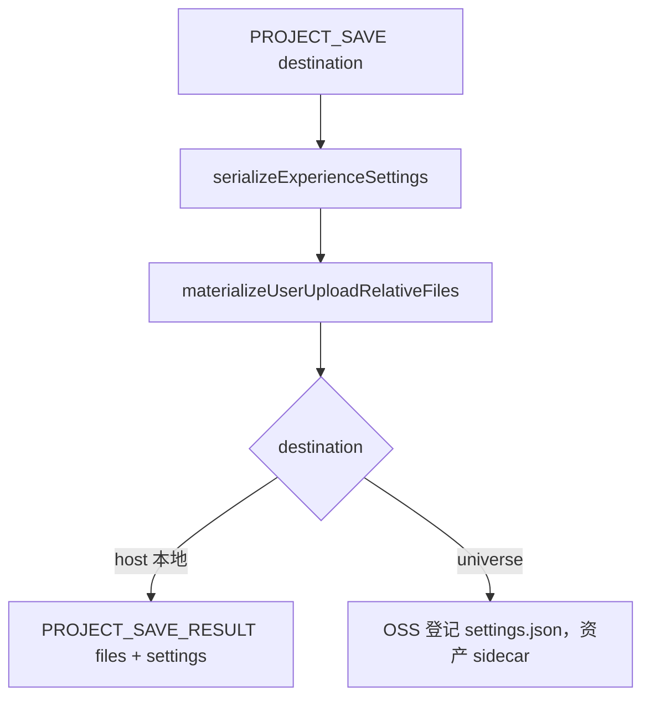

# 项目保存管线说明

> postMessage 本地保存 `destination: 'host'` 把产物交回父级；`universe` 由 Viewer 上传。协议表见 [SaaS第三期 编辑模式交互职责划分](SaaS第三期%20编辑模式交互职责划分.md)。

## 1. 能力概览

| 项 | 说明 |
|----|------|
| 统一入口 | `saveExperienceProject`（`src/settings-io/save.ts`） |
| 入站 | `PROJECT_SAVE { destination?: 'host' \| 'universe', requestId?: string }`，缺省 `universe` |
| 出站 | `host`（本地保存）成功/失败都走 `PROJECT_SAVE_RESULT`；`universe` 成功 `PROJECT_SAVE_SUCCEEDED`，失败 `PROJECT_SAVE_FAILED` |
| 进度出站 | `PROJECT_SAVE_PROGRESS { phase, message, done?, total?, bytes?, requestId? }`，`requestId` 为发起时的原值；只是进度，**结束看上面三个事件** |
| 取消入站 | `PROJECT_SAVE_CANCEL { requestId? }`：中止进行中的 `PROJECT_SAVE`（分块下载 / 打包 / 上传尽快停），结束仍由 `PROJECT_SAVE_RESULT` / `PROJECT_SAVE_FAILED` 带 `cancelled: true` 表示；无进行中保存则 warn 忽略 |
| 代码内取消 | `saveExperienceProject(global, destination, { signal })`：取消返回 `{ ok: false, cancelled: true, message: '已取消保存' }` |
| host | postMessage 本地保存：**不下载、不上传**。回传完整 settings、主模型 File、用户资源 File、路径↔字段 `references`。无论主模型是否改过都带回 `content/`；`contentChanged` 仅标记 Viewer 是否换过启动 URL。父级自行打包下载或交给客户上传 |
| universe | **不写 `content` 字段、不上传主场景**。只登记 `settings.json`；用户相对路径资产仍 sidecar put |
| Viewer 内部 `local` | 仅内部 UI 直连 `saveExperienceProject(..., 'local')` 下载 `project-{projectId}.zip`（无 projectId 时为 `project.zip`），**不是**父级 postMessage 协议值 |
| 缩略图 | 暂存 JPEG **仅 universe** OSS + 登记；host / 内部 local 不上传缩略图 |
| 超时 | internal UI 等待保存结果 **60s**；主场景为 `lod-meta.json` 时 **30min**（逐块拉取） |

## 2. 协议

### PROJECT_SAVE

- 缺省或非法 `destination` 视为 `'universe'`（SaaS 父页上传可不传）。
- **postMessage 本地保存**发 `destination: 'host'`：不上传、不触发下载，出站 `PROJECT_SAVE_RESULT`。
- **`universe`**：Viewer 上传 OSS。
- Viewer 内部顶栏「保存到本地」在直连路径仍调 `destination: 'local'` 下载 zip；走 message-bridge 时改发 `host`。
- **结束 / 进度**：`PROJECT_SAVE_RESULT`（host）/ `PROJECT_SAVE_SUCCEEDED` / `PROJECT_SAVE_FAILED` 就是**结束**回调，在分块下载 + 打包全部完成后才发，不需要再加结束事件。过程用 `PROJECT_SAVE_PROGRESS`。
- 同窗口内部编辑 UI 另走 `global.events`：`projectSave:progress`（进度）与 `projectSave:result`（结束，由 message-bridge 在处理完 `PROJECT_SAVE` 后派发）。父级不会把 `PROJECT_SAVE_RESULT` 回传给 iframe，所以内部 UI 的「保存成功/失败」提示以此为准，不再靠父级消息。
- 内部 UI 保存期间显示常驻进度提示（`showEditToastPersistent`，带百分比进度条 + 「取消」按钮），结束时关闭并换成成功/失败/已取消提示；浏览器控制台按 10% 节流打 `[SuperSplat][projectSave]` 日志（含 `已完成/总数 · 体积`）。
- **取消的实现**：直连保存由 UI 持有 `AbortController`，经 `{ signal }` 下沉到主场景 fetch、`lod-meta.json` fetch、各分块 fetch、`Blob.arrayBuffer()` 之间的打包循环与 universe 上传步骤；message-bridge 路径由 bridge 持有 controller（`PROJECT_SAVE_CANCEL` 中止）。「保存并退出」时取消则**留在编辑态**。

### ASSET_PLACE File

入站仍为 `ASSET_PLACE { value: AssetLibraryItem }`，`value.src` 为 `string | File`：

- **src 为 File**：写入会话表并把 `src` 改成 `assets/<basename>`（重名 `assets/<assetId>-<basename>`）；Viewer 用会话表 object URL 加载。`ScenePlacedItem.file` 仍可保留原始字节（内部，不走 postMessage）。
- **仅 http(s) 字符串**：行为不变，settings 写绝对 URL，不打包。
- 跨域 iframe **不要只传父页 `blob:` 字符串**（绑在父 document origin，iframe 无法 fetch）。应 postMessage 传 `File`（放在 `value.src`）。
- `blob:` **不写入 settings**。`ASSET_COPY` 复制同一 `file` 引用。不认独立 `value.url` / `value.file`。
- 放置逻辑在 `src/loaders/asset-file.ts`，不进 serialize。

### 天空盒 / 标注 File

与放置资产同一套会话表与相对路径：

- **`SKYBOX_SET` / `SKYBOX_ADD`**：`{ value?: string | File }`。File 写入 `background.skybox.currentUrl` / `uploadUrls` 为 `assets/<basename>`。
- **`ANNOTATION_CONFIRM` / `ANNOTATION_UPDATE`**：`value.image` / `value.video` 为 `string | File`。写入 `annotations[].imageUrl` / `videoUrl` 为相对路径；视频优先于图片。
- 仅 http(s) URL 仍不打包。高斯转 mesh 的 GLB 在会话内入库为相对路径（见下），不经协议 File 槽。

## 3. 相对路径约定

用户上传文件在 settings 中写成 **相对 `settings.json` 所在目录** 的路径，例如 `sceneAssets[].source.url` = `"assets/纸雕吉他.glb"`。

**要附带**（同时满足）：无 scheme、非站点根 `/`、来源是 File / `data:` 或字段已是相对路径。

扫描字段：

- `sceneAssets[].source.url`；`filename` 仅当含目录时
- `sceneAssets[].thumbnailUrl`（仅已是相对路径）
- `background.skybox.currentUrl` / `uploadUrls[]`
- `annotations[].imageUrl` / `videoUrl`
- `soundUrl`
- `collision.url`（Universe 生成的 GLB 写成 `assets/collision.glb` 等相对路径；已有绝对 CDN URL 不改写）

- **不附带**：内置天空盒 CDN、任何绝对 URL。
- **主场景**：`host` 与内部 `local` zip 都把当前主场景写成 `settings.content` 并带上 `content/<sog|splat|ply>`。`universe` **不带**主场景。**LOD**（`lod-meta.json`）按 `content/lod-meta.json` + `content/<filenames 相对路径>` 整包带走（见下）。普通加载 URL `?content=` 优先；**导入刷新**后 pending 包内 `content/` 优先。标注图片/视频存盘为 `imageUrl`/`videoUrl`，收集与导入按同一字段对齐。
- **LOD 打包**：拉 `lod-meta.json` 后按 `filenames[]` 逐项取字节，包内路径为 `content/<相对名>`（保留子目录）；`settings.content` 写 `content/lod-meta.json`，meta 内 `filenames` 仍是相对 meta 的路径，可互相解析。`filenames` 为绝对 URL 时尽量拉回本地并改写为相对名，拉取失败则保留原 URL（不整单失败）；已是 blob/data（包内导入后再次保存）用会话内登记的原相对名还原。

会话表 `global.userUploadFiles`：`相对路径 → Blob`。加载时相对路径优先会话表 object URL，否则 `new URL(rel, settingsUrl)`。**不把 `blob:` 写回 settings**。

## 4. 保存步骤

1. `serializeExperienceSettings`
2. `materializeUserUploadRelativeFiles`：File / `data:` / `blob:` → `assets/<unique>` 并写入会话表；已是相对路径则保留并从会话表或 `config.settingsUrl` 取回字节。缺字节则整次失败。
3. 按 `destination` 分流。

### host（postMessage 本地保存）

- 物化相对路径文件与 universe 相同；缺字节则 `PROJECT_SAVE_RESULT { ok: false, message }`。
- **不**触发浏览器下载，**不**上传 OSS / UniVerse，**不**发 `PROJECT_SAVE_SUCCEEDED`。
- 出站 `files: [{ path, file }]`（`File` 可 structured clone），`references` 为 `path` 与 settings 字段（如 `sceneAssets[0].source.url`）的对应关系。
- **主模型**：启动 URL 仍是原来的 `?content=` / CDN 时 `contentChanged: false`，**仍带回**主模型 File 并写 `settings.content`。blob/data 或运行期换了 URL 时 `contentChanged: true`。
- **LOD**：`files` 除 `content/lod-meta.json` 外还带各分块（`content/<相对名>`）；`references` 只标 `content`（分块由 meta 的 `filenames` 引用，无独立 settings 字段）。任一分块取不到字节则整次失败。
- 父级用这份产物统一打包下载，或交给客户上传。

### Viewer 内部 local（非 postMessage）

- 仅内部编辑 UI 直连：`saveExperienceProject(..., 'local')` 下载 `project-{projectId}.zip`（无 projectId 时 `project.zip`；包内仍是 `settings.json` + `content/` + `assets/`）。缺主场景字节则失败、不下载残包。
- **zip 走流式**（`zipSettingsArchive`，fflate `Zip` + `ZipPassThrough` / `ZipDeflate`）：逐文件读字节 → 分片进 `Blob`，不再像 `zipSync` 那样凑一块大 `Uint8Array`；`settings.json` 压 level 6，分块 / 资产原样存。文件之间按 16ms 节流 `await` 一次，进度能刷、页面不假死。单文件内部仍是同步压缩，峰值内存 ≈ 单个最大文件 + 整包分片。
- 父级 Controller **不要**发 `destination: 'local'`；postMessage 本地保存发 `host`。

### universe

- **与主场景无关**：`stripPackedContentField` 去掉 `content`，sidecar 循环也跳过 `content/`，所以 LOD 的 `lod-meta.json` 与分块**既不登记也不上传**（`packMainSceneContent` 只在 local / host 分支被调用）。上传后的项目重新打开仍由外层给 `?content=`。
- 有暂存缩略图时先 OSS + `POST /app/api/v1/saas/project/image`。
- 无相对路径：`uploadProjectData` 登记 `settings.json`。
- 有相对路径：共用一次 `uploadTimestamp`。
  - 先 `uploadProjectSidecarFiles`：OSS put 到 `<STS baseDir>/<projectId>/<timestamp>/assets/...`，**不走**版本接口「最多 2 文件 / type=model」。
  - 再上传并登记 `settings.json`（内容保持相对路径，与旁边 `assets/` 可互相解析）。
- STS `fileName` 用 basename；对象 key 由 `buildProjectVersionObjectKey` 拼出版本目录。缩略图仍沿用 STS `objectKey`，不进该目录。

## 5. 读取

- **URL `?content=`**：主场景仍走查询参数；`?settings=` 只读 settings.json，相对用户文件相对该 json 目录。
- **无 `?content=`**：若 `settings.content` 为相对路径（`content/flower.sog`），则相对 settings.json 目录（或会话表）加载主场景。
- **LOD `content/lod-meta.json`**：有包内 meta 字节时，`filenames` 逐项改写为可解析的绝对引用后注入 —— 分块在包内 → object URL；不在包内但原启动场景也是 lod-meta → 按它 rebase 成绝对 URL（只换 meta 的场景）；两者都不成立则该次加载报 `无法读取主场景`（提示改用「导入文件夹」），**不再**退回 settingsUrl，避免指到站点根 `content/` 去 404。包内没有 meta 字节（`?settings=` 指向服务器上的项目包）时，改按 settings.json 目录解析。
- **注入的 blob URL 必须带 `#<文件名>`**（`content/lod-meta.json` → `#lod-meta.json`，每个分块 → `#0.sog`）。原因：引擎 `GSplatHandler._getParser` 按 URL basename 的**扩展名**选解析器（表里只有 `ply` / `sog` / `json` / `octree`，未知扩展名落到 PLY 兜底），而分块 Asset 由 `GSplatAssetLoader` 创建（`new Asset(url, 'gsplat', { url })`，**没有 filename**）只能用 URL 本身；引擎 `_getUrlWithoutParams` 只截 `?` 不截 `#`，所以扩展名只能放 `#`。漏了会报 `Invalid ply header`——日志里的资源名是 loader 的 key `${url}-${type}`（例如 `…-gsplat`），不是真实 URL，别被它误导。主场景不受影响：`new Asset(..., { url, filename })` 带了 `filename`，引擎优先用它。
- **导入项目**：入站 `PROJECT_IMPORT { files, requestId? }`。支持项目文件夹，也支持单个 `.sog` / `.splat` / `.ply` / `lod-meta.json` content；单文件导入只带主场景，放入虚拟 `content/` 路径，其余配置取 settings **模板**：`?settings=`（保留项目相机 / 特效 / `lodSettings` / 标注）→ viewer 默认 `./settings.json` → 最小配置（`{ camera: {}, background: {}, animTracks: [] }`，与空入口同形）。dev 只 serve `public/`，没有 `public/settings.json` 是常态，**不**因为缺默认 settings 让导入失败（会 warn 后走最小配置）。单独导入 `lod-meta.json` 只有 meta 一份字节，分块按上一条 rebase。不支持 zip。成功先出站 `PROJECT_IMPORT_SUCCEEDED` 再刷新，用导入包内 content 作为主场景（即使 URL 仍有 `?content=`）。失败出站 `PROJECT_IMPORT_FAILED { message, requestId? }`。
- **空入口握手**：无 `content` 启动时先出站 `VIEWER_BOOTSTRAP_READY { requestId? }`，父级收到后发送 `PROJECT_IMPORT`；不要等待 `VIEWER_READY`，因为空入口没有主场景首帧。
- 不要相对 Viewer 页面解析用户文件，否则会变成 `https://<viewer>/assets/xxx`。

`?settings=` 只读 **settings.json**（不把 zip 当 URL）。bootstrap 把该文件的绝对 URL 写入 `config.settingsUrl`。相对路径 `new URL(rel, settingsUrl)`：OSS 上与 `assets/` 同目录；本地解压 zip 后例如 `public/my-project/settings.json` → `?settings=/my-project/settings.json`（可不再写 `?content=`，由 `settings.content` 指向旁边的 `content/`）。

## 6. 代码目录

解析/导出收口 `src/settings-io/`：

| 文件 | 职责 |
|------|------|
| `load.ts` | 读 settings.json |
| `save.ts` | `saveExperienceProject`、local 下载 project zip（含主场景）、universe 上传、host 交回产物 |
| `host-protocol.ts` | `VIEWER_LOAD_FAILED` / `requestId`；bootstrap 失败也能 postMessage |
| `project-pack.ts` | 主场景打包路径（含 LOD meta + 分块）、文件夹解析、`?content=` 优先 |
| `import-local-project.ts` | 编辑菜单 / `PROJECT_IMPORT` 导入项目文件夹或单个 content |
| `user-files.ts` | 相对路径判定、会话表、物化、加载 URL |
| `pack.ts` | 本地下载 zip 编码、路径规范化、MIME |

`settings-serialize/` 仍只负责 ExperienceSettings 序列化，从 `user-files` 引用 `persistScenePlacedItemSource`。OSS 上传在 `src/universe/service.ts`（`uploadProjectData` / `uploadProjectSidecarFiles` / `buildProjectVersionObjectKey`）。
